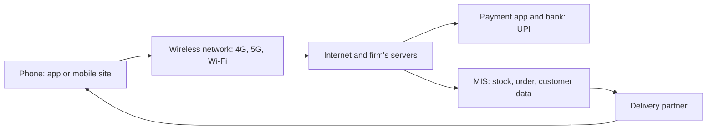

**In simple words:** e-commerce is a shop you visit by sitting at a computer. Mobile commerce (m-commerce) is a shopkeeper who walks with you in your pocket: you buy, sell and pay with your phone, anywhere. <Cite id="e-commerce-wiki-mcommerce" />

**Definition:** m-commerce is buying, selling and paying through wireless handheld devices such as smartphones and tablets, using apps, mobile websites, SMS or QR codes. <Cite id="e-commerce-investopedia-mcommerce" /> <Cite id="e-commerce-rainer-intro-is" />

**Why it is needed:** in India more people reach the internet by phone than by computer. A phone is personal, always with us and knows our location, so a firm can reach the customer anywhere at the right moment.

**Applications**

- **Mobile shopping:** Amazon, Flipkart, Myntra apps.
- **Mobile payments and banking:** UPI apps (Google Pay, PhonePe), SBI YONO.
- **Food and quick delivery:** Zomato, Swiggy, Blinkit.
- **Tickets and travel:** IRCTC, BookMyShow, Ola, Uber.
- **Location-based services:** nearby offers and maps.
- **Entertainment:** music, video and games.

**Advantages:** use anywhere and any time; personal and location-based offers; fast payment; reaches people without computers. **Disadvantages:** small screen; lost or stolen phone; fake apps and public Wi-Fi risks; network dependence; privacy worries.

| Point | E-commerce | M-commerce |
|---|---|---|
| Device | Computer, laptop | Smartphone, tablet |
| Use | Mostly at a fixed place | While moving |
| Location | Mostly not used | Used (GPS offers, tracking) |
| Payment | Card, net banking | UPI, wallet, QR code |

<Cite id="e-commerce-gfg-ecom-vs-mcom" />

**Conclusion:** m-commerce makes e-commerce personal, mobile and fast, and is the main way Indians shop and pay today.
