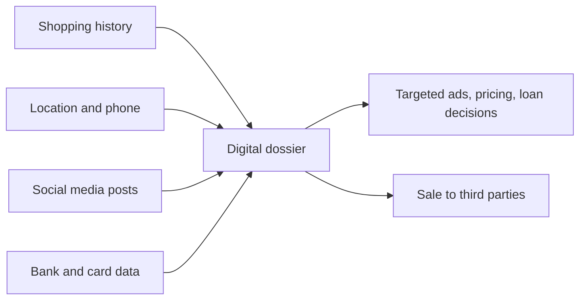

**In simple words:** privacy aapka right hai ki aap decide karo kaun aapke baare mein kya jaane. Information technology (IT) logon ke facts collect karna, jodna, copy karna aur bechna aasaan bana deti hai, isliye privacy par pressure hai. Ye aise ghar mein rehne jaisa hai jiski deewarein glass ki hon. <Cite id="ethics-privacy-wiki-info-privacy" />

**Definition:** privacy akele rehne ka aur unreasonable personal intrusion se free rehne ka right hai. Information privacy ye decide karne ka right hai ki aapki personal information kab, kaise aur kitni share ho. <Cite id="ethics-privacy-sep-it-privacy" /> India mein Supreme Court ne Puttaswamy judgment (2017) mein kaha ki privacy ek fundamental right hai. <Cite id="ethics-privacy-wiki-puttaswamy" />

**IT se affect hone wale privacy issues** <Cite id="ethics-privacy-gfg-ethical-issues" />

1. **Electronic surveillance:** CCTV, face recognition, phone tracking aur workplace email monitoring se employers aur governments logon ko lagataar dekh sakte hain.
2. **Data aggregation aur digital dossiers:** kai databases (shopping, location, social media) ke chhote facts jodkar ek detailed profile ban jaati hai. Har fact harmless hai; saath mein tasveer harmless nahi.
3. **Profiling:** firms profile se ads, prices ya loan decisions target karti hain, kabhi-kabhi unfairly. <Cite id="ethics-privacy-ibm-data-privacy" />
4. **Internet par information:** posts aur photos online rehti hain aur copy ho sakti hain; cookies browsing record karti hain; location data routine dikha deta hai.
5. **Data breaches aur misuse:** hackers ya laparwah staff stored data expose kar dete hain, ya firms data ko aise purpose ke liye use karti hain jiske liye aapne agree nahi kiya. Facebook aur Cambridge Analytica case mein lagbhag 87 million users ka data political profiling ke liye use hua. <Cite id="ethics-privacy-wiki-cambridge-analytica" />
6. **Galat data:** ek galat record sab jagah copy ho jaata hai aur theek karna mushkil hota hai.
7. **Aasaan copying aur selling:** digital data copy karne mein lagbhag kuch nahi lagta, isliye data brokers ise third parties ko bechte hain.

| IT ka benefit | Privacy risk |
|---|---|
| Personalised service | Profiling aur tracking |
| CCTV se safety | Lagataar surveillance |
| Data ki aasaan sharing | Aasaan leaks aur copying |

**Protection:** privacy policies, consent, data laws (India ka DPDP Act 2023, IT Act 2000), encryption aur access control.

**Conclusion:** IT convenience deti hai par privacy ko khatre mein daalti hai, isliye firms ko sirf wahi collect karna chahiye jo zaroori ho aur use protect karna chahiye.
