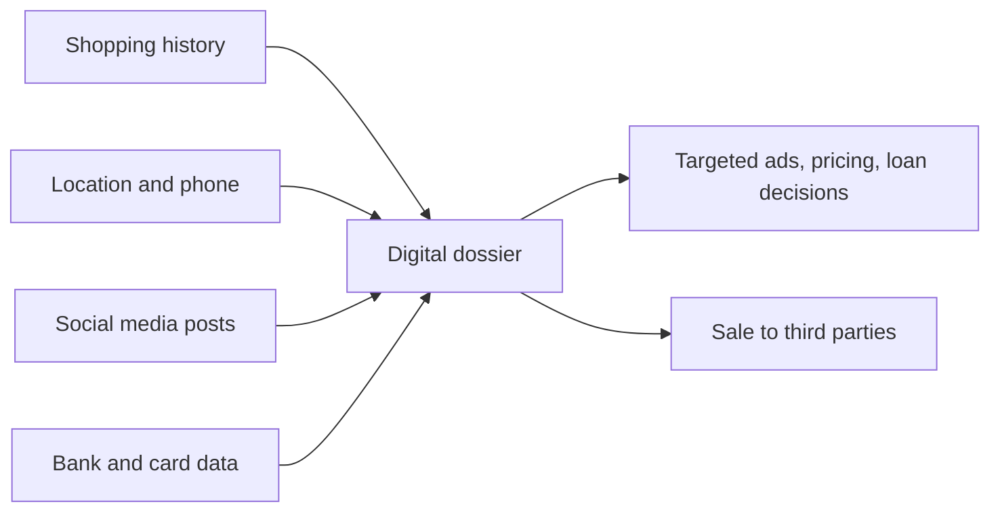

**In simple words:** privacy is your right to decide who knows what about you. Information technology (IT) makes it easy to collect, join, copy and sell facts about people, so privacy is under pressure. It is like living in a house where the walls are glass. <Cite id="ethics-privacy-wiki-info-privacy" />

**Definition:** privacy is the right to be left alone and free of unreasonable personal intrusion. Information privacy is the right to decide when, how and how much of your personal information is shared with others. <Cite id="ethics-privacy-sep-it-privacy" /> In India the Supreme Court held in the Puttaswamy judgment (2017) that privacy is a fundamental right. <Cite id="ethics-privacy-wiki-puttaswamy" />

**Privacy issues affected by IT** <Cite id="ethics-privacy-gfg-ethical-issues" />

1. **Electronic surveillance:** CCTV, face recognition, phone tracking and workplace email monitoring let employers and governments watch people continuously.
2. **Data aggregation and digital dossiers:** small facts from many databases (shopping, location, social media) are joined into one detailed profile. Each fact is harmless; the combined picture is not.
3. **Profiling:** firms use the profile to target ads, prices or loan decisions, sometimes unfairly. <Cite id="ethics-privacy-ibm-data-privacy" />
4. **Information on the internet:** posts and photos stay online and can be copied; cookies record browsing; location data shows routines.
5. **Data breaches and misuse:** hackers or careless staff expose stored data, or firms use it for a purpose you never agreed to. In the Facebook and Cambridge Analytica case, data of about 87 million users was used for political profiling. <Cite id="ethics-privacy-wiki-cambridge-analytica" />
6. **Inaccurate data:** a wrong record is copied everywhere and is hard to correct.
7. **Easy copying and selling:** digital data costs almost nothing to copy, so data brokers sell it to third parties.

| Benefit of IT | Privacy risk |
|---|---|
| Personalised service | Profiling and tracking |
| Safety through CCTV | Constant surveillance |
| Easy sharing of data | Easy leaks and copying |

**Protection:** privacy policies, consent, data laws (India's DPDP Act 2023, the IT Act 2000), encryption and access control.

**Conclusion:** IT gives convenience but threatens privacy, so firms must collect only what they need and protect it.
