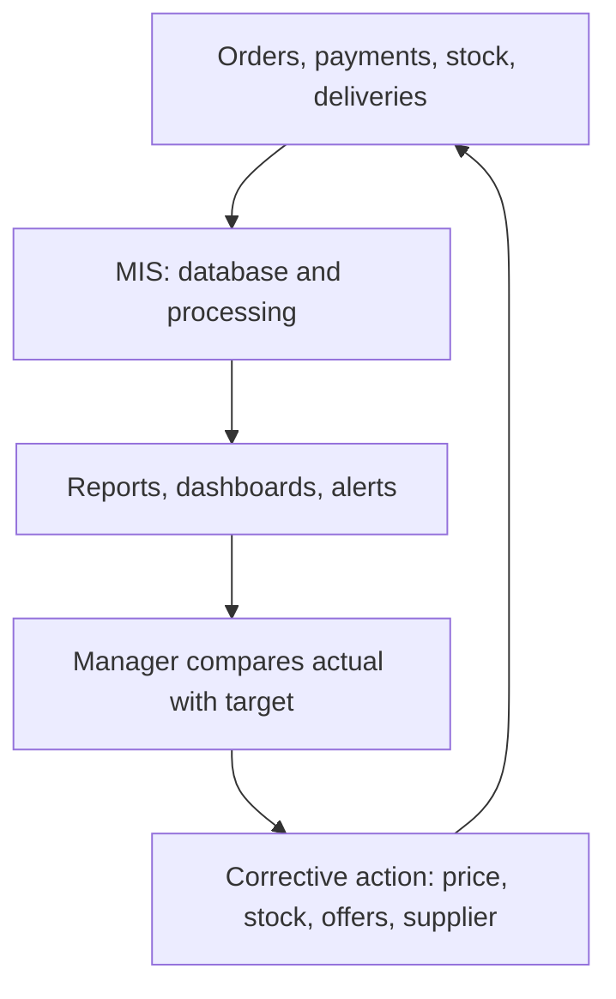

**In simple words:** business model batata hai ki kaun kisko bechta hai. B2B mein ek business doosre business ko bechta hai; B2C mein business aam customers ko bechta hai. MIS information ki backbone hai: ye har order record karta hai aur managers ko dikhata hai ki kahan action lena hai. <Cite id="e-commerce-gfg-types" />

**Examples**

- **B2B (business to business):** Infosys ka bank ko software services bechna; steel maker ka car company ko bechna; IndiaMART, jahan businesses suppliers dhoondhte hain; Walmart ka apne suppliers se kharidna. <Cite id="e-commerce-tp-b2b" />
- **B2C (business to consumer):** Amazon, Flipkart aur Myntra ka individuals ko bechna; Zomato; BookMyShow. <Cite id="e-commerce-tp-b2c" />

| Point | B2B | B2C |
|---|---|---|
| Buyer | Doosra business | Individual customer |
| Order | Bada, bulk, kam buyers | Chhota, bahut saare buyers |
| Decision | Soch-samajhkar, kai log | Jaldi, price aur reviews par |
| Price | Negotiated ya contract se | Fixed list price, discounts |
| Relationship | Long-term | Short-term |
| Payment | Credit terms, invoice, bank transfer | UPI, card, wallet, COD |
| Systems | EDI, supplier portal, e-procurement | Website, app, cart, payment gateway |

**In models ko control karne mein MIS ka contribution** <Cite id="e-commerce-rainer-intro-is" />

- **B2C control:** customer aur order database; recommendation engine aur personal offers; fraud detection (ajeeb orders, kai failed payments); return aur refund tracking; daily sales, abandoned carts, delivery time aur ratings ke dashboards.
- **B2B control:** requests, bids aur orders ke liye e-procurement portal; paperless purchase orders aur invoices ke liye EDI <Cite id="e-commerce-wiki-edi" />; real-time stock sharing taaki suppliers restock karein; contract, price aur credit-limit records; quality, delay aur price par supplier performance reports.

| Point | B2C control | B2B control |
|---|---|---|
| Main sawaal | Customers kharid rahe hain aur khush hain? | Partners contract ke hisaab se deliver kar rahe hain? |
| Key reports | Sales, returns, ratings | Contract ke against orders, supplier delay |
| Risk jo dekha jaata hai | Payment fraud, fake reviews | Late supply, price disputes |

**Conclusion:** dono models mein MIS plan, measure, compare aur act follow karta hai, jisse managers cost, quality aur fraud control karte hain.
