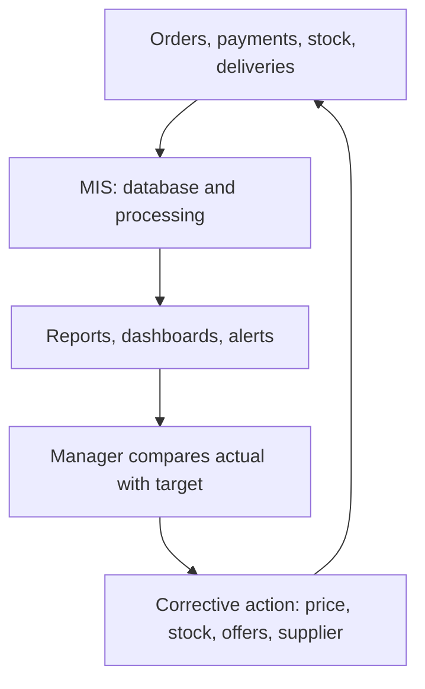

**In simple words:** the business model tells us who sells to whom. In B2B a business sells to another business; in B2C a business sells to ordinary customers. MIS is the information backbone that records every order and shows managers where to act. <Cite id="e-commerce-gfg-types" />

**Examples**

- **B2B (business to business):** Infosys selling software services to a bank; a steel maker selling to a car company; IndiaMART, where businesses find suppliers; Walmart buying from its suppliers. <Cite id="e-commerce-tp-b2b" />
- **B2C (business to consumer):** Amazon, Flipkart and Myntra selling to individuals; Zomato; BookMyShow. <Cite id="e-commerce-tp-b2c" />

| Point | B2B | B2C |
|---|---|---|
| Buyer | Another business | Individual customer |
| Order | Large, bulk, few buyers | Small, very many buyers |
| Decision | Careful, several people | Quick, based on price and reviews |
| Price | Negotiated or by contract | Fixed list price, discounts |
| Relationship | Long-term | Short-term |
| Payment | Credit terms, invoice, bank transfer | UPI, card, wallet, COD |
| Systems | EDI, supplier portal, e-procurement | Website, app, cart, payment gateway |

**Contribution of MIS to control these models** <Cite id="e-commerce-rainer-intro-is" />

- **B2C control:** customer and order database; recommendation engine and personal offers; fraud detection (strange orders, many failed payments); return and refund tracking; dashboards for daily sales, abandoned carts, delivery time and ratings.
- **B2B control:** e-procurement portal for requests, bids and orders; EDI for paperless purchase orders and invoices <Cite id="e-commerce-wiki-edi" />; real-time stock sharing so suppliers restock; contract, price and credit-limit records; supplier performance reports on quality, delay and price.

| Point | B2C control | B2B control |
|---|---|---|
| Main question | Are customers buying and happy? | Are partners delivering on contract? |
| Key reports | Sales, returns, ratings | Orders against contract, supplier delay |
| Risk watched | Payment fraud, fake reviews | Late supply, price disputes |

**Conclusion:** in both models MIS follows plan, measure, compare and act, so managers control cost, quality and fraud.
