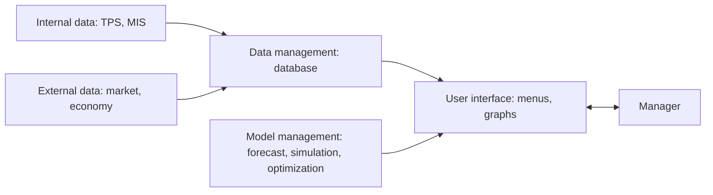

**In simple words:** Decision Support System (DSS) manager ke liye GPS app jaisa hai. Kahan jaana hai, manager decide karta hai; DSS options, unke effects aur kuch badle to kya hoga, ye dikhata hai. Steering wheel wo kabhi nahi pakadta. <Cite id="business-intelligence-tp-dss" />

**Definition:** DSS ek interactive, computer-based system hai jo data, models aur easy interface ko jodkar managers ko semi-structured aur unstructured problems solve karne mein madad karta hai. Ye decision ko support karta hai; decision manager hi leta hai. <Cite id="business-intelligence-wiki-dss" />

**Kyun zaroori hai:** MIS past ki fixed reports deta hai. Naye problem ka saamna karte manager ko "what if?" poochna hota hai aur jawab turant chahiye.

**Components**

1. **Data management:** TPS aur MIS ka internal data, aur external data.
2. **Model management:** financial, forecasting, simulation aur optimization models.
3. **User interface:** menus aur graphs jo non-programmer bhi use kar sake.

**DSS kaunse analysis deta hai:** what-if analysis ("price 5 percent badha den to kya hoga?"), sensitivity analysis (kaunsa input sabse zyada matter karta hai) <Cite id="business-intelligence-wiki-sensitivity" />, aur goal seeking ("₹10 lakh profit ke liye kitni units bechni hongi?").

**Characteristics:** semi-structured problems ko support karta hai; interactive aur flexible; user control mein rehta hai; individuals ya groups use karte hain.

**DSS ke Applications** <Cite id="is-fundamentals-gfg-dss" />

| Field | DSS ka use |
|---|---|
| Healthcare | Diagnosis aur treatment choices ke liye clinical decision support |
| Banking | Credit checks aur loan approval; branch performance judge karna |
| Agriculture | Soil aur weather data se crops aur inputs plan karna |
| Manufacturing aur logistics | Production scheduling, inventory levels, route planning |
| Marketing aur finance | Pricing, budgeting, sales forecasting, investment choice |
| Transport | Airlines aur railways crew aur equipment schedule karti hain |

**Advantages:** tez, behtar-informed decisions; kai options safely try kar sakte hain. **Disadvantages:** costly; results data aur model jitne hi achhe hote hain; managers is par zyada depend kar sakte hain.

**Conclusion:** DSS manager ke judgement ko support karta hai, replace nahi karta.
