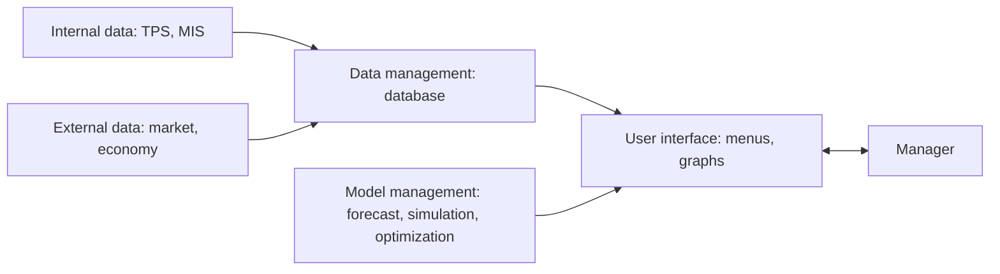

**In simple words:** a Decision Support System (DSS) is like a GPS app for a manager. The manager decides where to go; the DSS shows options, effects and what happens if something changes. It never takes the wheel. <Cite id="business-intelligence-tp-dss" />

**Definition:** a DSS is an interactive, computer-based system that combines data, models and an easy interface to help managers solve semi-structured and unstructured problems. It supports the decision; the manager still makes it. <Cite id="business-intelligence-wiki-dss" />

**Why needed:** an MIS gives fixed reports about the past. A manager facing a new problem needs to ask "what if?" and get an answer at once.

**Components**

1. **Data management:** internal data from TPS and MIS, plus external data.
2. **Model management:** financial, forecasting, simulation and optimization models.
3. **User interface:** menus and graphs that a non-programmer can use.

**Analyses a DSS offers:** what-if analysis ("what if we raise the price by 5 percent?"), sensitivity analysis (which input matters most) <Cite id="business-intelligence-wiki-sensitivity" />, and goal seeking ("how many units must we sell to earn a profit of ₹10 lakh?").

**Characteristics:** supports semi-structured problems; interactive and flexible; user stays in control; used by individuals or groups.

**Applications of DSS** <Cite id="is-fundamentals-gfg-dss" />

| Field | Use of DSS |
|---|---|
| Healthcare | Clinical decision support for diagnosis and treatment choices |
| Banking | Credit checks and loan approval; judging branch performance |
| Agriculture | Planning crops and inputs from soil and weather data |
| Manufacturing and logistics | Production scheduling, inventory levels, route planning |
| Marketing and finance | Pricing, budgeting, sales forecasting, investment choice |
| Transport | Airlines and railways schedule crew and equipment |

**Advantages:** faster, better-informed decisions; many options tried safely. **Disadvantages:** costly; results are only as good as data and model; managers may over-rely on it.

**Conclusion:** a DSS supports, never replaces, the manager's judgement.
