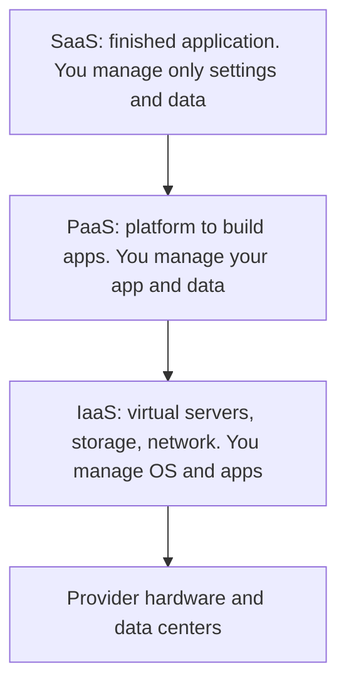

**In simple words:** cloud computing ka matlab hai computing power, storage aur software internet par rent karna aur sirf jitna use karo utna pay karna, apne servers kharid kar chalane ki jagah. Servers ka malik hona car rakhne jaisa hai; cloud Ola ya Uber use karne jaisa hai jahan ride ke hisaab se pay karte ho. <Cite id="note-cloud-computing-gfg-cloud" />

**Definition:** cloud computing configurable computing resources (networks, servers, storage, applications) ke shared pool tak convenient, on-demand network access ka model hai, jinhe kam management effort se jaldi provision aur release kiya ja sakta hai. <Cite id="note-cloud-computing-nist-800-145" />

**Kyun zaroori hai:** apne servers ke liye bada pehla payment, sabse busy din ke liye extra capacity aur unhe chalane wala staff chahiye. Cloud fixed cost ko variable cost mein badal deta hai.

**Key characteristics (NIST):** on-demand self-service, broad network access, resource pooling, rapid elasticity aur measured service.

**Cloud models**

**Service models** <Cite id="note-cloud-computing-ibm-models" /> <Cite id="note-cloud-computing-gfg-models" />

| Model | Kya milta hai | Users | Examples |
|---|---|---|---|
| IaaS | Virtual machines, storage, network | IT administrators | Amazon EC2, Azure Virtual Machines |
| PaaS | Apps develop aur run karne ka platform | Developers | Heroku, Google App Engine |
| SaaS | Subscription par ready application | End users | Salesforce, Microsoft 365, Zoom |

**Deployment models** <Cite id="note-cloud-computing-gfg-deploy" />

| Model | Meaning | Example |
|---|---|---|
| Public | Provider ka, kai customers share karte hain | AWS par ek start-up |
| Private | Sirf ek organisation use karti hai | Bank ka apna data center |
| Hybrid | Private aur public jude hue | Retailer customer records private rakhta hai aur sale ke liye public capacity rent karta hai |
| Community | Common needs wali organisations share karti hain | Hospitals jo compliance wala cloud share karte hain |

**Benefits:** kam upfront cost, pay-as-you-go, scalability, kahin se access, kam IT kaam. **Risks:** data security aur privacy, internet par dependence, vendor lock-in, cost overruns.

**Conclusion:** cloud computing IT ko service ki tarah deta hai, aur sahi service aur deployment model control, cost aur security needs par depend karta hai.
