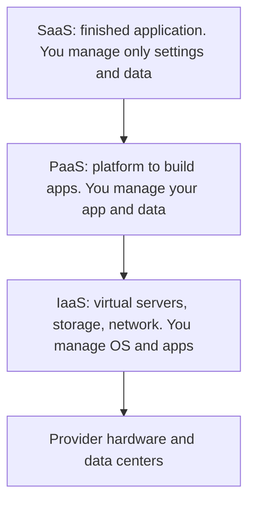

**In simple words:** cloud computing means renting computing power, storage and software over the internet and paying only for what you use, instead of buying and running your own servers. Owning servers is like owning a car; cloud is like using Ola or Uber and paying per ride. <Cite id="note-cloud-computing-gfg-cloud" />

**Definition:** cloud computing is a model for convenient, on-demand network access to a shared pool of configurable computing resources (networks, servers, storage, applications) that can be quickly provisioned and released with minimal management effort. <Cite id="note-cloud-computing-nist-800-145" />

**Why needed:** owning servers needs a large first payment, spare capacity for the busiest day and staff to run it. Cloud turns that fixed cost into a variable cost.

**Key characteristics (NIST):** on-demand self-service, broad network access, resource pooling, rapid elasticity and measured service.

**Cloud models**

**Service models** <Cite id="note-cloud-computing-ibm-models" /> <Cite id="note-cloud-computing-gfg-models" />

| Model | What you get | Users | Examples |
|---|---|---|---|
| IaaS | Virtual machines, storage, network | IT administrators | Amazon EC2, Azure Virtual Machines |
| PaaS | Platform to develop and run apps | Developers | Heroku, Google App Engine |
| SaaS | Ready application by subscription | End users | Salesforce, Microsoft 365, Zoom |

**Deployment models** <Cite id="note-cloud-computing-gfg-deploy" />

| Model | Meaning | Example |
|---|---|---|
| Public | Owned by a provider, shared by many customers | A start-up on AWS |
| Private | Used by one organisation only | A bank's own data center |
| Hybrid | Private and public joined | A retailer keeps customer records privately and rents public capacity for a sale |
| Community | Shared by organisations with common needs | Hospitals sharing a compliance-bound cloud |

**Benefits:** low upfront cost, pay-as-you-go, scalability, access from anywhere, less IT work. **Risks:** data security and privacy, internet dependence, vendor lock-in, cost overruns.

**Conclusion:** cloud computing delivers IT as a service, and the right service and deployment model depends on control, cost and security needs.
