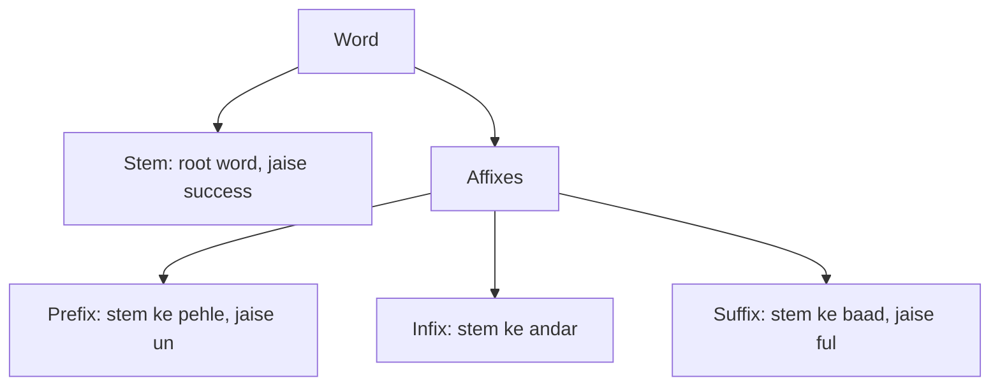
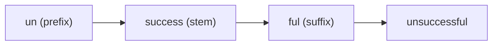

**Ek line mein:** <mark>Affix ek bound morpheme hai jo word ke root ya stem mein lagta hai, uska meaning badalne, naya word banane ya grammatical function badalne ke liye</mark>; position ke hisaab se ye **prefix, suffix ya infix** hota hai. <Cite id="class-nlp-pyq2" loc="p. 3" />

<Box kind="key">

**Ye points likho:**

- <mark>Affix: a bound morpheme added to the root or stem</mark> (ye akela nahi reh sakta).
- Position ke hisaab se teen types: <mark>prefix (shuru mein), suffix (end mein), infix (andar)</mark>.
- Examples: <mark>un- in unhappy; -ed in walked; -ness in happiness</mark>.
- Infix English mein **rare ya non-existent** hai, doosri languages mein milta hai.
- Word = **stem (root word) + affixes**: un + success + ful = unsuccessful.

</Box>

## Core answer (5 marks, yahan ke har question ke liye)

<Box kind="definition">

**Affix:** a bound morpheme added to the root or stem of a word to alter its meaning, create a new word, or change its grammatical function. <Cite id="class-nlp-pyq2" loc="p. 3" />

</Box>

**Kyun zaroori:** morphology mein word **stem** (root word) aur **affixes** se banta hai; FSA ya FST inhi parts ko padhta hai. <Cite id="class-nlp-m2" loc="p. 4" />

| Type | Kahan lagta hai | Example |
|---|---|---|
| Prefix | Root word ke shuru mein | unhappy mein un- meaning ko ulta kar deta hai |
| Suffix | Root word ke end mein | walked mein -ed, happiness mein -ness |
| Infix | Root word ke andar | English mein rare ya non-existent, doosri languages mein milta hai |

<Cite id="class-nlp-pyq2" loc="p. 3" /> <Cite id="class-nlp-m2" loc="p. 4" />

**Conclusion:** word = stem plus affixes; success + un- + -ful se unsuccessful.

## Extended answer (10 marks): ye add karo

### 1. Ek stem pe affixes (class examples)

| Stem | Prefix ke saath | Suffix ke saath | Dono ke saath |
|---|---|---|---|
| success | unsuccess | successful | unsuccessful |
| friend | unfriend | friendly | unfriendly |
| do | undo | doable | undoable |
| install | preinstall | installment | preinstallment |

<Cite id="class-nlp-m2" loc="p. 5" /> <Cite id="class-nlp-m2" loc="p. 6" /> <Cite id="class-nlp-m2" loc="p. 7" />

Kuch beech ke forms (unsuccess) roz ke words nahi hain; wo sirf dikhate hain ki automaton kaise chalta hai. Poore words hi asli hain.

### 2. Kaam ke hisaab se affixes

- **Inflectional affixes** word ko same rakhte hain aur grammar dikhate hain: plural -s, past -ed, -ing. <Cite id="class-nlp-pyq2" loc="p. 3" />
- **Derivational affixes** naya word banate hain: paint + -er = painter. <Cite id="class-nlp-pyq2" loc="p. 4" />

### 3. Ek aur type (standard, class files mein nahi)

**Circumfix** ke do parts hote hain, ek stem ke pehle aur ek baad (German *ge-...-t*, *gespielt* mein). English mein asli circumfix nahi hai. <Cite id="web-nlp-1-wiki-affix" />

## Har question mein kaise fit karein

- **"Define affixes. Explain the types of affixes."** (5 marks) <PYQ id="2022-12-ce/q1b" /> <PYQ id="2025-05/q1a" />: definition box, teen-row table aur diagram; conclusion mein success example. Section 2 aur 3 sirf extra marks ke liye.

## Exam tips

- **Definition word for word likho**: "bound morpheme added to the root or stem".
- **Har type ka ek English example** do; infix ke liye likho ki English mein rare hai.
- **Stem plus prefix plus suffix** ka picture draw karo; diagram ka mark milta hai.

Exam mein English mein likho.
