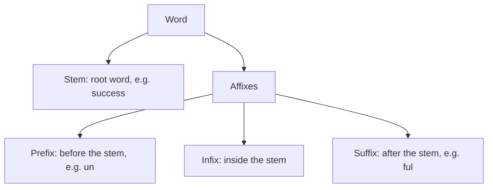
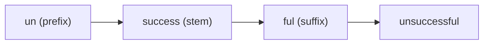

**In one line:** <mark>An affix is a bound morpheme added to the root or stem of a word to alter its meaning, create a new word, or change its grammatical function</mark>; by position it is a **prefix, suffix or infix**. <Cite id="class-nlp-pyq2" loc="p. 3" />

<Box kind="key">

**Key points to write:**

- <mark>Affix: a bound morpheme added to the root or stem</mark> (it cannot stand alone).
- Three types by position: <mark>prefix (beginning), suffix (end), infix (inside)</mark>.
- Examples: <mark>un- in unhappy; -ed in walked; -ness in happiness</mark>.
- Infix is **rare or non-existent in English**, found in other languages.
- A word = **stem (root word) + affixes**: un + success + ful = unsuccessful.

</Box>

## Core answer (5 marks, fits every question here)

<Box kind="definition">

**Affix:** a bound morpheme added to the root or stem of a word to alter its meaning, create a new word, or change its grammatical function. <Cite id="class-nlp-pyq2" loc="p. 3" />

</Box>

**Why it matters:** in morphology a word is built from a **stem** (root word) and **affixes**; an FSA or FST reads these parts. <Cite id="class-nlp-m2" loc="p. 4" />

| Type | Where it attaches | Example |
|---|---|---|
| Prefix | At the beginning of a root word | un- in unhappy changes the meaning to its opposite |
| Suffix | At the end of a root word | -ed in walked, -ness in happiness |
| Infix | Inserted directly inside a root word | Rare or non-existent in English, found in other languages |

<Cite id="class-nlp-pyq2" loc="p. 3" /> <Cite id="class-nlp-m2" loc="p. 4" />

**Conclusion:** a word is a stem plus affixes; success + un- + -ful gives unsuccessful.

## Extended answer (10 marks): add these

### 1. Affixes on one stem (class examples)

| Stem | With prefix | With suffix | With both |
|---|---|---|---|
| success | unsuccess | successful | unsuccessful |
| friend | unfriend | friendly | unfriendly |
| do | undo | doable | undoable |
| install | preinstall | installment | preinstallment |

<Cite id="class-nlp-m2" loc="p. 5" /> <Cite id="class-nlp-m2" loc="p. 6" /> <Cite id="class-nlp-m2" loc="p. 7" />

Some middle forms (unsuccess) are not everyday words; they only show how the automaton moves. The full words are the real ones.

### 2. Affixes by job

- **Inflectional affixes** keep the word the same and mark grammar: plural -s, past -ed, -ing. <Cite id="class-nlp-pyq2" loc="p. 3" />
- **Derivational affixes** make a new word: paint + -er = painter. <Cite id="class-nlp-pyq2" loc="p. 4" />

### 3. One more type (standard, not in the class files)

A **circumfix** has two parts, one before and one after the stem (German *ge-...-t* in *gespielt*). English has no real circumfix. <Cite id="web-nlp-1-wiki-affix" />

## Fit it to each question

- **"Define affixes. Explain the types of affixes."** (5 marks) <PYQ id="2022-12-ce/q1b" /> <PYQ id="2025-05/q1a" />: definition box, the three-row table and the diagram; add the success example as conclusion. Sections 2 and 3 only if extra marks are asked.

## Exam tips

- **Write the definition word for word**: "bound morpheme added to the root or stem".
- Give **one English example per type**; for infix say it is rare in English.
- Draw the **stem plus prefix plus suffix** picture; it earns the diagram mark.
