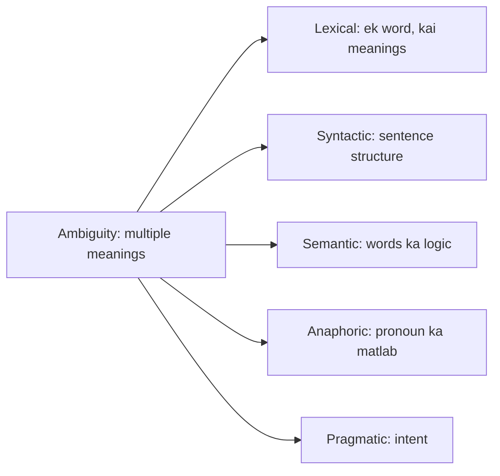
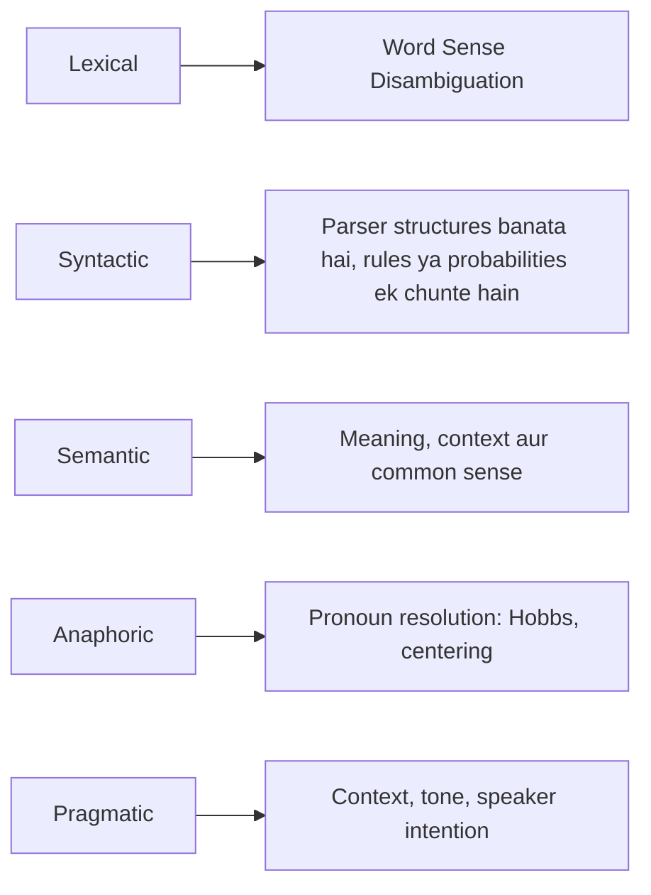

**Ek line mein:** <mark>Ambiguity matlab ek word, sentence ya phrase ke multiple meanings</mark>; NLP isse <mark>context use karke ek meaning chunta hai</mark>, aur har type ka alag method hai. <Cite id="class-nlp-m1" loc="p. 3" />

<Box kind="key">

**Ambiguity ke har question mein ye points likho:**

- <mark>Ambiguity: a word, sentence or phrase with multiple meanings</mark>. Example: "I saw a man with telescope".
- Paanch types, har ek ek stage ka: <mark>lexical, syntactic, semantic, anaphoric, pragmatic</mark>.
- **Lexical** = ek word, kai meanings (bank). **Syntactic** = ek sentence, kai structures. **Semantic** = grammar clear, logic unclear.
- **Anaphoric** = pronoun do nouns ko point kar sakta hai. **Pragmatic** = literal meaning intent nahi hai.
- Resolution: <mark>lexical ke liye WSD, syntactic ke liye parsing, anaphoric ke liye pronoun resolution, pragmatic ke liye context aur intention</mark>.
- Har example mein **do meanings** zaroor likho.

</Box>

## Core answer (5 marks, yahan ke har question ke liye)

<Box kind="definition">

**Ambiguity** in NLP is a word, sentence or phrase with multiple meanings. Example: "I saw a man with telescope" (who has the telescope?). <Cite id="class-nlp-m1" loc="p. 3" />

</Box>

**Kyun matter karta hai:** machine guess nahi kar sakti, isliye ek stage ka galat meaning agle stage tak jaata hai. NLP ko context se intended meaning dhoondhna padta hai.

| Type | Kya unclear hai | Example (do meanings) | Kaise resolve karein |
|---|---|---|---|
| Lexical | Ek word ke kai meanings | He deposited money in the bank: financial ya river bank | Word Sense Disambiguation |
| Syntactic | Sentence ka structure | Visiting relatives can be boring: hum unse milne jaate hain ya wo hamare paas aate hain | Parsing aur syntactic disambiguation rules |
| Semantic | Grammar clear, logic nahi | Someone ate every slice of pizza: ek insaan ne saara khaya, ya har slice kisi ne khayi | Meaning aur context |
| Anaphoric | Pronoun do nouns ko point kar sakta hai | Mary told Susan that she had won: Mary ya Susan | Pronoun resolution (Hobbs, centering) |
| Pragmatic | Literal meaning clear, intent alag | Do you know the time? | Context, tone, speaker ka intention |

<Cite id="class-nlp-m1" loc="p. 3" /> <Cite id="class-nlp-m1" loc="p. 4" /> <Cite id="class-nlp-m1" loc="p. 6" /> <Cite id="class-nlp-m1" loc="p. 7" /> <Cite id="class-nlp-pyq4" loc="p. 6" />

**Conclusion:** ambiguity context dekhke solve hoti hai, aur har type ka apna method hai.

## Extended answer (10 marks): ye add karo

### 1. Har type detail mein, teacher ke examples ke saath

- **Lexical:** ek word, kai meanings. "I saw a bat in a cave" (mammal ya cricket bat); "The bark was rough" (dog ya tree). <Cite id="class-nlp-m1" loc="p. 3" /> <Cite id="class-nlp-m1" loc="p. 4" /> <Cite id="web-nlp-1-wiki-lex-amb" />
- **Syntactic:** wahi words do tareeke se group ho sakte hain. "She hit the man with an umbrella": usne umbrella se maara, ya aadmi ke paas umbrella tha. <Cite id="class-nlp-m1" loc="p. 5" /> <Cite id="web-nlp-1-wiki-syn-amb" />
- **Semantic:** "All students did not pass the exam": koi pass nahi hua, ya sirf kuch pass hue. <Cite id="class-nlp-m1" loc="p. 6" />
- **Anaphoric:** "The children ate the cake because they were very sweet": bachche ya cake. <Cite id="class-nlp-m1" loc="p. 7" />
- **Pragmatic:** "My coffee is cold": fact, ya complaint. <Cite id="class-nlp-m1" loc="p. 8" />

### 2. Ambiguity resolve karne ke tareeke

- **WSD:** aas-paas ke words se pata lagata hai kaunsa sense hai; "bank" ke paas "money" ho to financial bank. <Cite id="class-nlp-pyq4" loc="p. 5" /> <Cite id="web-nlp-1-wiki-wsd" />
- **Parsing:** possible trees banata hai; rules ya probabilities ek chunte hain. <Cite id="class-nlp-pyq4" loc="p. 6" />
- **Pronoun resolution:** Hobbs' algorithm syntax tree pe upar chadhta hai aur gender, number, distance check karta hai; centering doosra method hai. <Cite id="class-nlp-asol" loc="p. 3" />
- **Pragmatic:** literal words se aage speaker ka intention dekho. <Cite id="class-nlp-asol" loc="p. 1" />
- **Semantic:** class files mein koi method nahi hai; ek line likho: aas-paas ke sentences aur common sense use karo.

### 3. NLP ke har stage pe ambiguity

| Stage | Ambiguity | Kya check hota hai |
|---|---|---|
| Lexical or morphological | Lexical | Tokens aur word senses |
| Syntactic | Syntactic | Grammatical order |
| Semantic | Semantic | Literal, dictionary meaning |
| Discourse integration | Anaphoric | Agle sentence se link |
| Pragmatic | Pragmatic | Intended meaning |

<Cite id="class-nlp-m1" loc="p. 1" /> <Cite id="class-nlp-m1" loc="p. 2" />

## Har question mein kaise fit karein

- **"Explain the ambiguities associated at each level with example for Natural Language processing."** (10 marks) <PYQ id="2023-05-ce/q3a" />: core table plus section 3 (level by level) aur section 1 se har type ka ek extra example.
- **"What do you mean by ambiguity in natural Language? Explain its types and ways to resolve it with suitable example"** (10 marks) <PYQ id="2024-12/q4b" /> <PYQ id="assignment-1/q1b" />: definition, types table, phir section 2 (ways to resolve) diagram ke saath.
- **"Explain ambiguity in every stage of NLP with example."** (5 marks) <PYQ id="2026-05/q1a" />: sirf core answer; types stage ke order mein likho (lexical, syntactic, semantic, discourse, pragmatic).

## Exam tips

- Har example ke **do meanings** likho; ek meaning likhoge to mark kat jaayega.
- Pehle paanch-branch diagram draw karo, phir table; "WSD" aur "parsing" naam se likho.
- **Syntactic** (structure) aur **semantic** (logic) mix mat karo; example sentences farq dikhate hain.

Exam mein English mein likho.
