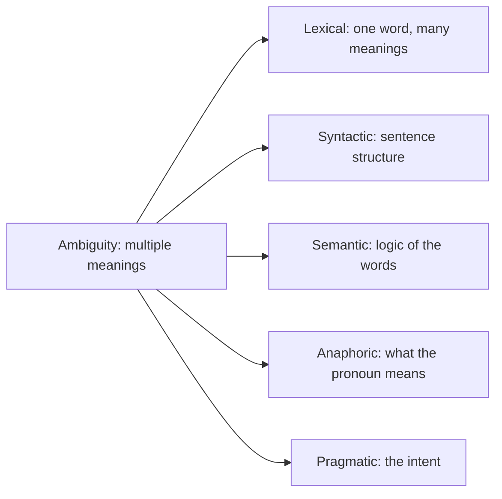
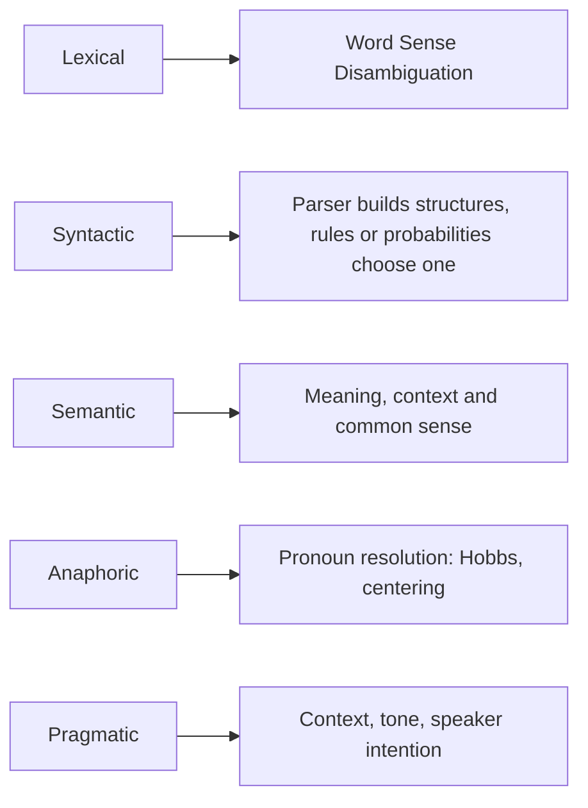

**In one line:** <mark>Ambiguity means a word, sentence or phrase has multiple meanings</mark>; NLP resolves it by <mark>using the context to pick one meaning</mark>, with a different method for each type. <Cite id="class-nlp-m1" loc="p. 3" />

<Box kind="key">

**Key points to write (any ambiguity question):**

- <mark>Ambiguity: a word, sentence or phrase with multiple meanings</mark>. Example: "I saw a man with telescope".
- Five types, one per stage: <mark>lexical, syntactic, semantic, anaphoric, pragmatic</mark>.
- **Lexical** = one word, many meanings (bank). **Syntactic** = one sentence, many structures. **Semantic** = clear grammar, unclear logic.
- **Anaphoric** = pronoun can point to two nouns. **Pragmatic** = literal meaning is not the intent.
- Resolution: <mark>WSD for lexical, parsing for syntactic, pronoun resolution for anaphoric, context and intention for pragmatic</mark>.
- Always write **two meanings** for each example.

</Box>

## Core answer (5 marks, fits every question here)

<Box kind="definition">

**Ambiguity** in NLP is a word, sentence or phrase with multiple meanings. Example: "I saw a man with telescope" (who has the telescope?). <Cite id="class-nlp-m1" loc="p. 3" />

</Box>

**Why it matters:** a machine cannot guess, so a wrong meaning at one stage is carried to the next. NLP must find the intended meaning from the context.

| Type | What is unclear | Example (two meanings) | How to resolve |
|---|---|---|---|
| Lexical | One word has several meanings | He deposited money in the bank: financial or river bank | Word Sense Disambiguation |
| Syntactic | The structure of the sentence | Visiting relatives can be boring: we visit them or they visit us | Parsing and syntactic disambiguation rules |
| Semantic | Grammar clear, logic not | Someone ate every slice of pizza: one person ate all, or each slice was eaten by someone | Meaning and context |
| Anaphoric | A pronoun can point to two nouns | Mary told Susan that she had won: Mary or Susan | Pronoun resolution (Hobbs, centering) |
| Pragmatic | Literal meaning clear, intent differs | Do you know the time? | Context, tone, speaker's intention |

<Cite id="class-nlp-m1" loc="p. 3" /> <Cite id="class-nlp-m1" loc="p. 4" /> <Cite id="class-nlp-m1" loc="p. 6" /> <Cite id="class-nlp-m1" loc="p. 7" /> <Cite id="class-nlp-pyq4" loc="p. 6" />

**Conclusion:** ambiguity is solved by looking at context, and each type has its own method.

## Extended answer (10 marks): add these

### 1. Each type in detail, with the teacher's examples

- **Lexical:** one word, many meanings. "I saw a bat in a cave" (mammal or cricket bat); "The bark was rough" (dog or tree). <Cite id="class-nlp-m1" loc="p. 3" /> <Cite id="class-nlp-m1" loc="p. 4" /> <Cite id="web-nlp-1-wiki-lex-amb" />
- **Syntactic:** the same words can be grouped two ways. "She hit the man with an umbrella": she used it as a weapon, or the man carried it. <Cite id="class-nlp-m1" loc="p. 5" /> <Cite id="web-nlp-1-wiki-syn-amb" />
- **Semantic:** "All students did not pass the exam": nobody passed, or only some passed. <Cite id="class-nlp-m1" loc="p. 6" />
- **Anaphoric:** "The children ate the cake because they were very sweet": the children or the cake. <Cite id="class-nlp-m1" loc="p. 7" />
- **Pragmatic:** "My coffee is cold": a fact, or a complaint. <Cite id="class-nlp-m1" loc="p. 8" />

### 2. Ways to resolve ambiguity

- **WSD:** finds which sense is meant from the words around it; "money" next to "bank" points to the financial bank. <Cite id="class-nlp-pyq4" loc="p. 5" /> <Cite id="web-nlp-1-wiki-wsd" />
- **Parsing:** builds the possible trees; rules or probabilities pick one. <Cite id="class-nlp-pyq4" loc="p. 6" />
- **Pronoun resolution:** Hobbs' algorithm walks up the syntax tree and checks gender, number and distance; the centering algorithm is the other method. <Cite id="class-nlp-asol" loc="p. 3" />
- **Pragmatic:** look at the speaker's intention beyond the literal words. <Cite id="class-nlp-asol" loc="p. 1" />
- **Semantic:** the class files give no method; write one line: use the surrounding sentences and common sense.

### 3. Ambiguity at each stage of NLP

| Stage | Ambiguity found | What is checked |
|---|---|---|
| Lexical or morphological | Lexical | Tokens and word senses |
| Syntactic | Syntactic | Grammatical order |
| Semantic | Semantic | Literal, dictionary meaning |
| Discourse integration | Anaphoric | Link to the next sentence |
| Pragmatic | Pragmatic | Intended meaning |

<Cite id="class-nlp-m1" loc="p. 1" /> <Cite id="class-nlp-m1" loc="p. 2" />

## Fit it to each question

- **"Explain the ambiguities associated at each level with example for Natural Language processing."** (10 marks) <PYQ id="2023-05-ce/q3a" />: core table plus section 3 (level by level) and one extra example per type from section 1.
- **"What do you mean by ambiguity in natural Language? Explain its types and ways to resolve it with suitable example"** (10 marks) <PYQ id="2024-12/q4b" /> <PYQ id="assignment-1/q1b" />: definition, types table, then section 2 (ways to resolve) with the diagram.
- **"Explain ambiguity in every stage of NLP with example."** (5 marks) <PYQ id="2026-05/q1a" />: core answer only; write the types in stage order (lexical, syntactic, semantic, discourse, pragmatic).

## Exam tips

- **Write two meanings** for every example; a single meaning loses the mark.
- Draw the five-branch diagram first, then the table; add "WSD" and "parsing" by name.
- Do not mix up **syntactic** (structure) and **semantic** (logic); the example sentences show the difference.
