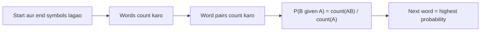
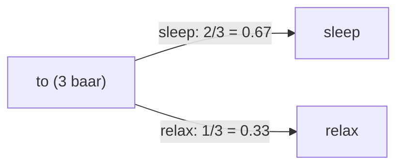

**Ek line mein:** <mark>Bigram probability P(B | A) = count(AB) / count(A)</mark> hai: har word pair gino, pehle word ke count se divide karo, aur <mark>sabse zyada probability wala word next word predict karo</mark>. <Cite id="class-nlp-m2" loc="p. 9" />

<Box kind="key">

**Bigram numerical ke har question mein ye points likho:**

- <mark>Formula: $P(B \mid A) = \dfrac{\text{count}(AB)}{\text{count}(A)}$</mark> (bigram count / unigram count).
- Count karne se pehle har sentence mein <mark>`<s>` shuru mein aur `</s>` end mein</mark> lagao.
- **Tokens minus sentences = bigrams ki sankhya** (quick check).
- Ek word ke baad aane wali saari probabilities <mark>ka sum 1</mark> hona chahiye.
- <mark>Next word = sabse zyada probability wala follower</mark>; tie ho to dono chalte hain.
- Sentence probability = <mark>uske bigram probabilities ka product</mark>.

</Box>

## Core answer (5 marks, yahan ke har question ke liye)

<Box kind="definition">

**Bigram model:** the next word depends only on the previous word. A bigram is two consecutive words; $P(B \mid A) = \text{count}(AB)/\text{count}(A)$. <Cite id="class-nlp-m2" loc="p. 9" />

</Box>

**Method (har corpus ke liye same):**

1. Har sentence ko `<s>` aur `</s>` ke saath likho, aur case waisa hi rakho jaisa question mein hai.
2. Har word count karo (unigram counts).
3. Paas-paas ke har word pair ki list banao aur count karo (bigram counts).
4. Divide karo: $P(B \mid A) = \text{count}(AB)/\text{count}(A)$.
5. Jis word ke liye poocha hai uske followers list karo; sabse bada probability wala prediction hai.

**Conclusion:** har pair count ko pehle word ke count se divide karo, aur sabse zyada probability wala follower chuno.

## Extended answer (10 marks): ye add karo

### 1. Ek class corpus ka poora solution

<Sum>

<Given>

Corpus: `<s>` I tell you to sleep and rest `</s>`; `<s>` I would like to sleep for an hour `</s>`; `<s>` Sleep helps one to relax `</s>`. *Sleep* (capital S) aur *sleep* alag tokens hain, class solution jaisa. <Cite id="class-nlp-pyq2" loc="p. 7" />

</Given>

<Find>

saare bigrams, unki conditional probabilities, aur **to** ke baad ka next word.

</Find>

<Steps>

1. **Unigram counts:** `<s>` 3, I 2, tell 1, you 1, to 3, sleep 2, and 1, rest 1, would 1, like 1, for 1, an 1, hour 1, Sleep 1, helps 1, one 1, relax 1, `</s>` 3 (26 tokens).
2. **Bigrams:** 26 tokens minus 3 sentences = 23 bigrams, jinme 21 alag hain (`<s> I` aur `to sleep` do baar aate hain). $P(B \mid A) = \text{count}(AB)/\text{count}(A)$ lagao. Table mein n(AB) = count(AB), n(A) = count(A).

| Bigram AB | n(AB) | n(A) | P |
|---|---|---|---|
| `<s>` I | 2 | 3 | 2/3 = 0.67 |
| I tell | 1 | 2 | 1/2 = 0.50 |
| tell you | 1 | 1 | 1 = 1.00 |
| you to | 1 | 1 | 1 = 1.00 |
| to sleep | 2 | 3 | 2/3 = 0.67 |
| sleep and | 1 | 2 | 1/2 = 0.50 |
| and rest | 1 | 1 | 1 = 1.00 |
| rest `</s>` | 1 | 1 | 1 = 1.00 |
| I would | 1 | 2 | 1/2 = 0.50 |
| would like | 1 | 1 | 1 = 1.00 |
| like to | 1 | 1 | 1 = 1.00 |
| sleep for | 1 | 2 | 1/2 = 0.50 |
| for an | 1 | 1 | 1 = 1.00 |
| an hour | 1 | 1 | 1 = 1.00 |
| hour `</s>` | 1 | 1 | 1 = 1.00 |
| `<s>` Sleep | 1 | 3 | 1/3 = 0.33 |
| Sleep helps | 1 | 1 | 1 = 1.00 |
| helps one | 1 | 1 | 1 = 1.00 |
| one to | 1 | 1 | 1 = 1.00 |
| to relax | 1 | 3 | 1/3 = 0.33 |
| relax `</s>` | 1 | 1 | 1 = 1.00 |

3. **to ke baad** (3 baar): sleep 2/3 = 0.67, relax 1/3 = 0.33.

</Steps>

<Answer>

**to** ke baad next word **sleep** hai (2/3 = 0.67).

</Answer>

<Box kind="verify">

2/3 + 1/3 = 1. Pair counts ka sum 2+1+1+1+2+1+1+1+1+1+1+1+1+1+1+1+1+1+1+1+1 = 23 = 26 - 3. (Handwritten notes mein sleep ke liye 1/3 likha tha, wo galat hai: sleep do sentences mein to ke baad aata hai.) <Cite id="class-nlp-m2" loc="p. 17" />

</Box>

</Sum>

### 2. Is theme ke baaki corpora kaise alag hain

| Corpus | Poocha gaya word | Result |
|---|---|---|
| Sleep corpus bina *and* ke (25 tokens, 22 bigrams) | to | sleep 2/3, relax 1/3: sleep |
| Sam corpus, 7 sentences (39 tokens, 32 bigrams) | like, Sam | like: college 3/5; Sam: `</s>` 3/5 |
| Four students corpus (44 tokens, 39 bigrams) | solving, is | solving: a 3/5; is: solving 4/4 |

<Cite id="class-nlp-pyq2" loc="p. 4" /> <Cite id="class-nlp-qb1" loc="Module 02, Q4" />

### 3. Sentence probability ("kaunsa sentence better hai" pucha ho to)

Sentence ke saath bigram probabilities ka product lo. Corpus `<s>` Sam I am `</s>`, `<s>` Sam I like `</s>`, `<s>` I am Sam `</s>`, `<s>` Sam I do like `</s>`, `<s>` do I like Sam `</s>` ka example: $P(\text{Sam I am}) = \tfrac35 \times \tfrac35 \times \tfrac25 \times \tfrac12 = 0.072$, jo poochhe gaye teen sentences mein sabse zyada hai. Wahan next words: Sam ke baad **I** (0.60); do ke baad **like ya I** (tie, 1/2 each); like ke baad **`</s>`** (2/3). <Cite id="web-nlp-1-slp3-ch3" />

### 4. n-gram general roop mein

n-gram n words ka continuous sequence hai; n-gram model pichhle n - 1 words se word predict karta hai (unigram: koi nahi, bigram: ek, trigram: do). <Cite id="class-nlp-m2" loc="p. 8" /> <Cite id="web-nlp-1-wiki-ngram" />

## Har question mein kaise fit karein

- **"Consider the following corpus: `<s>` I tell you to sleep and rest `</s>` ... List all possible bigrams. Compute conditional probabilities and predict the next word for the word "to"."** (5 marks, 10 marks) <PYQ id="2022-12-ce/q3a" /> <PYQ id="assignment-1/q2e" />: method, bigram table aur answer *sleep* likho; 5 marks ke liye table ko *to* ke baad wale pairs aur count tak chhota kar sakte ho.
- **"... `<s>` I tell you to sleep rest `</s>` ... predict the next word for the word "to"."** (10 marks) <PYQ id="2026-05/q3b" />: wahi, par is corpus mein *and* nahi hai: 25 tokens, 22 bigrams, aur `sleep rest` pair `sleep and` aur `and rest` ki jagah aata hai. Answer ab bhi sleep.
- **"Consider the following corpus: `<s>` I am Sam `</s>` ... predict the next word for the word like, Sam"** (10 marks) <PYQ id="2025-05/q5a" /> <PYQ id="assignment-1/q2c" />: 39 tokens, 32 bigrams; like ke baad: college (0.60); Sam ke baad: `</s>` (0.60). "Do" aur "do" alag words hain.
- **"Consider the following corpus: Four students Ravi, Ramesh, Rekha and Rita ... predict the next word for: solving, is"** (10 marks) <PYQ id="assignment-1/q2d" />: commas hata do; solving ke baad: a (0.60); is ke baad: solving (1.00).
- **"Explain concepts of Bi-gram and n-gram with formula. For following corpus, apply Bi-gram model ..."** (10 marks) <PYQ id="2025-05-ce/q2a" />: pehle concept aur formula (section 4), phir bigram table, chaar next words, aur section 3 ke sentence products.

## Exam tips

- **Hamesha check karo:** tokens minus sentences = bigrams ki sankhya; har follower list ka sum 1.
- `<s>` aur `</s>` mat bhoolo; wo bhi tokens hain.
- Formula ek baar likho, phir **n(AB), n(A) aur P wali table**; examiner har ek pe marks dete hain.

Exam mein English mein likho.
