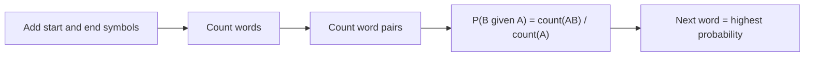
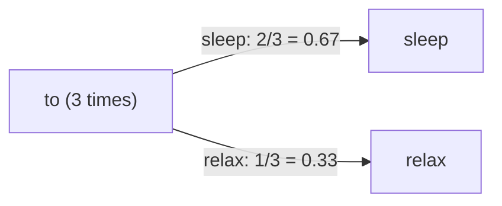

**In one line:** <mark>A bigram probability is P(B | A) = count(AB) / count(A)</mark>: count each word pair, divide by the count of the first word, and <mark>predict the next word with the highest probability</mark>. <Cite id="class-nlp-m2" loc="p. 9" />

<Box kind="key">

**Key points to write (any bigram numerical):**

- <mark>Formula: $P(B \mid A) = \dfrac{\text{count}(AB)}{\text{count}(A)}$</mark> (bigram count over unigram count).
- Add <mark>`<s>` at the start and `</s>` at the end</mark> of every sentence before counting.
- **Tokens minus sentences = number of bigrams** (a quick check).
- All probabilities after one word must <mark>add up to 1</mark>.
- <mark>Next word = the follower with the highest probability</mark>; a tie means either word.
- Sentence probability = <mark>product of its bigram probabilities</mark>.

</Box>

## Core answer (5 marks, fits every question here)

<Box kind="definition">

**Bigram model:** the next word depends only on the previous word. A bigram is two consecutive words; $P(B \mid A) = \text{count}(AB)/\text{count}(A)$. <Cite id="class-nlp-m2" loc="p. 9" />

</Box>

**Method (the same for every corpus):**

1. Write each sentence with `<s>` and `</s>`, and lowercase or keep case as the question does.
2. Count every word (unigram counts).
3. List every pair of neighbouring words and count each pair (bigram counts).
4. Divide: $P(B \mid A) = \text{count}(AB)/\text{count}(A)$.
5. For the word asked, list its followers; the one with the largest probability is the prediction.

**Conclusion:** divide each pair count by the count of the first word, and pick the follower with the highest probability.

## Extended answer (10 marks): add these

### 1. Full solution of a class corpus

<Sum>

<Given>

Corpus: `<s>` I tell you to sleep and rest `</s>`; `<s>` I would like to sleep for an hour `</s>`; `<s>` Sleep helps one to relax `</s>`. *Sleep* (capital S) and *sleep* are different tokens, as in the class solution. <Cite id="class-nlp-pyq2" loc="p. 7" />

</Given>

<Find>

all bigrams, their conditional probabilities, and the next word after **to**.

</Find>

<Steps>

1. **Unigram counts:** `<s>` 3, I 2, tell 1, you 1, to 3, sleep 2, and 1, rest 1, would 1, like 1, for 1, an 1, hour 1, Sleep 1, helps 1, one 1, relax 1, `</s>` 3 (26 tokens).
2. **Bigrams:** 26 tokens minus 3 sentences gives 23 bigrams, 21 of them different (`<s> I` and `to sleep` occur twice). Apply $P(B \mid A) = \text{count}(AB)/\text{count}(A)$. In the table, n(AB) = count(AB), n(A) = count(A).

| Bigram AB | n(AB) | n(A) | P |
|---|---|---|---|
| `<s>` I | 2 | 3 | 2/3 = 0.67 |
| I tell | 1 | 2 | 1/2 = 0.50 |
| tell you | 1 | 1 | 1 = 1.00 |
| you to | 1 | 1 | 1 = 1.00 |
| to sleep | 2 | 3 | 2/3 = 0.67 |
| sleep and | 1 | 2 | 1/2 = 0.50 |
| and rest | 1 | 1 | 1 = 1.00 |
| rest `</s>` | 1 | 1 | 1 = 1.00 |
| I would | 1 | 2 | 1/2 = 0.50 |
| would like | 1 | 1 | 1 = 1.00 |
| like to | 1 | 1 | 1 = 1.00 |
| sleep for | 1 | 2 | 1/2 = 0.50 |
| for an | 1 | 1 | 1 = 1.00 |
| an hour | 1 | 1 | 1 = 1.00 |
| hour `</s>` | 1 | 1 | 1 = 1.00 |
| `<s>` Sleep | 1 | 3 | 1/3 = 0.33 |
| Sleep helps | 1 | 1 | 1 = 1.00 |
| helps one | 1 | 1 | 1 = 1.00 |
| one to | 1 | 1 | 1 = 1.00 |
| to relax | 1 | 3 | 1/3 = 0.33 |
| relax `</s>` | 1 | 1 | 1 = 1.00 |

3. **After to** (3 times): sleep 2/3 = 0.67, relax 1/3 = 0.33.

</Steps>

<Answer>

The next word after **to** is **sleep** (2/3 = 0.67).

</Answer>

<Box kind="verify">

2/3 + 1/3 = 1. The pair counts add up to 2+1+1+1+2+1+1+1+1+1+1+1+1+1+1+1+1+1+1+1+1 = 23 = 26 - 3. (The handwritten notes wrote 1/3 for sleep, which is wrong: sleep follows to in two sentences.) <Cite id="class-nlp-m2" loc="p. 17" />

</Box>

</Sum>

### 2. How the other corpora in this theme differ

| Corpus | Words asked | Result |
|---|---|---|
| Sleep corpus without *and* (25 tokens, 22 bigrams) | to | sleep 2/3, relax 1/3: sleep |
| Sam corpus, 7 sentences (39 tokens, 32 bigrams) | like, Sam | like: college 3/5; Sam: `</s>` 3/5 |
| Four students corpus (44 tokens, 39 bigrams) | solving, is | solving: a 3/5; is: solving 4/4 |

<Cite id="class-nlp-pyq2" loc="p. 4" /> <Cite id="class-nlp-qb1" loc="Module 02, Q4" />

### 3. Sentence probability (when the question asks "which sentence is better")

Multiply the bigram probabilities along the sentence. Example from the corpus `<s>` Sam I am `</s>`, `<s>` Sam I like `</s>`, `<s>` I am Sam `</s>`, `<s>` Sam I do like `</s>`, `<s>` do I like Sam `</s>`: $P(\text{Sam I am}) = \tfrac35 \times \tfrac35 \times \tfrac25 \times \tfrac12 = 0.072$, the highest of the three sentences asked. The most probable next words there are: after Sam, **I** (0.60); after do, **like or I** (tie, 1/2 each); after like, **`</s>`** (2/3). <Cite id="web-nlp-1-slp3-ch3" />

### 4. n-gram in general

An n-gram is a continuous sequence of n words; an n-gram model predicts a word from the previous n - 1 words (unigram: none, bigram: one, trigram: two). <Cite id="class-nlp-m2" loc="p. 8" /> <Cite id="web-nlp-1-wiki-ngram" />

## Fit it to each question

- **"Consider the following corpus: `<s>` I tell you to sleep and rest `</s>` ... List all possible bigrams. Compute conditional probabilities and predict the next word for the word "to"."** (5 marks, 10 marks) <PYQ id="2022-12-ce/q3a" /> <PYQ id="assignment-1/q2e" />: write the method, the bigram table and the answer *sleep*; for 5 marks the table may be shortened to the pairs after *to* plus the count.
- **"... `<s>` I tell you to sleep rest `</s>` ... predict the next word for the word "to"."** (10 marks) <PYQ id="2026-05/q3b" />: the same, but this corpus has no *and*: 25 tokens, 22 bigrams, and `sleep rest` replaces `sleep and` and `and rest`. The answer is still sleep.
- **"Consider the following corpus: `<s>` I am Sam `</s>` ... predict the next word for the word like, Sam"** (10 marks) <PYQ id="2025-05/q5a" /> <PYQ id="assignment-1/q2c" />: 39 tokens, 32 bigrams; after like: college (0.60); after Sam: `</s>` (0.60). "Do" and "do" are different words.
- **"Consider the following corpus: Four students Ravi, Ramesh, Rekha and Rita ... predict the next word for: solving, is"** (10 marks) <PYQ id="assignment-1/q2d" />: drop the commas; after solving: a (0.60); after is: solving (1.00).
- **"Explain concepts of Bi-gram and n-gram with formula. For following corpus, apply Bi-gram model ..."** (10 marks) <PYQ id="2025-05-ce/q2a" />: first the concept and the formula (section 4), then the bigram table, the four next words, and the sentence products of section 3.

## Exam tips

- **Always check:** tokens minus sentences equals the number of bigrams; each follower list adds to 1.
- Do not forget `<s>` and `</s>`; they are tokens too.
- Show the formula once, then a **table with n(AB), n(A) and P**; examiners give marks for each.
