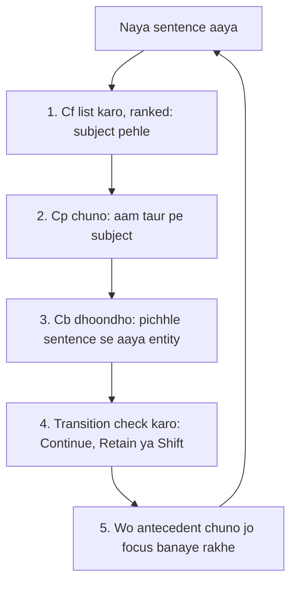

**Ek line mein:** <mark>Centering algorithm discourse ka focus sentence by sentence track karta hai, forward-looking centers (Cf), preferred center (Cp) aur backward-looking center (Cb) se, aur pronoun ko us antecedent se jodta hai jo focus banaye rakhe</mark>. <Cite id="class-nlp-asol" loc="p. 1" />

<Box kind="key">

**Ye points likho:**

- <mark>Centering Algorithm: discourse ka focus track karne aur coherent text ke liye pronouns resolve karne ka structured mechanism</mark>.
- <mark>Cf (forward-looking centers): sentence ke saare entities, prominence ke hisaab se ranked, subject pehle</mark>.
- <mark>Cp (preferred center): Cf ka sabse high-ranked entity, aam taur pe subject</mark>.
- <mark>Cb (backward-looking center): pichhle sentence ka wo entity jiske baare mein current sentence sabse zyada hai</mark>.
- <mark>Transitions: Continue (same focus, preferred), Retain (attention shift hota hai par coherent rehta hai), Shift (focus alag entity pe jaata hai)</mark>.
- Example: "Aragorn picked up the sword. He looked at Frodo." *He* = Aragorn.

</Box>

## Core answer (5 marks, yahan ke har question ke liye)

<Box kind="definition">

The **Centering Algorithm** is a central part of Centering Theory in NLP, providing a structured mechanism for tracking the focus of discourse and determining how pronouns and references are resolved for natural and coherent text understanding. <Cite id="class-nlp-asol" loc="p. 1" />

</Box>

**Ye kya karta hai:** ye model karta hai ki discourse apni coherence kaise banaye rakhta hai, ye track karke ki har sentence kin entities (log, objects, concepts) pe focus karta hai, aur ye focus ek sentence se doosre mein kaise shift hota hai. Anaphora resolution ke liye ye important hai: *he*, *she*, *it* ko sahi earlier mention se jodna. <Cite id="class-nlp-asol" loc="p. 2" /> <Cite id="web-nlp-2-anaphora" />

**Roz ki tasveer:** story ek camera jaisi hai. Kisi bhi moment camera ek character pe hota hai, aur agle sentence ka pronoun lagbhag hamesha usi character ko mean karta hai.

**Key concepts:** <Cite id="class-nlp-asol" loc="p. 2" />

- **Cf** (forward-looking centers): utterance ke entities, prominence se ranked.
- **Cp** (preferred center): Cf ka top entity, aksar subject.
- **Cb** (backward-looking center): pichhle sentence ka wo entity jiske baare mein current sentence hai.
- **Transitions:** Continue, Retain, Shift.

**Steps:** <Cite id="class-nlp-asol" loc="p. 2" /> <Cite id="class-nlp-asol" loc="p. 3" />

1. Current sentence ka Cf pehchano.
2. Cp tay karo.
3. Pichhle sentence se Cb tay karo.
4. Transition types use karo (Continue preferred, phir Retain, phir Shift).
5. Wo antecedent chuno jo centers ki continuity aur prominence banaye rakhe.

**Example:** "Aragorn picked up the sword. He looked at Frodo." Aragorn hi Cb aur Cp hai, isliye *He* = Aragorn. <Cite id="class-nlp-asol" loc="p. 3" />

**Conclusion:** centering text ka focus steady rakhkar pronouns resolve karta hai.

## Extended answer (10 marks): ye add karo

### 1. Har sentence ke liye loop

### 2. Teen transitions

| Transition | Matlab | Preference |
|---|---|---|
| Continue | Cb same rehta hai aur wahi Cp bhi hai: wahi entity focus mein | best |
| Retain | Cb same rehta hai par ab Cp nahi: attention hilna shuru | beech ka |
| Shift | Cb badal jaata hai: focus alag, kam related entity pe | sabse kam |

<Cite id="class-nlp-asol" loc="p. 2" /> <Cite id="web-nlp-2-grosz-centering" />

### 3. Worked example

<Sum>

<Given>

U1: *Aragorn picked up the sword.* U2: *He looked at Frodo.* U3a: *Frodo waited for him.* U3b: *Frodo ran to the river.*

</Given>

<Find>

Har sentence ka Cf, Cb aur transition.

</Find>

<Steps>

1. U1: Cf = [Aragorn, sword]; Cp = Aragorn (subject). Ye pehla sentence hai, isliye abhi Cb nahi.
2. U2: *He* pronoun hai, to Cf(U1) mein uska antecedent dhoondho. Aragorn top-ranked aur male hai, isliye *He* = Aragorn. Cf(U2) = [Aragorn, Frodo]; Cb(U2) = Aragorn; Cp = Aragorn. Focus Aragorn pe hi hai: **Continue**.
3. U3a: Cf = [Frodo, Aragorn (him)]; Cp = Frodo. Cb wo highest-ranked entity hai jo Cf(U2) se U3a mein mila, yaani Aragorn (pehle jaisa Cb), lekin ab Cp Frodo hai. Attention shift hota hai par text coherent rehta hai: **Retain**.
4. U3b: Cf = [Frodo, river]; Cp = Frodo. Cf(U2) se sirf Frodo aaya, isliye Cb = Frodo, jo ab Aragorn nahi. Focus move ho gaya: **Shift**.

</Steps>

<Answer>

U2: He = Aragorn, Continue. U3a: Retain. U3b: Shift.

</Answer>

<Box kind="verify">

Preference order Continue, phir Retain, phir Shift hai. U2 smooth padhta hai; U3b topic change hai, isliye sabse kam preferred. Transitions ka exact rule original centering paper ke hisaab se hai; class answer sirf teen naam batata hai.

</Box>

</Sum>

### 4. Centering Theory ke do rules

*(Class answer mein nahi; original paper se.)* **Rule 1:** pichhle sentence ka koi bhi entity current sentence mein pronoun se realize ho, to Cb bhi pronoun se hi realize hona chahiye. **Rule 2:** Continue ki sequences Retain ki sequences se behtar, aur Retain Shift se behtar. <Cite id="web-nlp-2-grosz-centering" />

### 5. Importance, advantages aur limits

Ye algorithm **machine translation, summarization, story generation aur conversational AI** mein natural, coherent text banane aur judge karne ke liye important hai. <Cite id="class-nlp-asol" loc="p. 3" /> Proposal ke thodi der baad ise pronoun resolution pe lagaya gaya. <Cite id="web-nlp-2-slp3-coref" loc="Historical Notes" />

| Advantages | Limits |
|---|---|
| Ek sentence nahi, poora discourse follow karta hai | Har sentence mein entities ki ranking chahiye |
| Coherence aur topic shift model karta hai | Candidates ke liye grammar tree search nahi karta |
| Clear preference order deta hai | Cb ke liye sirf pichhla sentence use hota hai |

## Har question mein kaise fit karein

- **"Describe in detail Centering Algorithm for reference resolution."** (10 marks) <PYQ id="2023-05-ce/q4b" /> <PYQ id="assignment-2/q5b" />: teacher ke flowchart ke saath poora core answer, phir transitions table, worked example aur importance paragraph.

## Exam tips

- **Cf, Cp aur Cb** ko ek-ek line mein define karo; ye marking keywords hain.
- **Paanch-step loop** draw karo aur **transitions ko preference order** mein likho.
- **Aragorn** example use karo; ye class ka example hai.

Exam mein English mein likho.
