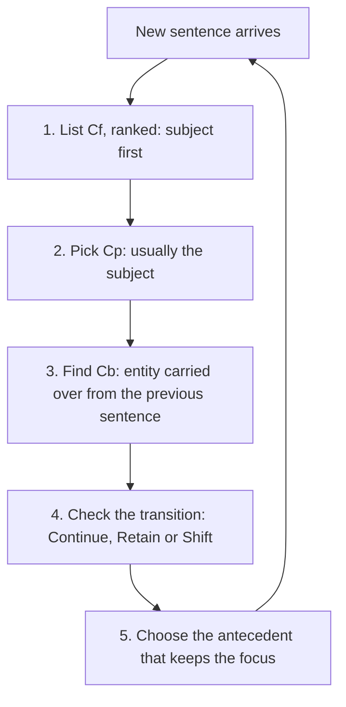

**In one line:** <mark>The Centering algorithm tracks the focus of the discourse sentence by sentence, using forward-looking centers (Cf), the preferred center (Cp) and the backward-looking center (Cb), and resolves a pronoun to the antecedent that keeps the focus</mark>. <Cite id="class-nlp-asol" loc="p. 1" />

<Box kind="key">

**Key points to write:**

- <mark>Centering Algorithm: a structured mechanism for tracking the focus of discourse and resolving pronouns for coherent text</mark>.
- <mark>Cf (forward-looking centers): all entities of a sentence, ranked by prominence, subject first</mark>.
- <mark>Cp (preferred center): the highest-ranked entity of Cf, usually the subject</mark>.
- <mark>Cb (backward-looking center): the entity from the previous sentence that this sentence is most centrally about</mark>.
- <mark>Transitions: Continue (same focus, preferred), Retain (attention shifts but stays coherent), Shift (focus moves to a different entity)</mark>.
- Example: "Aragorn picked up the sword. He looked at Frodo." *He* = Aragorn.

</Box>

## Core answer (5 marks, fits every question here)

<Box kind="definition">

The **Centering Algorithm** is a central part of Centering Theory in NLP, providing a structured mechanism for tracking the focus of discourse and determining how pronouns and references are resolved for natural and coherent text understanding. <Cite id="class-nlp-asol" loc="p. 1" />

</Box>

**What it does:** it models how a discourse keeps its coherence by tracking which entities (people, objects, concepts) each sentence focuses on, and how that focus shifts from one sentence to the next. It is important for anaphora resolution: linking *he*, *she*, *it* to the right earlier mention. <Cite id="class-nlp-asol" loc="p. 2" /> <Cite id="web-nlp-2-anaphora" />

**Everyday picture:** a story is like a camera. At any moment the camera points at one character, and a pronoun in the next sentence almost always means that character.

**Key concepts:** <Cite id="class-nlp-asol" loc="p. 2" />

- **Cf** (forward-looking centers): the entities of an utterance, ranked by prominence.
- **Cp** (preferred center): the top entity of Cf, often the subject.
- **Cb** (backward-looking center): the entity from the previous sentence that the current sentence is about.
- **Transitions:** Continue, Retain, Shift.

**Steps:** <Cite id="class-nlp-asol" loc="p. 2" /> <Cite id="class-nlp-asol" loc="p. 3" />

1. Identify the Cf of the current sentence.
2. Determine the Cp.
3. Determine the Cb from the previous sentence.
4. Use the transition types (Continue preferred, then Retain, then Shift).
5. Prefer the antecedent that keeps the continuity and prominence of the centers.

**Example:** "Aragorn picked up the sword. He looked at Frodo." Aragorn is the Cb and the Cp, so *He* = Aragorn. <Cite id="class-nlp-asol" loc="p. 3" />

**Conclusion:** centering resolves pronouns by keeping the focus of the text steady.

## Extended answer (10 marks): add these

### 1. The loop for every sentence

### 2. The three transitions

| Transition | Meaning | Preference |
|---|---|---|
| Continue | Cb stays the same and is also the Cp: the same entity stays in focus | best |
| Retain | Cb stays the same but is no longer the Cp: attention starts to move | middle |
| Shift | Cb changes: the focus moves to a different, less related entity | least |

<Cite id="class-nlp-asol" loc="p. 2" /> <Cite id="web-nlp-2-grosz-centering" />

### 3. Worked example

<Sum>

<Given>

U1: *Aragorn picked up the sword.* U2: *He looked at Frodo.* U3a: *Frodo waited for him.* U3b: *Frodo ran to the river.*

</Given>

<Find>

Cf, Cb and the transition for each sentence.

</Find>

<Steps>

1. U1: Cf = [Aragorn, sword]; Cp = Aragorn (subject). It is the first sentence, so it has no Cb yet.
2. U2: *He* is a pronoun, so find its antecedent in Cf(U1). Aragorn is top-ranked and male, so *He* = Aragorn. Cf(U2) = [Aragorn, Frodo]; Cb(U2) = Aragorn; Cp = Aragorn. The focus stays on Aragorn: **Continue**.
3. U3a: Cf = [Frodo, Aragorn (him)]; Cp = Frodo. Cb is the highest-ranked entity of Cf(U2) found in U3a, which is Aragorn (the same Cb as before), but Cp is now Frodo. Attention shifts but the text stays coherent: **Retain**.
4. U3b: Cf = [Frodo, river]; Cp = Frodo. Only Frodo from Cf(U2) appears, so Cb = Frodo, which is not Aragorn any more. The focus has moved: **Shift**.

</Steps>

<Answer>

U2: He = Aragorn, Continue. U3a: Retain. U3b: Shift.

</Answer>

<Box kind="verify">

The preference order is Continue, then Retain, then Shift. U2 reads smoothly; U3b is a change of topic, so it is the least preferred. The exact rule for the transitions follows the original centering paper; the class answer only names the three.

</Box>

</Sum>

### 4. The two rules of Centering Theory

*(Not in the class answer; from the original paper.)* **Rule 1:** if any entity of the previous sentence is realized by a pronoun in the current sentence, the Cb must be realized by a pronoun too. **Rule 2:** sequences of Continue are preferred over sequences of Retain, and Retain over Shift. <Cite id="web-nlp-2-grosz-centering" />

### 5. Importance, advantages and limits

The algorithm is important for creating and judging natural, coherent text in **machine translation, summarization, story generation and conversational AI**. <Cite id="class-nlp-asol" loc="p. 3" /> It was applied to pronoun resolution soon after it was proposed. <Cite id="web-nlp-2-slp3-coref" loc="Historical Notes" />

| Advantages | Limits |
|---|---|
| Follows the whole discourse, not one sentence | Needs entities ranked in every sentence |
| Models coherence and the shift of topic | Does not search the grammar tree for candidates |
| Gives a clear preference order | Only the previous sentence is used for the Cb |

## Fit it to each question

- **"Describe in detail Centering Algorithm for reference resolution."** (10 marks) <PYQ id="2023-05-ce/q4b" /> <PYQ id="assignment-2/q5b" />: the full core answer with the teacher's flowchart, then the transitions table, the worked example and the importance paragraph.

## Exam tips

- **Define Cf, Cp and Cb** in one line each; they are the marking keywords.
- Draw the **five-step loop** and name the **transitions in preference order**.
- Use the **Aragorn** example; it is the class example.
