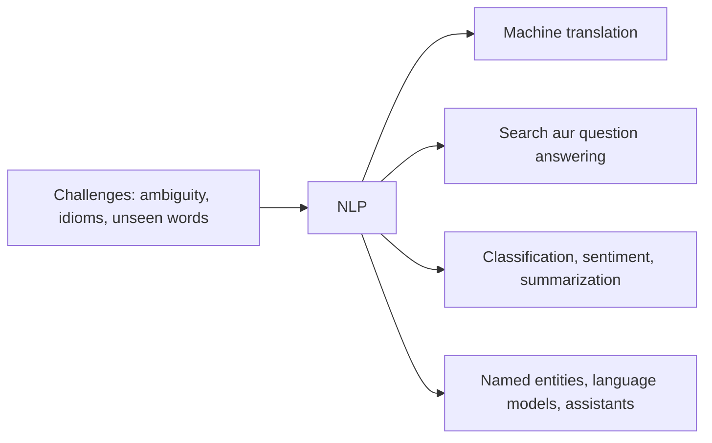
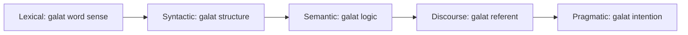

**Ek line mein:** <mark>NLP mushkil hai kyunki natural language har stage pe ambiguous hoti hai</mark>, aur isko solve karna zaroori hai kyunki <mark>translation, search, question answering, classification, summarization aur voice assistants isi pe chalte hain</mark>. <Cite id="class-nlp-m1" loc="p. 3" />

<Box kind="key">

**Challenges ya applications ke har question mein ye points likho:**

- <mark>Main challenge: ambiguity</mark>, paanch types ki: **lexical, syntactic, semantic, anaphoric, pragmatic**.
- Baaki challenges: <mark>figurative language (idioms, metaphors)</mark>, **unseen (out-of-vocabulary) words**, aur **domain change**.
- Shuru ke stage ki ek galat choice <mark>aage ke har stage ko kharab kar deti hai</mark>.
- Applications: <mark>machine translation, information retrieval, question answering, text classification, summarization, sentiment analysis, named entity recognition, language models, speech assistants</mark>.
- Har point ke saath **ek example** do (bank, "I saw a man with telescope", "Do you know the time?").

</Box>

## Core answer (5 marks, yahan ke har question ke liye)

<Box kind="definition">

**Natural Language Processing (NLP)** is a branch of AI that focuses on interaction between computers and humans. Examples: Alexa, Siri, ChatGPT. <Cite id="class-nlp-m1" loc="p. 1" />

</Box>

**Challenges: NLP mushkil kyun hai.** Ek hi word ya sentence ke ek se zyada matlab ho sakte hain, isliye machine ko context se sahi matlab chunna padta hai. <Cite id="class-nlp-m1" loc="p. 3" />

| Challenge | Example |
|---|---|
| Lexical: ek word, kai meanings | bank (financial ya river) |
| Syntactic: ek sentence, kai structures | I saw a man with telescope |
| Semantic: words ka logic | All students did not pass the exam |
| Anaphoric: pronoun kis noun ko point karta hai | Mary told Susan that she had won |
| Pragmatic: asli intention | Do you know the time? |

Aur bhi mushkil: figurative language jaise "I'm falling for you" <Cite id="class-nlp-asol" loc="p. 1" />, aise words jo model ne kabhi dekhe nahi, aur model jo ek domain mein chalta hai par doosre mein fail. <Cite id="class-nlp-pyq3" loc="p. 5" />

**Applications:** machine translation, information retrieval, question answering, text classification, summarization, sentiment analysis, named entity recognition, language models aur speech assistants (neeche detail). <Cite id="class-nlp-m6" loc="slide 1" />

**Conclusion:** ambiguity main challenge hai, aur applications wo wajah hain jisse isko solve karna zaroori hai.

## Extended answer (10 marks): ye add karo

### 1. NLP ke har stage ke challenges

Har stage pe ek challenge hai, aur shuru ki galti aage tak jaati hai. <Cite id="class-nlp-m1" loc="p. 4" /> <Cite id="class-nlp-m1" loc="p. 6" /> <Cite id="class-nlp-m1" loc="p. 7" />

| Stage | Challenge | Example |
|---|---|---|
| Lexical or morphological | Ek word, kai meanings | I saw a bat in a cave: mammal ya toy |
| Syntactic | Ek sentence, kai structures | She hit the man with an umbrella |
| Semantic | Grammar clear, logic open | Someone ate every slice of pizza |
| Discourse integration | Pronoun do nouns ko point kar sakta hai | Mary told Susan that she had won |
| Pragmatic | Literal meaning intent nahi hai | My coffee is cold: fact ya complaint |

### 2. Applications detail mein

| Application | Kya karta hai | Example |
|---|---|---|
| Machine translation | Text ya speech ek language se doosri mein translate karta hai <Cite id="class-nlp-m6" loc="slide 1" /> | Website localization, subtitles |
| Information retrieval | Relevant documents dhoondh ke query ke liye rank karta hai <Cite id="class-nlp-m6" loc="slide 9" /> | Search engine |
| Question answering | Sawalon ka precise jawab deta hai <Cite id="class-nlp-m6" loc="slide 15" /> | Who, what, when questions |
| Text classification | Text ko predefined labels deta hai <Cite id="class-nlp-m6" loc="slide 18" /> | Spam detection |
| Summarization | Text chhota karta hai, key information rakhta hai <Cite id="class-nlp-m6" loc="slide 23" /> | Banking, law, healthcare reports |
| Sentiment analysis | Positive, negative ya neutral opinion nikalta hai <Cite id="class-nlp-m6" loc="slide 26" /> | Customer feedback |
| Named entity recognition | Logon, jagahon, dates ke naam nikalta hai <Cite id="class-nlp-m6" loc="slide 35" /> | Amazon company ya forest |
| Language models | Agla word predict karte hain <Cite id="class-nlp-m6" loc="slide 40" /> | Text prediction, spelling correction |
| Speech assistants | Bole gaye requests samajh ke jawab dete hain <Cite id="class-nlp-m1" loc="p. 1" /> | Alexa, Siri, ChatGPT |

### 3. Aur challenges (standard, class files mein nahi)

Language badalti rehti hai (slang, naye words), ek sentence mein kai languages mix hoti hain, world knowledge pe depend karti hai, aur bahut si languages ka data kam hai. <Cite id="web-nlp-1-wiki-nlp" />

## Har question mein kaise fit karein

- **"Explain the challenges of Natural Language processing."** (5 marks) <PYQ id="2023-05-ce/q1a" />: core answer, challenges table aur "aur bhi mushkil" line. Applications chhod do.
- **"Discuss the challenges in various stages of natural language processing."** (10 marks) <PYQ id="2023-12-ce/q2b" />: paanch-stage flow, phir section 1 ka stage table; figurative-language line add karo.
- **"Explain the applications of Natural Language processing."** (5 marks) <PYQ id="2024-05-ce/q1a" />: definition, phir applications table; challenges chhod do.
- **"Discuss various challenges and applications of NLP in detail."** (10 marks) <PYQ id="2025-05/q6a" /> <PYQ id="assignment-1/q1d" />: core answer plus section 2, aur section 1 pe ek line.

## Exam tips

- **Hamesha draw karo** ambiguity ke paanch types ki picture, aur har type ka ek example do.
- Applications ko **example column wali table** mein likho; examiner har application pe tick lagata hai.
- "In detail" questions mein batao ki challenges aur applications jude hain: ambiguity jitni mushkil, application utni kharab.

Exam mein English mein likho.
