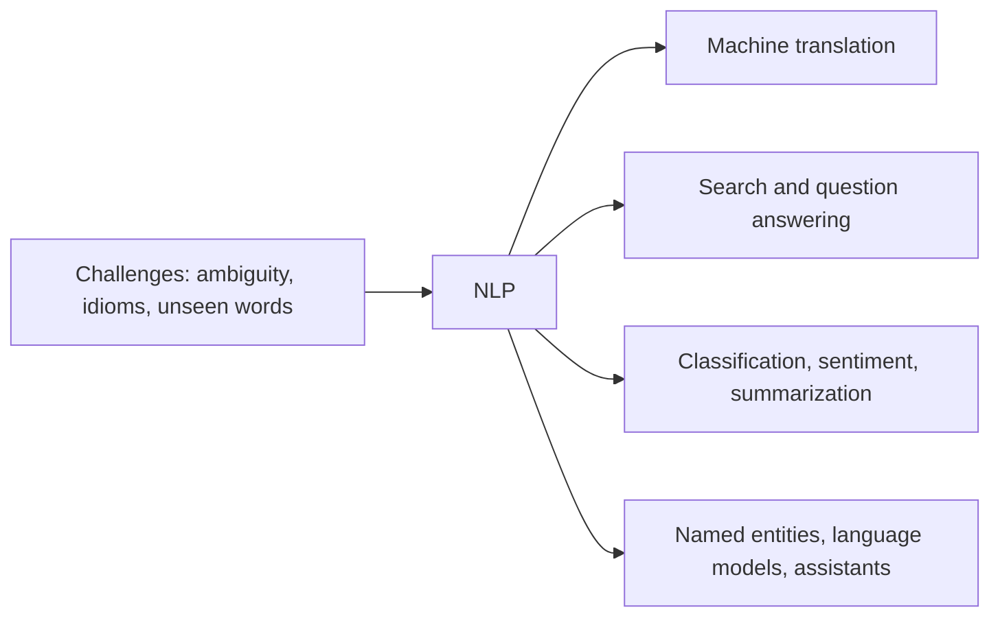
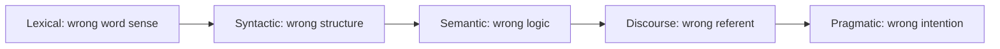

**In one line:** <mark>NLP is hard because natural language is ambiguous at every stage</mark>, and it is worth solving because <mark>it powers translation, search, question answering, classification, summarization and voice assistants</mark>. <Cite id="class-nlp-m1" loc="p. 3" />

<Box kind="key">

**Key points to write (any challenges or applications question):**

- <mark>Main challenge: ambiguity</mark>, of five types: **lexical, syntactic, semantic, anaphoric, pragmatic**.
- Other challenges: <mark>figurative language (idioms, metaphors)</mark>, **unseen (out-of-vocabulary) words**, and **domain change**.
- One wrong choice at an early stage <mark>spoils every later stage</mark>.
- Applications: <mark>machine translation, information retrieval, question answering, text classification, summarization, sentiment analysis, named entity recognition, language models, speech assistants</mark>.
- Give **one example per point** (bank, "I saw a man with telescope", "Do you know the time?").

</Box>

## Core answer (5 marks, fits every question here)

<Box kind="definition">

**Natural Language Processing (NLP)** is a branch of AI that focuses on interaction between computers and humans. Examples: Alexa, Siri, ChatGPT. <Cite id="class-nlp-m1" loc="p. 1" />

</Box>

**Challenges: why NLP is hard.** The same word or sentence can mean more than one thing, so the machine must pick the intended meaning from context. <Cite id="class-nlp-m1" loc="p. 3" />

| Challenge | Example |
|---|---|
| Lexical: one word, many meanings | bank (financial or river) |
| Syntactic: one sentence, many structures | I saw a man with telescope |
| Semantic: the logic of the words | All students did not pass the exam |
| Anaphoric: which noun a pronoun means | Mary told Susan that she had won |
| Pragmatic: the real intention | Do you know the time? |

Also hard: figurative language such as "I'm falling for you" <Cite id="class-nlp-asol" loc="p. 1" />, words the model has never seen, and models that work in one domain but fail in another. <Cite id="class-nlp-pyq3" loc="p. 5" />

**Applications:** machine translation, information retrieval, question answering, text classification, summarization, sentiment analysis, named entity recognition, language models and speech assistants (details below). <Cite id="class-nlp-m6" loc="slide 1" />

**Conclusion:** ambiguity is the main challenge, and the applications are the reason it must be solved.

## Extended answer (10 marks): add these

### 1. Challenges at each stage of NLP

A challenge sits at every stage, and an early mistake is carried forward. <Cite id="class-nlp-m1" loc="p. 4" /> <Cite id="class-nlp-m1" loc="p. 6" /> <Cite id="class-nlp-m1" loc="p. 7" />

| Stage | Challenge | Example |
|---|---|---|
| Lexical or morphological | One word, many meanings | I saw a bat in a cave: mammal or toy |
| Syntactic | One sentence, many structures | She hit the man with an umbrella |
| Semantic | Grammar clear, logic open | Someone ate every slice of pizza |
| Discourse integration | Pronoun can point to two nouns | Mary told Susan that she had won |
| Pragmatic | Literal meaning is not the intent | My coffee is cold: a fact or a complaint |

### 2. The applications in detail

| Application | What it does | Example |
|---|---|---|
| Machine translation | Translates text or speech from one language to another <Cite id="class-nlp-m6" loc="slide 1" /> | Website localization, subtitles |
| Information retrieval | Finds relevant documents and ranks them for a query <Cite id="class-nlp-m6" loc="slide 9" /> | A search engine |
| Question answering | Answers questions with precise facts <Cite id="class-nlp-m6" loc="slide 15" /> | Who, what, when questions |
| Text classification | Assigns predefined labels to text <Cite id="class-nlp-m6" loc="slide 18" /> | Spam detection |
| Summarization | Shortens a text and keeps the key information <Cite id="class-nlp-m6" loc="slide 23" /> | Banking, law, healthcare reports |
| Sentiment analysis | Finds positive, negative or neutral opinion <Cite id="class-nlp-m6" loc="slide 26" /> | Customer feedback |
| Named entity recognition | Finds names of people, places, dates <Cite id="class-nlp-m6" loc="slide 35" /> | Amazon the company or the forest |
| Language models | Predict the next word <Cite id="class-nlp-m6" loc="slide 40" /> | Text prediction, spelling correction |
| Speech assistants | Understand and answer spoken requests <Cite id="class-nlp-m1" loc="p. 1" /> | Alexa, Siri, ChatGPT |

### 3. More challenges (standard, not in the class files)

Language keeps changing (slang, new words), mixes languages in one sentence, depends on world knowledge, and has too little data for many languages. <Cite id="web-nlp-1-wiki-nlp" />

## Fit it to each question

- **"Explain the challenges of Natural Language processing."** (5 marks) <PYQ id="2023-05-ce/q1a" />: core answer, challenges table and the "also hard" line. Skip the applications.
- **"Discuss the challenges in various stages of natural language processing."** (10 marks) <PYQ id="2023-12-ce/q2b" />: the five-stage flow, then the stage table of section 1; add the figurative-language line.
- **"Explain the applications of Natural Language processing."** (5 marks) <PYQ id="2024-05-ce/q1a" />: definition, then the applications table; skip the challenges.
- **"Discuss various challenges and applications of NLP in detail."** (10 marks) <PYQ id="2025-05/q6a" /> <PYQ id="assignment-1/q1d" />: core answer plus section 2, and one line on section 1.

## Exam tips

- **Always draw** the five-type ambiguity picture and give one example for each type.
- Write the applications as a **table with an example column**; examiners tick each application.
- For "in detail" questions, mention that challenges and applications are linked: the harder the ambiguity, the more it hurts the application.
