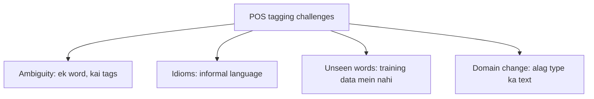
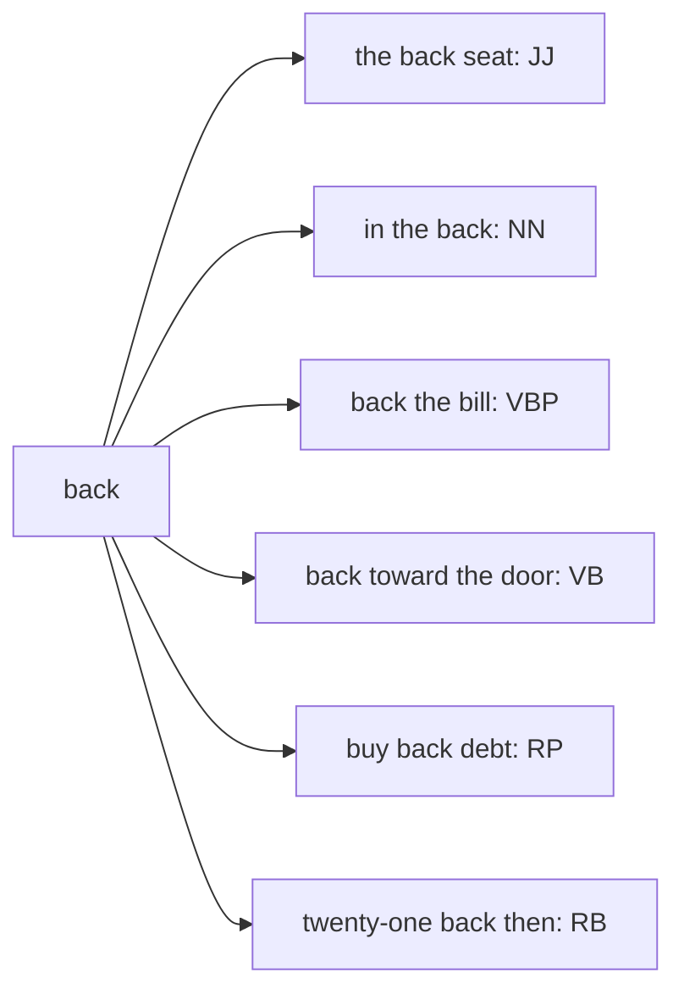

**Ek line mein:** <mark>POS tagging har word ko ek grammatical category deta hai, aur iske main challenges hain ambiguity, idiomatic expressions, out-of-vocabulary (unseen) words aur domain dependence</mark>. <Cite id="class-nlp-pyq3" loc="p. 4" /> <Cite id="class-nlp-pyq3" loc="p. 5" />

<Box kind="key">

**Ye points likho:**

- <mark>POS tagging: sentence ke har word ko ek grammatical category di jaati hai</mark> jaise noun, verb, adjective ya adverb.
- <mark>Ambiguity: ek word ke context ke hisaab se kai tags ho sakte hain</mark>. *Book* "read a book" mein noun hai aur "book a ticket" mein verb.
- <mark>Idiomatic expressions aur informal language ko tag karna mushkil hai</mark>.
- <mark>Out-of-vocabulary words (naye words, names) galat tags dete hain</mark>.
- <mark>Domain dependence: news pe train hua model tweets pe fail ho sakta hai</mark>.
- Ambiguous words word **types ka sirf 14 percent hain, lekin running text ke aadhe se zyada words**.

</Box>

## Core answer (5 marks, yahan ke har question ke liye)

<Box kind="definition">

**POS tagging** is a fundamental task in NLP where each word in a sentence is assigned a grammatical category such as noun, verb, adjective or adverb. <Cite id="class-nlp-pyq3" loc="p. 4" />

</Box>

Example: The/DT quick/JJ brown/JJ fox/NN jumps/VBZ over/IN the/DT lazy/JJ dog/NN. <Cite id="class-nlp-pyq3" loc="p. 4" />

**Challenges** <Cite id="class-nlp-pyq3" loc="p. 5" />

1. **Ambiguity:** ek word ke kai meanings ya tags ho sakte hain, aur sahi wala sirf context batata hai. *Book* "read a book" mein NN hai aur "book a ticket" mein VB.
2. **Idiomatic expressions:** informal language aur idioms normal grammar follow nahi karte, isliye galat tag hote hain.
3. **Out-of-vocabulary (OOV) words:** training mein na dekhe hue words (naye words, names) ko galat tag milta hai.
4. **Domain dependence:** model apne training domain ke bahar achha kaam nahi karta (news text vs tweets).

**Conclusion:** zyadatar tagging errors in chaar se aate hain, aur context inke khilaaf main tool hai.

## Extended answer (10 marks): ye add karo

### 1. Ambiguity ka problem kitna bada hai?

Zyadatar word types unambiguous hain (*Janet* hamesha proper noun hai), lekin ambiguous wale bahut common words hain. WSJ corpus mein lagbhag 14 percent word types ke do ya zyada tags hain, phir bhi wo running text ke 55 percent word tokens bante hain. <Cite id="web-nlp-1-slp3-seqlabel" loc="§18.2" />

<Cite id="web-nlp-1-slp3-seqlabel" loc="§18.2" />

### 2. Har challenge detail mein

| Challenge | Mushkil kyun | Example |
|---|---|---|
| Ambiguity | tag neighbours pe depend karta hai | "The back of the bill" (NN) aur "back the bill" (VB) |
| Idioms | meaning words ke sum se alag hai | "kick the bucket" |
| Unseen words | koi tag seekha hi nahi | naya product name, naya slang |
| Domain change | alag vocabulary aur style | news model tweets pe |

### 3. Taggers in problems ko kaise kam karte hain

- **Context use karo:** HMM aur MaxEnt taggers previous tag aur paas ke words dekhte hain. <Cite id="class-nlp-pyq3" loc="p. 7" />
- Unseen words ke liye **word ke andar ke clues** use karo: capital letter proper noun batata hai, ending *-ing* verb form batati hai. <Cite id="web-nlp-1-wiki-pos" />
- **Target domain ke text pe train karo.**
- Simple baseline, "word ka sabse frequent tag de do", already lagbhag 92 percent accuracy deta hai; best taggers lagbhag 97 percent tak jaate hain, jo humans ke barabar hai. <Cite id="web-nlp-1-slp3-seqlabel" loc="§18.2" />

### 4. Tagging ke advantages aur limits

| Madad karta hai | Abhi bhi mushkil |
|---|---|
| parsing, machine translation, information extraction | upar ke chaar challenges |
| text classification, chatbots, search | rare aur naye words |

<Cite id="class-nlp-pyq3" loc="p. 4" />

## Har question mein kaise fit karein

- **"What is POS tagging? Discuss various challenges faced by POS tagging."** (10 marks) <PYQ id="2022-12-ce/q3c" />: definition aur example, chaar challenges, phir sections 1 se 3.
- **"Explain the various challenges in POS tagging."** (10 marks) <PYQ id="2023-12-ce/q4b" />: chaar challenges diagram ke saath, phir sections 1 se 3; time kam ho to definition chhod do.
- **"Discuss the challenges in part of speech tagging."** (5 marks) <PYQ id="2024-05-ce/q1c" />: sirf core answer.

## Exam tips

- **Chaar challenges number karke likho** aur har ka ek example do.
- **Ambiguity** word aur *book* example har examiner dhoondhta hai.
- 10 marks ke liye "back" diagram ya 14 percent / 55 percent wala fact add karo.

Exam mein English mein likho.
