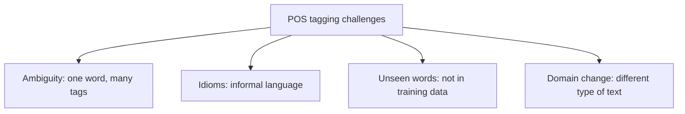
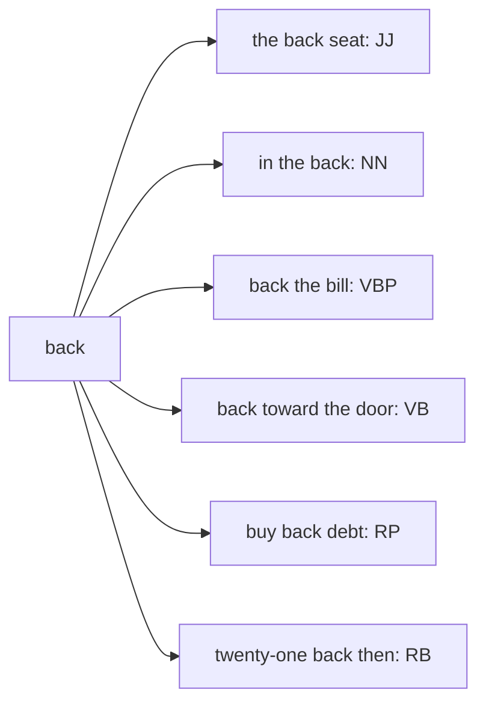

**In one line:** <mark>POS tagging assigns each word a grammatical category, and its main challenges are ambiguity, idiomatic expressions, out-of-vocabulary (unseen) words and domain dependence</mark>. <Cite id="class-nlp-pyq3" loc="p. 4" /> <Cite id="class-nlp-pyq3" loc="p. 5" />

<Box kind="key">

**Key points to write:**

- <mark>POS tagging: each word in a sentence is assigned a grammatical category</mark> such as noun, verb, adjective or adverb.
- <mark>Ambiguity: a word can have several tags depending on context</mark>. *Book* is a noun in "read a book" and a verb in "book a ticket".
- <mark>Idiomatic expressions and informal language are hard to tag</mark>.
- <mark>Out-of-vocabulary words (new words, names) lead to wrong tags</mark>.
- <mark>Domain dependence: a model trained on news may fail on tweets</mark>.
- Ambiguous words are only about **14 percent of word types but more than half of running words**.

</Box>

## Core answer (5 marks, fits every question here)

<Box kind="definition">

**POS tagging** is a fundamental task in NLP where each word in a sentence is assigned a grammatical category such as noun, verb, adjective or adverb. <Cite id="class-nlp-pyq3" loc="p. 4" />

</Box>

Example: The/DT quick/JJ brown/JJ fox/NN jumps/VBZ over/IN the/DT lazy/JJ dog/NN. <Cite id="class-nlp-pyq3" loc="p. 4" />

**Challenges** <Cite id="class-nlp-pyq3" loc="p. 5" />

1. **Ambiguity:** a word can have several meanings or tags, and only the context tells which one. *Book* is NN in "read a book" and VB in "book a ticket".
2. **Idiomatic expressions:** informal language and idioms do not follow normal grammar, so they are tagged wrongly.
3. **Out-of-vocabulary (OOV) words:** words not seen in training (new words, names) get wrong tags.
4. **Domain dependence:** a model may not work well outside the domain it was trained on (news text versus tweets).

**Conclusion:** most tagging errors come from these four, and context is the main tool against them.

## Extended answer (10 marks): add these

### 1. How big is the ambiguity problem?

Most word types are unambiguous (*Janet* is always a proper noun), but the ambiguous ones are very common words. In the WSJ corpus about 14 percent of word types have two or more tags, yet they make up 55 percent of the word tokens in running text. <Cite id="web-nlp-1-slp3-seqlabel" loc="§18.2" />

<Cite id="web-nlp-1-slp3-seqlabel" loc="§18.2" />

### 2. Each challenge in more detail

| Challenge | Why it is hard | Example |
|---|---|---|
| Ambiguity | tag depends on the neighbours | "The back of the bill" (NN) and "back the bill" (VB) |
| Idioms | meaning is not the sum of the words | "kick the bucket" |
| Unseen words | no tag was learned | a new product name, a new slang word |
| Domain change | different vocabulary and style | news model on tweets |

### 3. How taggers reduce these problems

- **Use the context:** HMM and MaxEnt taggers look at the previous tag and nearby words. <Cite id="class-nlp-pyq3" loc="p. 7" />
- **Use clues inside the word** for unseen words: a capital letter suggests a proper noun, the ending *-ing* suggests a verb form. <Cite id="web-nlp-1-wiki-pos" />
- **Train on text from the target domain.**
- A simple baseline, "always give the most frequent tag of the word", already reaches about 92 percent accuracy; the best taggers reach about 97 percent, the same as humans. <Cite id="web-nlp-1-slp3-seqlabel" loc="§18.2" />

### 4. Advantages and limits of tagging

| Helps | Still hard |
|---|---|
| parsing, machine translation, information extraction | the four challenges above |
| text classification, chatbots, search | rare and new words |

<Cite id="class-nlp-pyq3" loc="p. 4" />

## Fit it to each question

- **"What is POS tagging? Discuss various challenges faced by POS tagging."** (10 marks) <PYQ id="2022-12-ce/q3c" />: definition and example, the four challenges, then sections 1 to 3.
- **"Explain the various challenges in POS tagging."** (10 marks) <PYQ id="2023-12-ce/q4b" />: the four challenges with the diagram, then sections 1 to 3; skip the definition if short of time.
- **"Discuss the challenges in part of speech tagging."** (5 marks) <PYQ id="2024-05-ce/q1c" />: core answer only.

## Exam tips

- **Number the four challenges** and give one example each.
- The word **ambiguity** with the *book* example is the one every examiner looks for.
- For 10 marks add the "back" diagram or the 14 percent / 55 percent fact.
