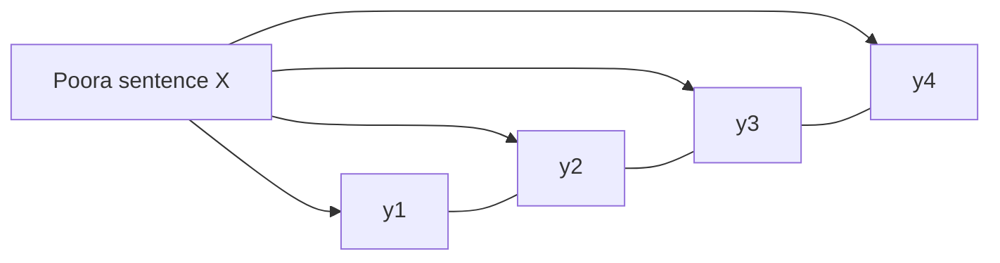
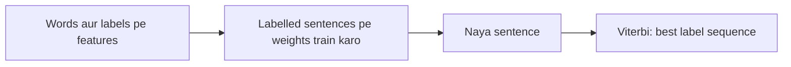

**Ek line mein:** <mark>Conditional Random Field (CRF) ek probabilistic model hai jo words ka sequence aur context samajhta hai, jisse predictions zyada accurate hoti hain</mark>; ye <mark>poore label sequence ko ek saath score karta hai</mark>. <Cite id="class-nlp-m6" loc="slide 39" /> <Cite id="class-nlp-asol" loc="p. 10" />

<Box kind="key">

**Ye points likho:**

- <mark>CRF: a probabilistic model that understands the sequence and context of words</mark> (class ka description).
- <mark>Discriminative: ye seedha $P(Y \mid X)$ model karta hai</mark>, poore sentence ke liye poora label sequence.
- <mark>$Z(X)$ ke saath global normalization, saare label sequences pe</mark>, isliye **label bias nahi**.
- <mark>Rich features</mark> use karta hai (word, neighbours, word shape, neighbouring labels).
- <mark>POS tagging aur named entity recognition</mark> ke liye use hota hai; decoding Viterbi se.
- Drawback: HMM ki counting se **training slow** hai.

</Box>

## Core answer (5 marks, yahan ke har question ke liye)

<Box kind="definition">

A **CRF** is a probabilistic model that understands the sequence and context of words, which helps in making predictions (for example entities) more accurate. <Cite id="class-nlp-m6" loc="slide 39" /> <Cite id="class-nlp-asol" loc="p. 10" />

</Box>

Class files mein sirf ye ek-line description hai; baaki answer standard explanation hai. <Cite id="web-nlp-1-sutton-crf" />

**Kyun chahiye:** HMM maanta hai ki next tag sirf current tag pe depend karta hai aur extra features use nahi kar sakta. <Cite id="class-nlp-pyq3" loc="p. 5" /> MaxEnt (MEMM) rich features use karta hai par har step pe locally normalize karta hai, jisse label bias problem aati hai. <Cite id="class-nlp-pyq3" loc="p. 10" /> CRF rich features rakhta hai aur **poore sentence pe ek baar normalize** karta hai.

**Definition (formal):** CRF ek discriminative model hai jo seedha $P(Y \mid X)$ model karta hai, poore word sequence $X$ diye hue poore label sequence $Y = (y_1, \ldots, y_n)$ ki probability.

$$
P(Y \mid X) = \frac{1}{Z(X)} \exp\Big(\sum_{i=1}^{n} \sum_{k} \lambda_k f_k(y_{i-1}, y_i, X, i)\Big)
$$

$f_k$ feature functions hain, $\lambda_k$ learned weights aur $Z(X)$ saare possible label sequences pe sum karta hai, isliye normalization global hai.

**Conclusion:** CRF rich features aur global normalization se sequence label karta hai, isliye label bias se bachta hai.

## Extended answer (10 marks): ye add karo

### 1. CRF sequence labelling ke liye kaise use hota hai

1. Words, neighbours, word shape aur neighbouring labels pe **feature functions** define karo (jaise "word -ing pe khatam hota hai aur label VBG hai").
2. Labelled sentences pe weights $\lambda_k$ **train** karo (iterative optimization).
3. Naye sentence ke liye **Viterbi** se highest probability wala label sequence dhoondho.

<Cite id="web-nlp-1-wiki-crf" /> <Cite id="web-nlp-1-slp3-seqlabel" />

### 2. Example: named entity recognition

"Barack Obama was born in Honolulu" ke liye CRF labels de sakta hai Person, Person, O, O, O, Location. Ek "Person" label ke baad doosra "Person" label zyada likely hai; CRF ye neighbouring-label features se seekhta hai. <Cite id="class-nlp-m6" loc="slide 35" />

### 3. HMM, MaxEnt aur CRF ki comparison

| Point | HMM | MaxEnt (MEMM) | CRF |
|---|---|---|---|
| Type | Generative, $P(x, y)$ | Discriminative, $P(y \mid x)$ | Discriminative, $P(Y \mid X)$ |
| Rich features | Nahi | Haan | Haan |
| Normalization | Joint model | Local, har step | Global, poora sentence |
| Label bias | Nahi | Haan | Nahi |

### 4. Applications aur disadvantage

**Applications:** POS tagging, named entity recognition. **Disadvantage:** HMM ki counting se training slow hai. <Cite id="web-nlp-1-sutton-crf" />

## Har question mein kaise fit karein

- **"Explain how Conditional Random Field (CRF) is used for sequence labeling."** (10 marks) <PYQ id="2023-12-ce/q6b" />: core answer, phir section 1 (kaise use hota hai, teen steps), section 3 (comparison table) aur section 4.
- **"Demonstrate the concept of conditional Random field in NLP"** (10 marks) <PYQ id="2024-05-ce/q3b" />: class line ke saath definition, formula aur chain diagram, NER example (section 2) aur comparison table.

## Exam tips

- **Chain diagram draw karo** aur likho ki har label poore sentence X ko dekh sakta hai.
- **Teen-column comparison table** do; isse HMM aur MaxEnt bhi revise ho jaate hain.
- Conclusion mein likho "**global normalization, isliye label bias nahi**".

Exam mein English mein likho.
