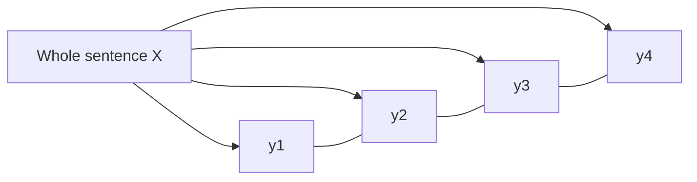
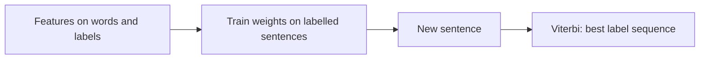

**In one line:** <mark>A Conditional Random Field (CRF) is a probabilistic model that understands the sequence and context of words, which helps in making predictions more accurate</mark>; it <mark>scores the whole label sequence together</mark>. <Cite id="class-nlp-m6" loc="slide 39" /> <Cite id="class-nlp-asol" loc="p. 10" />

<Box kind="key">

**Key points to write:**

- <mark>CRF: a probabilistic model that understands the sequence and context of words</mark> (class description).
- <mark>Discriminative: it directly models $P(Y \mid X)$</mark>, the whole label sequence given the whole sentence.
- <mark>Global normalization with $Z(X)$ over all label sequences</mark>, so **no label bias**.
- Uses <mark>rich features</mark> (word, neighbours, word shape, neighbouring labels).
- Used for <mark>POS tagging and named entity recognition</mark>; decoding with Viterbi.
- Drawback: **training is slower** than counting for an HMM.

</Box>

## Core answer (5 marks, fits every question here)

<Box kind="definition">

A **CRF** is a probabilistic model that understands the sequence and context of words, which helps in making predictions (for example entities) more accurate. <Cite id="class-nlp-m6" loc="slide 39" /> <Cite id="class-nlp-asol" loc="p. 10" />

</Box>

The class files give only this one-line description; the rest of the answer is the standard explanation. <Cite id="web-nlp-1-sutton-crf" />

**Why it is needed:** the HMM assumes the next tag depends only on the current tag and cannot use extra features. <Cite id="class-nlp-pyq3" loc="p. 5" /> MaxEnt (MEMM) uses rich features but normalizes locally at each step, which gives the label bias problem. <Cite id="class-nlp-pyq3" loc="p. 10" /> A CRF keeps the rich features and normalizes **once over the whole sentence**.

**Definition (formal):** a CRF is a discriminative model that directly models $P(Y \mid X)$, the probability of the whole label sequence $Y = (y_1, \ldots, y_n)$ given the whole word sequence $X$.

$$
P(Y \mid X) = \frac{1}{Z(X)} \exp\Big(\sum_{i=1}^{n} \sum_{k} \lambda_k f_k(y_{i-1}, y_i, X, i)\Big)
$$

$f_k$ are feature functions, $\lambda_k$ learned weights and $Z(X)$ adds over all possible label sequences, so normalization is global.

**Conclusion:** a CRF labels a sequence using rich features and global normalization, so it avoids label bias.

## Extended answer (10 marks): add these

### 1. How a CRF is used for sequence labelling

1. Define **feature functions** on words, neighbours, word shape and neighbouring labels (for example "word ends in -ing and the label is VBG").
2. **Train** the weights $\lambda_k$ on labelled sentences (iterative optimization).
3. For a new sentence, find the label sequence with the highest probability using **Viterbi**.

<Cite id="web-nlp-1-wiki-crf" /> <Cite id="web-nlp-1-slp3-seqlabel" />

### 2. Example: named entity recognition

For "Barack Obama was born in Honolulu", a CRF can give labels Person, Person, O, O, O, Location. A label like "Person" is more likely after another "Person" label; the CRF learns this from the neighbouring-label features. <Cite id="class-nlp-m6" loc="slide 35" />

### 3. Comparison of HMM, MaxEnt and CRF

| Point | HMM | MaxEnt (MEMM) | CRF |
|---|---|---|---|
| Type | Generative, $P(x, y)$ | Discriminative, $P(y \mid x)$ | Discriminative, $P(Y \mid X)$ |
| Rich features | No | Yes | Yes |
| Normalization | Joint model | Local, each step | Global, whole sentence |
| Label bias | No | Yes | No |

### 4. Applications and disadvantage

**Applications:** POS tagging, named entity recognition. **Disadvantage:** training is slower than counting for an HMM. <Cite id="web-nlp-1-sutton-crf" />

## Fit it to each question

- **"Explain how Conditional Random Field (CRF) is used for sequence labeling."** (10 marks) <PYQ id="2023-12-ce/q6b" />: core answer, then section 1 (how it is used, with the three steps), section 3 (comparison table) and section 4.
- **"Demonstrate the concept of conditional Random field in NLP"** (10 marks) <PYQ id="2024-05-ce/q3b" />: definition with the class line, the formula and chain diagram, the NER example (section 2) and the comparison table.

## Exam tips

- **Draw the chain diagram** and say that each label can look at the whole sentence X.
- Give the **three-column comparison table**; it also revises HMM and MaxEnt.
- Say "**global normalization, so no label bias**" in the conclusion.
