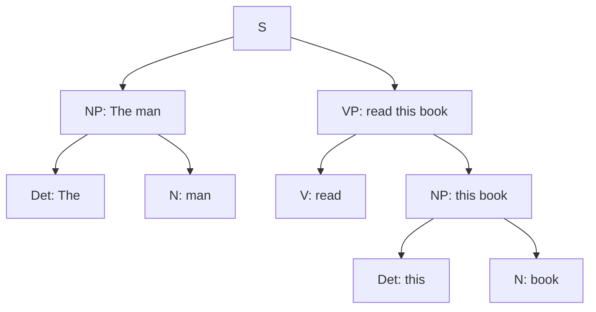
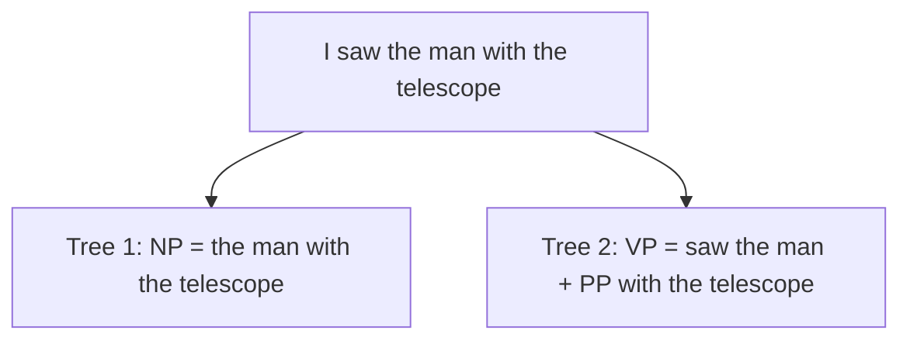

**Ek line mein:** <mark>Constituent ek word ya words ka group hai jo ek single unit ki tarah behave karta hai aur jiska grammatical label hota hai</mark> jaise NP, VP ya PP; <mark>CFG constituency ko har kism ke unit ke ek rule se describe karta hai</mark>. <Cite id="web-nlp-1-wiki-constituent" />

<Box kind="key">

**Ye points likho:**

- <mark>Constituent: words ka group jo ek unit ki tarah kaam karta hai</mark> (noun phrase, verb phrase, prepositional phrase).
- <mark>CFG ka har rule batata hai ki constituent kis se bana hai</mark>: NP → Det N.
- <mark>Parse tree dikhata hai ki chhote constituents kaise jud kar bade bante hain</mark>.
- **Tests:** pronoun se substitution, akele jawab ke roop mein aana, block ki tarah move hona.
- Constituency batata hai <mark>ek sentence ke do trees kyun ho sakte hain</mark> (syntactic ambiguity).
- Class grammar se **"The man read this book" ka tree** draw karo.

</Box>

## Core answer (5 marks, yahan ke har question ke liye)

<Box kind="definition">

A **constituent** is a word or a group of words that behaves as a single unit and has a grammatical label such as NP (noun phrase), VP (verb phrase) or PP (prepositional phrase). A **context-free grammar** describes constituency: each rule such as NP → Det N says what a constituent is made of. <Cite id="web-nlp-1-wiki-constituent" /> <Cite id="web-nlp-1-wiki-cfg" />

</Box>

**Class grammar ke saath example:** S → NP VP, NP → Det N | N, VP → V NP, Det → The | this, N → man | book, V → read. <Cite id="class-nlp-pyq3" loc="p. 8" />

Yahan constituents: *The man* (NP), *this book* (NP), *read this book* (VP) aur poora sentence (S). *man read* constituent nahi hai, kyunki koi rule use nahi banata.

**Conclusion:** CFG sentence ko constituents se banata hai, aur parse tree dikhata hai ki kaunse words saath hain.

## Extended answer (10 marks): ye add karo

### 1. Constituent ke tests (standard)

| Test | Example | Result |
|---|---|---|
| Substitution: pronoun se badlo | The man read this book se **He** read **it** | The man aur this book units hain |
| Akele: sawal ka jawab ban sake | What did he do? Read this book | read this book ek unit hai |
| Movement: block ki tarah move ho | This book, the man read | this book ek unit hai |

<Cite id="web-nlp-1-wiki-constituent" />

### 2. Common constituent types

| Label | Naam | Example |
|---|---|---|
| S | Sentence | The man read this book |
| NP | Noun phrase | The man, this book |
| VP | Verb phrase | read this book |
| PP | Prepositional phrase | with the telescope |

### 3. Constituency kyun matter karti hai: ek sentence, do trees

Wahi words do tareeke se group ho sakte hain, isliye ek sentence ke do trees. "I saw the man with the telescope": ya to *the man with the telescope* ek NP hai (telescope aadmi ke paas), ya *with the telescope* VP ke andar PP hai (maine use kiya). <Cite id="class-nlp-pyq4" loc="p. 6" />

### 4. Constituents se parser tak

Parsers (top-down, bottom-up, CYK) wo constituents dhoondhte hain jo poore sentence ko cover karein. <Cite id="web-nlp-1-slp3-cfg" />

## Har question mein kaise fit karein

- **"Explain constituency in context free grammar with example."** (10 marks) <PYQ id="2026-05/q4b" />: definition, class grammar, tree (diagram aur bracket list), phir section 1 aur 3; time ho to section 2 pe ek line.

## Exam tips

- **Parse tree draw karo** labelled boxes ke saath; constituents pe circle lagao.
- **Definition word for word** aur teen tests har ek ke ek example ke saath likho.
- Do-tree example likho; wo dikhata hai ki constituency kyun zaroori hai.

Exam mein English mein likho.
