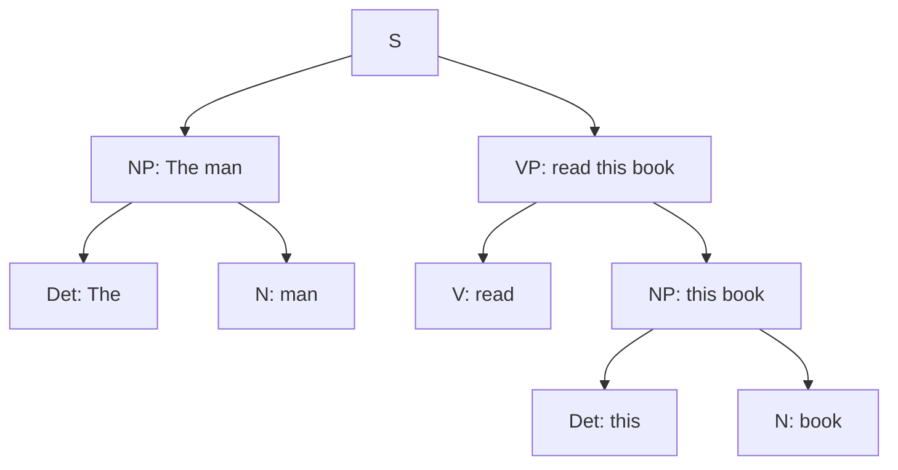
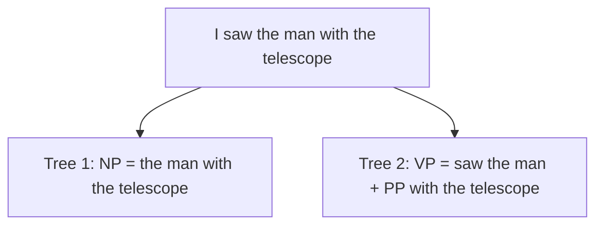

**In one line:** <mark>A constituent is a word or a group of words that behaves as a single unit and has a grammatical label</mark> such as NP, VP or PP; <mark>a CFG describes constituency with one rule for each kind of unit</mark>. <Cite id="web-nlp-1-wiki-constituent" />

<Box kind="key">

**Key points to write:**

- <mark>Constituent: a group of words that works as one unit</mark> (a noun phrase, verb phrase, prepositional phrase).
- <mark>Each CFG rule says what a constituent is made of</mark>: NP → Det N.
- <mark>The parse tree shows how small constituents join into bigger ones</mark>.
- **Tests:** substitution by a pronoun, standing alone as an answer, moving as a block.
- Constituency explains <mark>why one sentence can have two trees</mark> (syntactic ambiguity).
- Draw **the tree of "The man read this book"** from the class grammar.

</Box>

## Core answer (5 marks, fits every question here)

<Box kind="definition">

A **constituent** is a word or a group of words that behaves as a single unit and has a grammatical label such as NP (noun phrase), VP (verb phrase) or PP (prepositional phrase). A **context-free grammar** describes constituency: each rule such as NP → Det N says what a constituent is made of. <Cite id="web-nlp-1-wiki-constituent" /> <Cite id="web-nlp-1-wiki-cfg" />

</Box>

**Example with the class grammar:** S → NP VP, NP → Det N | N, VP → V NP, Det → The | this, N → man | book, V → read. <Cite id="class-nlp-pyq3" loc="p. 8" />

Constituents here: *The man* (NP), *this book* (NP), *read this book* (VP) and the whole sentence (S). *man read* is not a constituent, because no rule builds it.

**Conclusion:** a CFG builds a sentence from constituents, and the parse tree shows which words belong together.

## Extended answer (10 marks): add these

### 1. Tests for a constituent (standard)

| Test | Example | Result |
|---|---|---|
| Substitution: replace it by a pronoun | The man read this book becomes **He** read **it** | The man and this book are units |
| Stand alone: it can answer a question | What did he do? Read this book | read this book is a unit |
| Movement: it moves as a block | This book, the man read | this book is a unit |

<Cite id="web-nlp-1-wiki-constituent" />

### 2. Common constituent types

| Label | Name | Example |
|---|---|---|
| S | Sentence | The man read this book |
| NP | Noun phrase | The man, this book |
| VP | Verb phrase | read this book |
| PP | Prepositional phrase | with the telescope |

### 3. Why constituency matters: two trees for one sentence

The same words can group in two ways, so the same sentence gets two trees. "I saw the man with the telescope": either *the man with the telescope* is one NP (the man has it), or *with the telescope* is a PP inside the VP (I used it). <Cite id="class-nlp-pyq4" loc="p. 6" />

### 4. From constituents to a parser

Parsers (top-down, bottom-up, CYK) search for the constituents that cover the whole sentence. <Cite id="web-nlp-1-slp3-cfg" />

## Fit it to each question

- **"Explain constituency in context free grammar with example."** (10 marks) <PYQ id="2026-05/q4b" />: definition, class grammar, the tree (diagram and bracket list), then sections 1 and 3; one line on section 2 if time permits.

## Exam tips

- **Draw the parse tree** with labelled boxes; circle the constituents.
- Write the **definition word for word** and the three tests with one example each.
- Mention the two-tree example; it shows why constituency matters.
