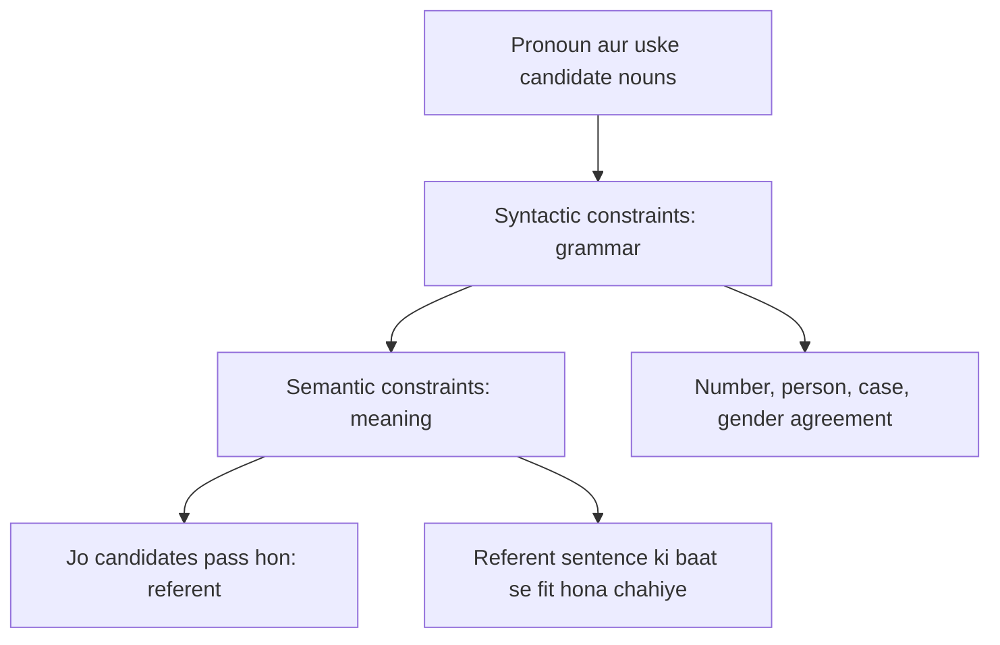
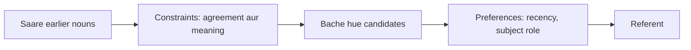

**Ek line mein:** <mark>Coreference ke constraints wo rules hain jo impossible antecedents hata dete hain: syntactic constraints (number, person, case aur gender agreement) grammar pe chalte hain, aur semantic constraints meaning pe</mark>; jo bachta hai wo text ko coherent rakhta hai. <Cite id="web-nlp-2-slp3-coref" loc="§24.1.4" />

<Box kind="key">

**Ye points likho:**

- <mark>Pronoun aur uske antecedent ko number, person, case aur gender mein agree karna hota hai</mark> (syntactic constraints).
- <mark>Number agreement: singular ke saath singular, plural ke saath plural</mark>. "The chefs made lunch. **She** served it" galat hai.
- <mark>Person agreement: first (I), second (you), third (he, she, it, they) match hone chahiye</mark>.
- <mark>Case agreement: he (subject), him (object), his (owner)</mark>. "Ram saw **him**" mein *him* Ram nahi hai.
- <mark>Semantic constraints: meaning fit hona chahiye</mark>: verb decide karta hai ki uski jagah kya aa sakta hai (selectional restriction). "I ate the soup in my new bowl after cooking **it**": *it* = soup, bowl nahi.
- Constraints candidates **hatate** hain; **preferences** (recency, subject role) bacho mein se chunti hain.

</Box>

## Core answer (5 marks, yahan ke har question ke liye)

<Box kind="definition">

A **constraint on coreference** is a rule that a pronoun and its antecedent must satisfy. **Syntactic constraints** come from grammar (agreement); **semantic constraints** come from meaning. Constraints cut down the candidate antecedents so that the text stays coherent, which means its sentences hang together. <Cite id="web-nlp-2-slp3-coref" loc="§24.1.4" /> <Cite id="web-nlp-2-coherence" />

</Box>

**1. Syntactic constraints (agreement)**

- **Number:** singular pronoun ko singular antecedent chahiye, plural ko plural. "The chefs made lunch. **She** served it." galat hai kyunki *She* singular hai aur *chefs* plural.
- **Person:** third-person pronoun (he, she, they) ko third-person antecedent chahiye. "Ram said that **he** was late": *he* Ram se fit hota hai.
- **Case:** pronoun ka form uska kaam dikhata hai: *he* (subject), *him* (object), *his* (owner). "Ram saw **him**" mein *him* Ram nahi ho sakta.
- **Gender:** *he* ko male antecedent, *she* ko female, *it* ko cheez. "John saw Mary, he greeted her" mein *he* = John.

**2. Semantic constraints (meaning)**

Grammar do nouns allow kare phir bhi sirf ek ka matlab banta hai. "I ate the soup in my new bowl after cooking **it** for hours": *eat* ko khane layak cheez chahiye, isliye *it* soup hai, bowl nahi. <Cite id="web-nlp-2-slp3-coref" loc="§24.1.4" />

**Conclusion:** syntactic constraints grammar se candidates reject karte hain, semantic constraints meaning se; jo bachta hai wahi referent hai aur text ko coherent rakhta hai.

## Extended answer (10 marks): ye add karo

### 1. Constraints ki table

| Constraint | Kya poochta hai | Example | Kya hatata hai |
|---|---|---|---|
| Number | Number mein agree? | The chefs ... She | chefs |
| Person | Same person? | Ram said that he ... | you, I |
| Case | Pronoun form kaam ke liye sahi? | Ram saw him | Ram (object ke roop mein) |
| Gender | Gender mein agree? | John saw Mary, he ... | Mary |
| Semantic | Meaning fit hota hai? | cooking it (soup ya bowl) | bowl |

### 2. Agreement detail mein

- Number: English mein *she, he, it* singular hain; *we, they* plural; *you* unspecified. <Cite id="web-nlp-2-slp3-coref" loc="§24.1.4" /> <Cite id="web-nlp-2-agreement" />
- Gender: English mein sirf third-person singular pronouns (he, she, it) ise dikhate hain. <Cite id="web-nlp-2-slp3-coref" loc="§24.1.4" />
- Exceptions: collective noun *it* ya *they* le sakta hai ("IBM announced a product. They have worked on it"), aur *they* ek insaan ke liye bhi use hota hai. Isliye agreement ko dhyaan se lagate hain, bahut strictly nahi. <Cite id="web-nlp-2-slp3-coref" loc="§24.1.4" />

### 3. Doosra syntactic constraint: binding

Reflexive pronoun (*himself*, *herself*) apni clause ke subject ko refer karta hai; normal pronoun nahi kar sakta. "Janet bought **herself** a bottle" (herself = Janet) lekin "Janet bought **her** a bottle" (her Janet nahi). <Cite id="web-nlp-2-slp3-coref" loc="§24.1.4" />

### 4. Semantic constraints detail mein

- **Selectional restriction:** verb sirf kuch kinds ke objects allow karta hai (eat ko khane layak cheez).
- **Verb meaning:** "John telephoned Bill. **He** lost the laptop" aam taur pe John; "John criticized Bill. **He** lost the laptop" aam taur pe Bill. <Cite id="web-nlp-2-slp3-coref" loc="§24.1.4" />
- **World knowledge:** car chalayi ja sakti hai, garage nahi.

### 5. Constraints vs preferences, aur coherence

Constraints hold karne hi chahiye; **preferences** sirf bache hue ko rank karti hain: **recency** (recent sentence zyada likely) aur **grammatical role** (subject object se zyada likely). <Cite id="web-nlp-2-slp3-coref" loc="§24.1.4" /> Text **coherent** tab hota hai jab uske sentences jude hon, aur ek hi entity ko focus mein rakhna iska ek tareeka hai, jise Centering model karta hai. <Cite id="web-nlp-2-coherence" /> <Cite id="web-nlp-2-grosz-centering" />

## Har question mein kaise fit karein

- **"Explain following Syntactic and Semantic Constraints on Co reference 1) Number Agreement 2) Person and Case Agreement"** (5 marks) <PYQ id="2025-05-ce/q1e" />: core part 1 (number, person, case) examples aur diagram ke saath; semantic constraints pe ek line.
- **"Explain syntactic and semantic constraints on coherence."** (5 marks) <PYQ id="2026-05/q1e" />: poora core answer (syntactic list, semantic example, diagram aur conclusion); time ho to section 1 ki table add karo.

## Exam tips

- Har constraint ka **galat example** do ("The chefs made lunch. She served it"); isse dikhta hai rule kya rokta hai.
- Chaar agreements ke naam likho: **number, person, case, gender**.
- Bolo ki constraints candidates **hatate** hain aur preferences **chunti** hain.

Exam mein English mein likho.
