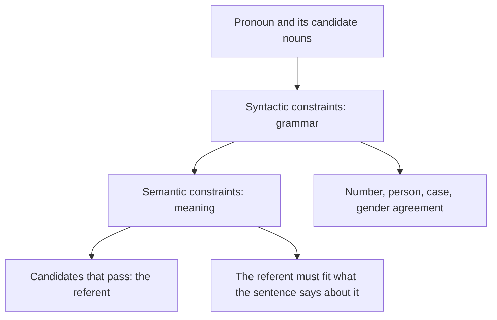
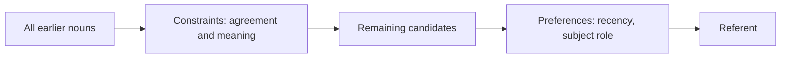

**In one line:** <mark>Constraints on coreference are rules that remove impossible antecedents: syntactic constraints (number, person, case and gender agreement) work on grammar, and semantic constraints work on meaning</mark>; what is left keeps the text coherent. <Cite id="web-nlp-2-slp3-coref" loc="§24.1.4" />

<Box kind="key">

**Key points to write:**

- <mark>A pronoun and its antecedent must agree in number, person, case and gender</mark> (syntactic constraints).
- <mark>Number agreement: singular with singular, plural with plural</mark>. "The chefs made lunch. **She** served it" is wrong.
- <mark>Person agreement: first (I), second (you), third (he, she, it, they) must match</mark>.
- <mark>Case agreement: he (subject), him (object), his (owner)</mark>. In "Ram saw **him**", *him* is not Ram.
- <mark>Semantic constraints: the meaning must fit</mark>: the verb limits what can fill its place (a selectional restriction). "I ate the soup in my new bowl after cooking **it**": *it* = soup, not bowl.
- Constraints **remove** candidates; **preferences** (recency, subject role) choose among the rest.

</Box>

## Core answer (5 marks, fits every question here)

<Box kind="definition">

A **constraint on coreference** is a rule that a pronoun and its antecedent must satisfy. **Syntactic constraints** come from grammar (agreement); **semantic constraints** come from meaning. Constraints cut down the candidate antecedents so that the text stays coherent, which means its sentences hang together. <Cite id="web-nlp-2-slp3-coref" loc="§24.1.4" /> <Cite id="web-nlp-2-coherence" />

</Box>

**1. Syntactic constraints (agreement)**

- **Number:** a singular pronoun needs a singular antecedent, a plural pronoun a plural one. "The chefs made lunch. **She** served it." is wrong because *She* is singular and *chefs* is plural.
- **Person:** a third-person pronoun (he, she, they) needs a third-person antecedent. "Ram said that **he** was late": *he* fits Ram.
- **Case:** the pronoun form shows its job: *he* (subject), *him* (object), *his* (owner). In "Ram saw **him**", *him* cannot be Ram.
- **Gender:** *he* needs a male antecedent, *she* a female one, *it* a thing. In "John saw Mary, he greeted her", *he* = John.

**2. Semantic constraints (meaning)**

Even when grammar allows two nouns, only one makes sense. "I ate the soup in my new bowl after cooking **it** for hours": *eat* needs something edible, so *it* is the soup, not the bowl. <Cite id="web-nlp-2-slp3-coref" loc="§24.1.4" />

**Conclusion:** syntactic constraints reject candidates by grammar, semantic constraints reject them by meaning; the candidate that survives is the referent and keeps the text coherent.

## Extended answer (10 marks): add these

### 1. Table of the constraints

| Constraint | Question asked | Example | Removes |
|---|---|---|---|
| Number | Do they agree in number? | The chefs ... She | chefs |
| Person | Same person? | Ram said that he ... | you, I |
| Case | Is the pronoun form right for the job? | Ram saw him | Ram (as the object) |
| Gender | Do they agree in gender? | John saw Mary, he ... | Mary |
| Semantic | Does the meaning fit? | cooking it (soup or bowl) | the bowl |

### 2. Agreement in more detail

- Number: English *she, he, it* are singular; *we, they* are plural; *you* is unspecified. <Cite id="web-nlp-2-slp3-coref" loc="§24.1.4" /> <Cite id="web-nlp-2-agreement" />
- Gender: in English only the third-person singular pronouns show it (he, she, it). <Cite id="web-nlp-2-slp3-coref" loc="§24.1.4" />
- Exceptions: a collective noun can take *it* or *they* ("IBM announced a product. They have worked on it"), and *they* is also used for one person. So agreement is applied with care, not too strictly. <Cite id="web-nlp-2-slp3-coref" loc="§24.1.4" />

### 3. Other syntactic constraint: binding

A reflexive pronoun (*himself*, *herself*) refers to the subject of its own clause; a plain pronoun cannot. "Janet bought **herself** a bottle" (herself = Janet) but "Janet bought **her** a bottle" (her is not Janet). <Cite id="web-nlp-2-slp3-coref" loc="§24.1.4" />

### 4. Semantic constraints in more detail

- **Selectional restriction:** a verb allows only some kinds of objects (eat takes something edible).
- **Verb meaning:** "John telephoned Bill. **He** lost the laptop" usually means John; "John criticized Bill. **He** lost the laptop" usually means Bill. <Cite id="web-nlp-2-slp3-coref" loc="§24.1.4" />
- **World knowledge:** a car can be driven, a garage cannot.

### 5. Constraints versus preferences, and coherence

Constraints must hold; **preferences** only rank what remains: **recency** (a recent sentence is more likely) and **grammatical role** (a subject is more likely than an object). <Cite id="web-nlp-2-slp3-coref" loc="§24.1.4" /> A text is **coherent** when its sentences connect, and keeping the same entity in focus is one way to do it, which Centering models. <Cite id="web-nlp-2-coherence" /> <Cite id="web-nlp-2-grosz-centering" />

## Fit it to each question

- **"Explain following Syntactic and Semantic Constraints on Co reference 1) Number Agreement 2) Person and Case Agreement"** (5 marks) <PYQ id="2025-05-ce/q1e" />: core part 1 (number, person, case) with their examples and the diagram; one line on semantic constraints.
- **"Explain syntactic and semantic constraints on coherence."** (5 marks) <PYQ id="2026-05/q1e" />: the full core answer (syntactic list, semantic example, diagram and conclusion); add the table in section 1 if there is time.

## Exam tips

- **Give a wrong example** for each constraint ("The chefs made lunch. She served it"); it shows what the rule rules out.
- Name the four agreements: **number, person, case, gender**.
- Say that constraints **remove** candidates and preferences **choose**.
