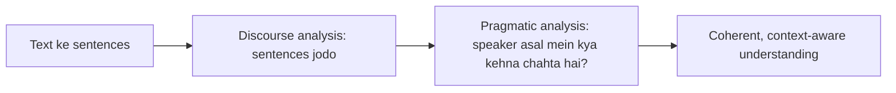
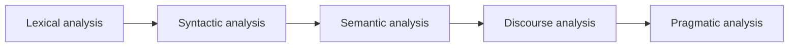

**Ek line mein:** <mark>Discourse analysis dekhta hai ki kai sentences bade context mein kaise jude hain taaki text coherent rahe; pragmatic analysis context, tone aur speaker ke intention se words aur sentences ka intended meaning nikalta hai</mark>. <Cite id="class-nlp-asol" loc="p. 1" />

<Box kind="key">

**Ye points likho:**

- <mark>Discourse analysis: kai sentences bade context mein kaise jude hain ye samajhna, taaki text coherent aur consistent rahe</mark>.
- Discourse ke kaam: **related sentences jodna, context banaye rakhna, references sahi interpret karna, lambe text ki coherence badhana**. Key aspects: **anaphora resolution** aur **contextual references**.
- <mark>Pragmatic analysis: literal meaning ke aage context, tone aur speaker intention dekhkar words aur sentences ka intended meaning samajhna</mark>.
- Pragmatic ke kaam: **implied meaning, figurative language (idioms, metaphors), intentions**; chatbots aur sentiment analysis ko support karta hai.
- Examples: "Taylor went to the store. **She** bought groceries" (discourse); "**Can you pass the salt?**" (pragmatic: ek request).
- Ye NLP ke **aakhri do levels** hain.

</Box>

## Core answer (5 marks, yahan ke har question ke liye)

<Box kind="definition">

**Discourse Analysis** focuses on understanding how multiple sentences connect within a larger context. It ensures that the meaning of a text remains coherent and consistent across sentences and paragraphs. **Pragmatic Analysis** focuses on understanding the intended meaning of words and sentences by considering context, tone and speaker intention beyond the literal meaning. <Cite id="class-nlp-asol" loc="p. 1" />

</Box>

**Discourse analysis kya karta hai:** related sentences aur ideas jodta hai; text mein contextual understanding banaye rakhta hai; references aur meanings sahi interpret karne mein madad karta hai; lambe ya complex text ki coherence badhata hai. <Cite id="class-nlp-asol" loc="p. 1" />

- *Anaphora resolution* pronoun ko sahi subject se jodta hai. "Taylor went to the store. **She** bought groceries": *She* = Taylor.
- *Contextual references*: "**This** is unfair!" *this* ka meaning aas-paas ke sentences pe depend karta hai.

**Pragmatic analysis kya karta hai:** implied meanings aur intentions samajhta hai; context, tone aur conversational meaning interpret karta hai; idioms aur metaphors jaisi figurative language pehchanta hai; machines ko human communication samajhne mein madad karta hai; sentiment analysis, chatbots aur conversational AI ko support karta hai. <Cite id="class-nlp-asol" loc="p. 1" />

- "**Can you pass the salt?**" ek polite request hai, ability ka sawal nahi.
- "**I'm falling for you.**" pyaar jataata hai, sach mein girna nahi.

| | Discourse analysis | Pragmatic analysis |
|---|---|---|
| Kya dekhta hai | sentences kaise jude hain | speaker ka matlab kya hai |
| Main tool | references jodna (anaphora resolution) | context, tone, speaker intention |
| Example | *She* = *Taylor* | "Can you pass the salt?" = request |

**Conclusion:** discourse analysis coherent text deta hai; pragmatic analysis uska asli meaning.

## Extended answer (10 marks): ye add karo

### 1. NLP ke stages mein jagah

Discourse integration (sentence aas-paas ke sentences se kaise juda hai) aur pragmatic analysis (situation mein asli meaning) chauthe aur paanchve stages hain, lexical, syntactic aur semantic analysis ke baad. <Cite id="class-nlp-m1" loc="p. 1" /> <Cite id="class-nlp-m1" loc="p. 2" />

### 2. Discourse analysis detail mein

- **Discourse** jude hue sentences ka group hai. Har sentence akela aasan ho sakta hai, lekin *She* jaisa word sirf pichhle sentence ko dekhkar samajh aata hai. <Cite id="web-nlp-2-discourse-analysis" />
- Text **coherent** tab hota hai jab uske parts logically jude hon; pronouns jaise reference links text ko jodne ke main tareekon mein se ek hain. <Cite id="web-nlp-2-coherence" />
- Tools: anaphora resolution (Hobbs, Centering) aur referring expressions ko resolve karna.

### 3. Pragmatic analysis detail mein

- Pragmatics padhta hai ki context meaning mein kaise yogdaan deta hai. <Cite id="web-nlp-2-pragmatics" />
- **Implied meaning:** "Hello! What time is it?" context ke hisaab se late hone ki chinta dikha sakta hai. <Cite id="class-nlp-asol" loc="p. 1" />
- **Figurative meaning:** idioms ("kick the bucket") aur metaphors wo nahi kehte jo words kehte hain.
- **Intention:** wahi words sawal, request ya order ho sakte hain; sentence ka purpose dhoondhna.

### 4. Machine ko mushkil kyun, aur uses

| Mushkil kyun | Kahan use |
|---|---|
| jawab sirf words mein nahi | chatbots aur virtual assistants |
| world knowledge aur situation chahiye | sentiment analysis (sarcasm) |
| references text mein door peeche ho sakte hain | summarization, lambe texts ka machine translation |

**Roz ki tasveer.** Discourse analysis film ke plot ko scenes ke across follow karna hai. Pragmatic analysis samajhna hai ki jab dost kehta hai "It is cold here", to wo chahta hai ki tum window band kar do.

## Har question mein kaise fit karein

- **"Define Discourse and Pragmatic analysis."** (5 marks) <PYQ id="2024-12/q1c" /> <PYQ id="assignment-2/q5a" />: bilkul core answer: do definitions, har ke kaam ki list, examples, table aur ek-line conclusion.

## Exam tips

- **Dono definitions word for word likho**; marking text wahi hai.
- **Har ka ek example** do (She = Taylor; Can you pass the salt?).
- **Do-box flow** ya paanch-stage line draw karo; "looks at / main tool / example" wali table marks badhati hai.

Exam mein English mein likho.
