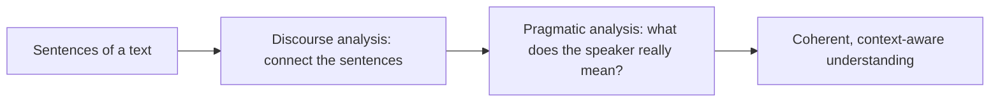
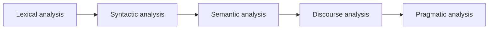

**In one line:** <mark>Discourse analysis studies how multiple sentences connect within a larger context so that a text stays coherent; pragmatic analysis finds the intended meaning of words and sentences using context, tone and speaker intention</mark>. <Cite id="class-nlp-asol" loc="p. 1" />

<Box kind="key">

**Key points to write:**

- <mark>Discourse analysis: understanding how multiple sentences connect within a larger context, so the text remains coherent and consistent</mark>.
- Discourse jobs: **connects related sentences, keeps context, interprets references, improves coherence of long texts**. Key aspects: **anaphora resolution** and **contextual references**.
- <mark>Pragmatic analysis: understanding the intended meaning of words and sentences by considering context, tone and speaker intention beyond the literal meaning</mark>.
- Pragmatic jobs: **implied meaning, figurative language (idioms, metaphors), intentions**; supports chatbots and sentiment analysis.
- Examples: "Taylor went to the store. **She** bought groceries" (discourse); "**Can you pass the salt?**" (pragmatic: a request).
- They are the **last two levels** of NLP.

</Box>

## Core answer (5 marks, fits every question here)

<Box kind="definition">

**Discourse Analysis** focuses on understanding how multiple sentences connect within a larger context. It ensures that the meaning of a text remains coherent and consistent across sentences and paragraphs. **Pragmatic Analysis** focuses on understanding the intended meaning of words and sentences by considering context, tone and speaker intention beyond the literal meaning. <Cite id="class-nlp-asol" loc="p. 1" />

</Box>

**Discourse analysis does:** connects related sentences and ideas; maintains contextual understanding across text; helps interpret references and meanings correctly; improves coherence in long or complex texts. <Cite id="class-nlp-asol" loc="p. 1" />

- *Anaphora resolution* links a pronoun to the right subject. "Taylor went to the store. **She** bought groceries": *She* = Taylor.
- *Contextual references*: "**This** is unfair!" The meaning of *this* depends on the sentences around it.

**Pragmatic analysis does:** understands implied meanings and intentions; interprets context, tone and conversational meaning; identifies figurative language such as idioms and metaphors; helps machines understand human communication; supports sentiment analysis, chatbots and conversational AI. <Cite id="class-nlp-asol" loc="p. 1" />

- "**Can you pass the salt?**" is a polite request, not a question about ability.
- "**I'm falling for you.**" expresses love, not literal falling.

| | Discourse analysis | Pragmatic analysis |
|---|---|---|
| Looks at | how sentences connect | what the speaker means |
| Main tool | linking references (anaphora resolution) | context, tone, speaker intention |
| Example | *She* = *Taylor* | "Can you pass the salt?" = a request |

**Conclusion:** discourse analysis gives a coherent text; pragmatic analysis gives its real meaning.

## Extended answer (10 marks): add these

### 1. Place among the stages of NLP

Discourse integration (how a sentence relates to the sentences around it) and pragmatic analysis (the real meaning in the situation) are the fourth and fifth stages, after lexical, syntactic and semantic analysis. <Cite id="class-nlp-m1" loc="p. 1" /> <Cite id="class-nlp-m1" loc="p. 2" />

### 2. Discourse analysis in more detail

- A **discourse** is a group of connected sentences. Each sentence may be easy alone, but a word like *She* can only be understood by looking at the sentence before it. <Cite id="web-nlp-2-discourse-analysis" />
- A text is **coherent** when its parts connect logically; reference links such as pronouns are one of the main ways a text stays together. <Cite id="web-nlp-2-coherence" />
- The tools are anaphora resolution (Hobbs, Centering) and resolving the referring expressions.

### 3. Pragmatic analysis in more detail

- Pragmatics studies how context contributes to meaning. <Cite id="web-nlp-2-pragmatics" />
- **Implied meaning:** "Hello! What time is it?" may show concern about being late, depending on the context. <Cite id="class-nlp-asol" loc="p. 1" />
- **Figurative meaning:** idioms ("kick the bucket") and metaphors do not mean what the words say.
- **Intention:** the same words can be a question, a request or an order; finding which is the purpose of the sentence.

### 4. Why the machine finds them hard, and uses

| Hard because | Used in |
|---|---|
| the answer is not in the words alone | chatbots and virtual assistants |
| needs world knowledge and the situation | sentiment analysis (sarcasm) |
| references can be far back in the text | summarization, machine translation of long texts |

**Everyday picture.** Discourse analysis is following the plot of a film across scenes. Pragmatic analysis is understanding that when a friend says "It is cold here", he may want you to close the window.

## Fit it to each question

- **"Define Discourse and Pragmatic analysis."** (5 marks) <PYQ id="2024-12/q1c" /> <PYQ id="assignment-2/q5a" />: the core answer exactly: two definitions, the lists of what each does, the examples, the table and the one-line conclusion.

## Exam tips

- **Write both definitions word for word**; they are the marking text.
- Give **one example for each** (She = Taylor; Can you pass the salt?).
- Draw the **two-box flow** or the five-stage line; a table with "looks at / main tool / example" adds marks.
