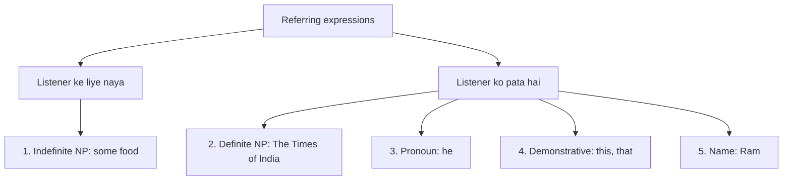
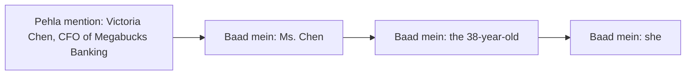

**Ek line mein:** <mark>Referring expressions ke paanch main types hain: indefinite noun phrases, definite noun phrases, pronouns, demonstratives aur names</mark>. <Cite id="class-nlp-asol" loc="p. 4" />

<Box kind="key">

**Ye points likho:**

- <mark>Reference resolution: har referring expression ka referent dhoondhna</mark> (jis cheez ko wo point karta hai).
- <mark>Indefinite NP: listener ke liye kuch naya (a, an, some)</mark>. "bring him **some food**".
- <mark>Definite NP: pehle se known ya identifiable cheez (the)</mark>. "**The Times of India**".
- <mark>Pronoun: repetition bachane ko noun ki jagah; ek definite reference</mark>. "Ram laughed as loud as **he** could".
- <mark>Demonstrative: this, that, these, those; point karta hai aur doori dikhata hai</mark>. "**This** is my book".
- <mark>Name: sabse simple aur direct form; context nahi chahiye</mark>. "**Ram**", India, Microsoft.

</Box>

## Core answer (5 marks, yahan ke har question ke liye)

<Box kind="definition">

A **referring expression** is a word or phrase used to point to a person, object or idea; the thing it points to is its **referent**. **Reference resolution** is the job of finding the referent of every referring expression. Language uses **five main types** of referring expressions. <Cite id="class-nlp-asol" loc="p. 4" /> <Cite id="class-nlp-asol" loc="p. 5" />

</Box>

| Type | Meaning | Class ka example |
|---|---|---|
| 1. Indefinite Noun Phrase | listener ke liye naya, pehle mention nahi hua; aam taur pe a, an ya some | "Ram had gone around one day to bring him **some food**." |
| 2. Definite Noun Phrase | ulta: pehle se known ya identifiable; aam taur pe the | "I used to read **The Times of India**." |
| 3. Pronoun | noun ki jagah repetition bachane ko; pehle mention hue noun ko refer karta hai | "Ram laughed as loud as **he** could." |
| 4. Demonstrative | specific entities ko point karta hai aur doori dikhata hai: this, that, these, those | "**This** is my book." "**That** is your car." |
| 5. Name | sabse simple aur direct; person, place, organization ya cheez ko identify karta hai; context nahi chahiye | "**Ram** laughed as loud as he could." India, Microsoft, Taj Mahal |

<Cite id="class-nlp-asol" loc="p. 4" /> <Cite id="class-nlp-asol" loc="p. 5" /> <Cite id="class-nlp-asol" loc="p. 6" />

**Conclusion:** expression ka type listener ko batata hai ki cheez nayi hai ya pehle se known, aur isliye uska referent kaise dhoondhna hai.

## Extended answer (10 marks): ye add karo

### 1. Har type kab use hota hai

- **Indefinite** phrases naya topic shuru karte hain ya aisi cheezon ke baare mein nayi jaankari dete hain jo listener ko abhi nahi pata. <Cite id="web-nlp-2-slp3-coref" loc="§24.1.1" />
- **Definite** phrases tab use hote hain jab speaker aur listener dono cheez ko identify kar sakte hain, isse baat clear rehti hai.
- **Pronouns** sentences ko smooth aur kam repetitive banate hain, lekin ye jaanne ke liye ki kaun ya kya, context pe depend karte hain. Ye un entities ke liye use hote hain jo bahut salient hon (listener ke dimaag mein strongly).
- **Demonstratives** paas-door dikhate hain: *this* speaker ke paas, *that* door. Ye akele (*that one*) ya noun se pehle (*this ingredient*) aa sakte hain.
- **Names** precise identification dete hain aur pehle ke context pe depend nahi karte; naye ya purane entities ko refer kar sakte hain.

### 2. Nayi aur purani jaankari

Jab entity pehli baar aati hai to mention lamba hota hai (full name aur role); jaise-jaise familiar hoti hai mentions chhote hote jaate hain, aakhir mein pronoun. <Cite id="web-nlp-2-slp3-coref" loc="§24.1.2" />

### 3. Pronouns sabse mushkil case hain

Indefinite phrases, definite phrases aur names mein referent identify karne ke liye kaafi words hote hain; pronoun mein lagbhag koi nahi, isliye use context se resolve karna padta hai. Use apne antecedent se number, person aur gender mein agree karna hota hai. <Cite id="web-nlp-2-slp3-coref" loc="§24.1.4" /> Algorithms ke liye Hobbs aur Centering ke answers dekho.

### 4. Ek worked sentence

"Taylor went to the store. She bought some groceries from The Big Bazaar. This was cheap."

| Expression | Type |
|---|---|
| Taylor | Name |
| the store | Definite NP |
| She | Pronoun (= Taylor) |
| some groceries | Indefinite NP |
| The Big Bazaar | Definite NP (name with *The*) |
| This | Demonstrative (shopping trip) |

### 5. Doosri languages

Kuch languages (Chinese, Japanese, Italian) pronoun ko poori tarah chhod sakti hain, ise **zero anaphora** kehte hain. <Cite id="web-nlp-2-slp3-coref" loc="§24.1.1" /> <Cite id="web-nlp-2-referring" />

## Har question mein kaise fit karein

- **"What are five types of referring expressions? Explain with the help of example."** (10 marks) <PYQ id="2023-12-ce/q3b" /> <PYQ id="assignment-2/q5d" />: core table aur diagram, phir sections 1 se 4.
- **"Define reference resolution and explain Five common types of referring expression."** (5 marks) <PYQ id="2026-05/q1b" />: definition line, paanch-row table har ek ke ek example ke saath, aur diagram.

## Exam tips

- **Paanchon order mein yaad rakho**: indefinite, definite, pronoun, demonstrative, name.
- Har ka **class example** do aur referring word underline karo.
- Ek-line test likho: **indefinite = naya, definite = known, pronoun = noun ki jagah, demonstrative = point karta hai, name = direct**.

Exam mein English mein likho.
