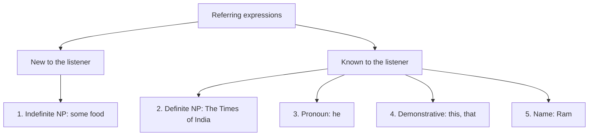
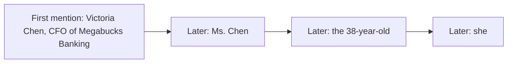

**In one line:** <mark>There are five main types of referring expressions: indefinite noun phrases, definite noun phrases, pronouns, demonstratives and names</mark>. <Cite id="class-nlp-asol" loc="p. 4" />

<Box kind="key">

**Key points to write:**

- <mark>Reference resolution: finding the referent of every referring expression</mark> (the thing it points to).
- <mark>Indefinite NP: something new to the listener (a, an, some)</mark>. "bring him **some food**".
- <mark>Definite NP: something already known or identifiable (the)</mark>. "**The Times of India**".
- <mark>Pronoun: replaces a noun to avoid repetition; a definite reference</mark>. "Ram laughed as loud as **he** could".
- <mark>Demonstrative: this, that, these, those; points and shows distance</mark>. "**This** is my book".
- <mark>Name: the simplest and most direct form; needs no context</mark>. "**Ram**", India, Microsoft.

</Box>

## Core answer (5 marks, fits every question here)

<Box kind="definition">

A **referring expression** is a word or phrase used to point to a person, object or idea; the thing it points to is its **referent**. **Reference resolution** is the job of finding the referent of every referring expression. Language uses **five main types** of referring expressions. <Cite id="class-nlp-asol" loc="p. 4" /> <Cite id="class-nlp-asol" loc="p. 5" />

</Box>

| Type | Meaning | Example from the class |
|---|---|---|
| 1. Indefinite Noun Phrase | refers to something new to the listener, not mentioned before; usually has a, an or some | "Ram had gone around one day to bring him **some food**." |
| 2. Definite Noun Phrase | the opposite: something already known or identifiable; usually has the | "I used to read **The Times of India**." |
| 3. Pronoun | used instead of a noun to avoid repetition; refers back to a noun already mentioned | "Ram laughed as loud as **he** could." |
| 4. Demonstrative | points to specific entities and shows distance: this, that, these, those | "**This** is my book." "**That** is your car." |
| 5. Name | simplest and most direct; identifies a person, place, organization or thing; needs no context | "**Ram** laughed as loud as he could." India, Microsoft, Taj Mahal |

<Cite id="class-nlp-asol" loc="p. 4" /> <Cite id="class-nlp-asol" loc="p. 5" /> <Cite id="class-nlp-asol" loc="p. 6" />

**Conclusion:** the type of expression tells the listener whether the thing is new or already known, and so how to look for its referent.

## Extended answer (10 marks): add these

### 1. When each type is used

- **Indefinite** phrases start a new topic or add new information about things the listener does not know yet. <Cite id="web-nlp-2-slp3-coref" loc="§24.1.1" />
- **Definite** phrases are used when speaker and listener can both identify the thing, which keeps the talk clear.
- **Pronouns** make sentences smoother and less repetitive, but they depend on context to know who or what they mean. They are used for entities that are very salient (strongly in the listener's mind).
- **Demonstratives** show nearness: *this* is near the speaker, *that* is far. They can appear alone (*that one*) or before a noun (*this ingredient*).
- **Names** give precise identification and do not depend on earlier context; they can refer to new or old entities.

### 2. New and old information

When an entity is first introduced its mention is long (full name and role); as it becomes more familiar, the mentions get shorter, ending in a pronoun. <Cite id="web-nlp-2-slp3-coref" loc="§24.1.2" />

### 3. Pronouns are the hard case

Indefinite phrases, definite phrases and names carry enough words to identify the referent; a pronoun carries almost none, so it needs resolution from the context. It must agree with its antecedent in number, person and gender. <Cite id="web-nlp-2-slp3-coref" loc="§24.1.4" /> For the algorithms see the Hobbs and Centering answers.

### 4. A worked sentence

"Taylor went to the store. She bought some groceries from The Big Bazaar. This was cheap."

| Expression | Type |
|---|---|
| Taylor | Name |
| the store | Definite NP |
| She | Pronoun (= Taylor) |
| some groceries | Indefinite NP |
| The Big Bazaar | Definite NP (a name with *The*) |
| This | Demonstrative (the shopping trip) |

### 5. Other languages

Some languages (Chinese, Japanese, Italian) can leave the pronoun out completely, called **zero anaphora**. <Cite id="web-nlp-2-slp3-coref" loc="§24.1.1" /> <Cite id="web-nlp-2-referring" />

## Fit it to each question

- **"What are five types of referring expressions? Explain with the help of example."** (10 marks) <PYQ id="2023-12-ce/q3b" /> <PYQ id="assignment-2/q5d" />: the core table and diagram, then sections 1 to 4.
- **"Define reference resolution and explain Five common types of referring expression."** (5 marks) <PYQ id="2026-05/q1b" />: the definition line, the five-row table with one example each, and the diagram.

## Exam tips

- **Learn the five in order**: indefinite, definite, pronoun, demonstrative, name.
- Give the **class example** for each, and underline the referring word.
- Write the one-line test: **indefinite = new, definite = known, pronoun = replaces a noun, demonstrative = points, name = direct**.
