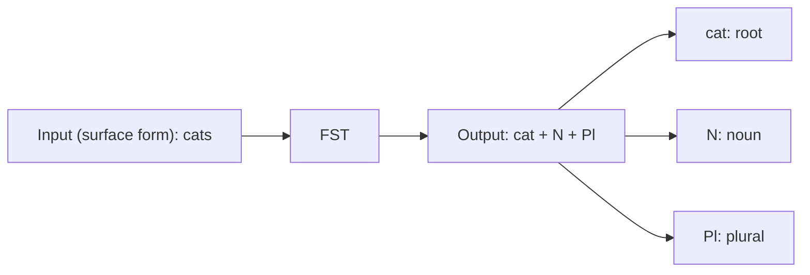
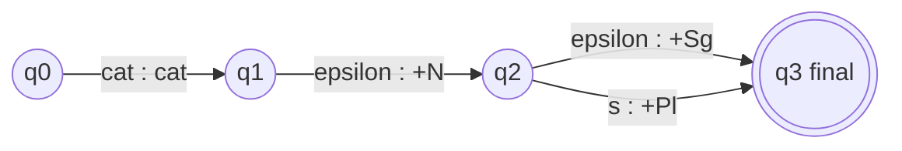

**Ek line mein:** <mark>Finite State Transducer (FST) ek FSA ka extension hai jo input sequences ko output sequences se map karta hai</mark>; morphological parsing mein ye <mark>word ke surface form ko root plus tags se map karta hai</mark>, jaise cats se cat + N + Pl. <Cite id="class-nlp-pyq2" loc="p. 9" />

<Box kind="key">

**FST ya morphological analysis ke har question mein ye points likho:**

- <mark>FSA sirf accept ya reject karta hai; FST input ko output mein transform karta hai</mark>. Har transition **input : output** likhte hain.
- Formal definition: <mark>$T = (Q, \Sigma, \Gamma, q_0, F)$</mark> (states, input alphabet, output alphabet, start state, final states).
- <mark>Morphological analysis ka output = lemma (root) + morphological tags</mark>.
- Chaar outputs yaad karo: <mark>walked = walk + V + Past, went = go + V + Past, cat = cat + N + Sg, cats = cat + N + Pl</mark>.
- Role: <mark>Surface word, phir FST, phir morphological analysis</mark>.
- Irregular forms (went, mice) ke liye **dictionary entry** chahiye; ending rule unhe nahi bana sakta.

</Box>

## Core answer (5 marks, yahan ke har question ke liye)

<Box kind="definition">

**FST:** an extension of a finite state automaton that maps input sequences to output sequences. An FSA only accepts or rejects an input; an FST transforms it. <Cite id="class-nlp-pyq2" loc="p. 9" />

</Box>

**Morphological analysis ka output** lemma (root) plus morphological tags hai. <Cite id="class-nlp-pyq2" loc="p. 9" />

| Word type | Input word | Morphological analysis (output) |
|---|---|---|
| Regular verb | walked | walk + V + Past |
| Irregular verb | went | go + V + Past |
| Singular noun | cat | cat + N + Sg |
| Plural noun | cats | cat + N + Pl |

*Went* se *go* isliye milta hai kyunki irregular form ka lemma dictionary se aata hai. <Cite id="class-nlp-pyq2" loc="p. 9" />

**Morphological parsing mein role:** FST word ke surface form ko uske morphological representation (root ya stem plus noun, verb, singular, plural, tense) se map karta hai. <Cite id="class-nlp-pyq2" loc="p. 10" />

**Conclusion:** FST dono directions deta hai: parsing ke liye word se analysis, generation ke liye analysis se word. <Cite id="web-nlp-1-wiki-fst" />

## Extended answer (10 marks): ye add karo

### 1. FST ki definition aur parts

$T = (Q, \Sigma, \Gamma, q_0, F)$: $Q$ states ka finite set, $\Sigma$ input alphabet, $\Gamma$ output alphabet, $q_0$ initial state, $F$ final states. <Cite id="class-nlp-pyq2" loc="p. 9" />

| Machine | Transition label | Answer |
|---|---|---|
| FSA | ek symbol | Accept ya reject |
| FST | input : output | Output string likhta hai |

### 2. Regular aur plural nouns ke liye FST (step-by-step run ke saath)

1. q0 pe input *cats* ke saath shuru karo. Stem *cat* padho aur copy karo (cat : cat).
2. Kuch padhe bina noun tag likho (epsilon : +N).
3. *s* padho aur +Pl likho. Agar kuch padhne ko nahi bacha, doosra arc lo aur +Sg likho.
4. Final state mein ruko: *cats* se **cat + N + Pl**, *cat* se **cat + N + Sg**.

*mice* jaise irregular plural ke liye ek extra arc chahiye jo *mice* padhe aur *mouse +N +Pl* likhe.

### 3. FSA nahi, FST kyun

- FSA sirf bata sakta hai ki *cats* valid word hai; FST ye bhi batata hai ki iska **matlab** kya hai (stem, noun, plural).
- Wahi FST ulta chalao to analysis se surface word **generate** hota hai.
- Fast aur rule based hai, isliye rich inflection wali languages ke liye achha hai. <Cite id="class-nlp-pyq2" loc="p. 6" /> <Cite id="web-nlp-1-wiki-morphology" />

## Har question mein kaise fit karein

- **"Represent output of morphological analysis for Regular verb, Irregular verb, singular noun, plural noun. Also Explain Role of FST in Morphological Parsing with an example"** (10 marks) <PYQ id="2023-05-ce/q2b" />: chaar-row table, FST definition, role aur cats diagram; section 2 add karo.
- **"Design FST for regular and plural nouns."** (10 marks) <PYQ id="2024-12-ce/q2a" />: do lines mein definition, section 2 ka diagram arc table aur step-by-step run ke saath, mice arc.
- **"What is the output of Morphological Analysis for Regular Verb, Irregular verb, Singular noun, Plural noun."** (5 marks) <PYQ id="2025-05-ce/q1b" />: chaar-row table aur *went* ki explanation; FST ki zaroorat nahi.
- **"Explain finite state transducer with suitable diagram and example."** (10 marks) <PYQ id="2026-05/q2b" />: definition, formal tuple, cats diagram, section 2 aur section 3.

## Exam tips

- **FST draw karo**, arcs ko input : output se label karo; epsilon arcs bhi label karo.
- Chaar outputs exactly **root + tag + tag** (walk + V + Past) likho.
- Hamesha likho **FSA accepts or rejects, FST transforms**; ye key sentence hai.

Exam mein English mein likho.
