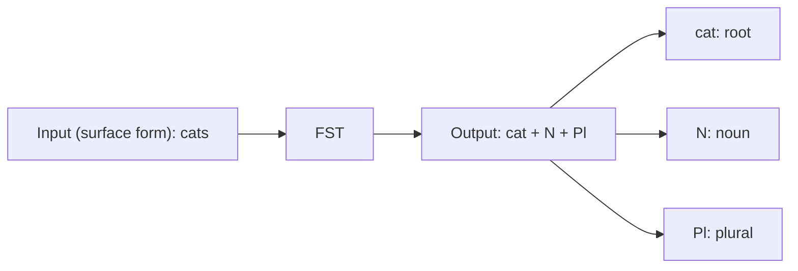
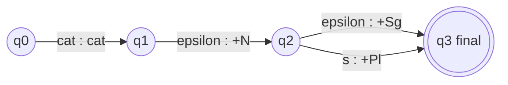

**In one line:** <mark>A Finite State Transducer (FST) is an extension of an FSA that maps input sequences to output sequences</mark>; in morphological parsing it <mark>maps the surface form of a word to its root plus tags</mark>, for example cats to cat + N + Pl. <Cite id="class-nlp-pyq2" loc="p. 9" />

<Box kind="key">

**Key points to write (any FST or morphological analysis question):**

- <mark>FSA only accepts or rejects; an FST transforms input into output</mark>. Every transition is written **input : output**.
- Formal definition: <mark>$T = (Q, \Sigma, \Gamma, q_0, F)$</mark> (states, input alphabet, output alphabet, start state, final states).
- <mark>Output of morphological analysis = lemma (root) + morphological tags</mark>.
- Four outputs to learn: <mark>walked = walk + V + Past, went = go + V + Past, cat = cat + N + Sg, cats = cat + N + Pl</mark>.
- Role: <mark>Surface word, then FST, then morphological analysis</mark>.
- Irregular forms (went, mice) need a **dictionary entry**; the ending rule cannot make them.

</Box>

## Core answer (5 marks, fits every question here)

<Box kind="definition">

**FST:** an extension of a finite state automaton that maps input sequences to output sequences. An FSA only accepts or rejects an input; an FST transforms it. <Cite id="class-nlp-pyq2" loc="p. 9" />

</Box>

**Output of morphological analysis** is the lemma (root) plus morphological tags. <Cite id="class-nlp-pyq2" loc="p. 9" />

| Word type | Input word | Morphological analysis (output) |
|---|---|---|
| Regular verb | walked | walk + V + Past |
| Irregular verb | went | go + V + Past |
| Singular noun | cat | cat + N + Sg |
| Plural noun | cats | cat + N + Pl |

*Went* gives *go* because the lemma of an irregular form is found in a dictionary. <Cite id="class-nlp-pyq2" loc="p. 9" />

**Role in morphological parsing:** the FST maps the surface form of a word to its morphological representation (root or stem plus noun, verb, singular, plural, tense). <Cite id="class-nlp-pyq2" loc="p. 10" />

**Conclusion:** the FST gives both directions: word to analysis for parsing, analysis to word for generation. <Cite id="web-nlp-1-wiki-fst" />

## Extended answer (10 marks): add these

### 1. FST definition and parts

$T = (Q, \Sigma, \Gamma, q_0, F)$: $Q$ finite set of states, $\Sigma$ input alphabet, $\Gamma$ output alphabet, $q_0$ initial state, $F$ final states. <Cite id="class-nlp-pyq2" loc="p. 9" />

| Machine | Transition label | Answer |
|---|---|---|
| FSA | one symbol | Accept or reject |
| FST | input : output | Writes an output string |

### 2. FST for regular and plural nouns (with a step-by-step run)

1. Start at q0 with the input *cats*. Read the stem *cat* and copy it (cat : cat).
2. Write the noun tag without reading anything (epsilon : +N).
3. Read *s* and write +Pl. If nothing is left to read, take the other arc and write +Sg.
4. Stop in the final state: *cats* gives **cat + N + Pl**, *cat* gives **cat + N + Sg**.

An irregular plural such as *mice* needs one extra arc that reads *mice* and writes *mouse +N +Pl*.

### 3. Why FST and not FSA

- An FSA can only say that *cats* is a valid word; the FST also says what it **means** (stem, noun, plural).
- The same FST run backwards **generates** the surface word from the analysis.
- It is fast and rule based, so it works well for languages with rich inflection. <Cite id="class-nlp-pyq2" loc="p. 6" /> <Cite id="web-nlp-1-wiki-morphology" />

## Fit it to each question

- **"Represent output of morphological analysis for Regular verb, Irregular verb, singular noun, plural noun. Also Explain Role of FST in Morphological Parsing with an example"** (10 marks) <PYQ id="2023-05-ce/q2b" />: four-row table, FST definition, role and the cats diagram; add section 2.
- **"Design FST for regular and plural nouns."** (10 marks) <PYQ id="2024-12-ce/q2a" />: definition in two lines, the section 2 diagram with the arc table and the step-by-step run, the mice arc.
- **"What is the output of Morphological Analysis for Regular Verb, Irregular verb, Singular noun, Plural noun."** (5 marks) <PYQ id="2025-05-ce/q1b" />: the four-row table and the explanation of *went*; no FST needed.
- **"Explain finite state transducer with suitable diagram and example."** (10 marks) <PYQ id="2026-05/q2b" />: definition, formal tuple, the cats diagram, section 2 and section 3.

## Exam tips

- **Draw the FST** with arcs labelled input : output; label epsilon arcs too.
- Write the four outputs exactly as **root + tag + tag** (walk + V + Past).
- Always say **FSA accepts or rejects, FST transforms**; it is the key sentence.
