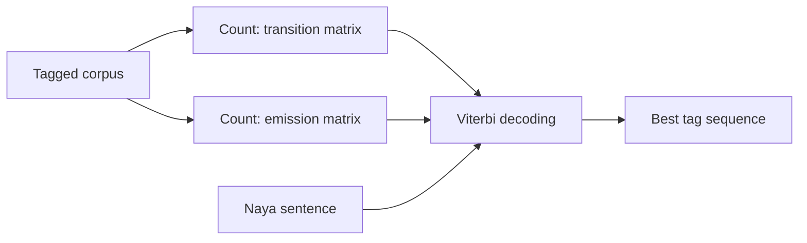
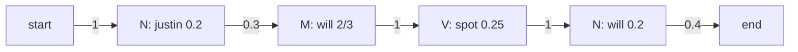

**Ek line mein:** <mark>HMM ke dono tables tagged corpus mein ginkar milte hain</mark>: <mark>transition $P(t_i \mid t_{i-1}) = C(t_{i-1}, t_i)/C(t_{i-1})$ aur emission $P(w_i \mid t_i) = C(t_i, w_i)/C(t_i)$</mark>; phir Viterbi algorithm best tag sequence dhoondhta hai. <Cite id="class-nlp-pyq3" loc="p. 7" />

<Box kind="key">

**HMM numerical ke har question mein ye points likho:**

- <mark>Transition probability: ek tag ke baad dusra tag kitna likely hai</mark>; <mark>emission probability: ek tag word kitna produce karta hai</mark>.
- Pehle tags count karo (**start `<s>` aur end `</s>` ke saath**), phir divide karo.
- <mark>Transition aur emission tables ki har row ka sum 1</mark> hona chahiye.
- Jis word ke do tags hain (Will noun aur modal) wo **do rows mein** aata hai.
- <mark>Viterbi: $v_t(j) = \max_i v_{t-1}(i) \cdot P(j \mid i) \cdot P(w_t \mid j)$</mark>, phir best path peeche trace karo.
- Aakhir mein **end probability** aur final tag sequence likho.

</Box>

## Core answer (5 marks, yahan ke har question ke liye)

<Box kind="definition">

An **HMM tagger** has hidden states (the tags) and observations (the words). Ye do kism ki probabilities use karta hai, dono tagged corpus mein ginkar milti hain: **transition** (tag se next tag) aur **emission** (tag se word). <Cite id="class-nlp-pyq3" loc="p. 3" /> <Cite id="class-nlp-pyq3" loc="p. 7" />

</Box>

$$
P(t_i \mid t_{i-1}) = \frac{C(t_{i-1}, t_i)}{C(t_{i-1})}, \qquad P(w_i \mid t_i) = \frac{C(t_i, w_i)}{C(t_i)}
$$

**Method:**

1. Har sentence mein `<s>` aur `</s>` lagao (start ka count = sentences ki sankhya).
2. Har tag, har tag-to-tag pair aur har tag-word pair count karo.
3. Pair counts ko pehle tag ke count (transition) ya tag ke count (emission) se divide karo.
4. Check karo ki har row ka sum 1 hai.
5. Naye sentence ko tag karne ke liye Viterbi chalao: har word aur tag ke liye best path probability rakho, phir trace back karo.

**Conclusion:** counting se do tables milte hain, aur Viterbi sentence ko tag karta hai.

## Extended answer (10 marks): ye add karo

### 1. Poora solution

<Sum>

<Given>

chaar sentences, tags N (noun), M (modal), V (verb): Martin/N Justin/N can/M watch/V Will/N; Spot/N will/M watch/V Martin/N; Will/N Justin/N spot/V Martin/N; Martin/N will/M pat/V Spot/N. Test sentence: *Justin will spot Will*. Yahan *Will*/*will* aur *Spot*/*spot* ko same word maana gaya hai. <Cite id="class-nlp-pyq3" loc="p. 7" />

</Given>

<Find>

transition matrix, emission matrix, aur test sentence ke most likely tags.

</Find>

<Steps>

1. **Tags count karo.** N = 10, M = 3 (can, will, will), V = 4 (watch, watch, spot, pat), start `<s>` = 4. Kul 17 words. *Reason: ye denominators hain.*
2. **Transitions** $P(t_i \mid t_{i-1}) = C(t_{i-1}, t_i) / C(t_{i-1})$. Chaaron sentences N se shuru hote hain. N se: N ko 2, M ko 3, V ko 1, `</s>` ko 4 (kul 10). M se: V ko 3. V se: N ko 4.

| From \ To | N | M | V | `</s>` |
|---|---|---|---|---|
| `<s>` | 4/4 = 1 | 0 | 0 | 0 |
| N | 2/10 = 0.2 | 3/10 = 0.3 | 1/10 = 0.1 | 4/10 = 0.4 |
| M | 0 | 0 | 3/3 = 1 | 0 |
| V | 4/4 = 1 | 0 | 0 | 0 |

3. **Emissions** $P(w \mid t) = C(t, w) / C(t)$:

| Tag | martin | justin | will | spot | can | watch | pat |
|---|---|---|---|---|---|---|---|
| N | 4/10 = 0.4 | 2/10 = 0.2 | 2/10 = 0.2 | 2/10 = 0.2 | 0 | 0 | 0 |
| M | 0 | 0 | 2/3 | 0 | 1/3 | 0 | 0 |
| V | 0 | 0 | 0 | 1/4 | 0 | 2/4 = 0.5 | 1/4 |

4. **Viterbi trellis.** Har cell = (pichhla cell) × transition × emission. Start: $P(N \mid \langle s\rangle)=1$.

| Tag | justin | will | spot | will |
|---|---|---|---|---|
| N | $1 \times 0.2 = 0.2$ | $0.2 \times 0.2 \times 0.2 = 0.008$ | $0.008 \times 0.2 \times 0.2 = 0.00032$ | $0.01 \times 1 \times 0.2 = 0.002$ (V se) |
| M | 0 | $0.2 \times 0.3 \times \frac23 = 0.04$ | 0 | $0.00032 \times 0.3 \times \frac23 = 0.000064$ |
| V | 0 | 0 | $0.04 \times 1 \times 0.25 = 0.01$ (M se) | 0 |

5. **End.** $0.002 \times P(\langle /s\rangle \mid N) = 0.002 \times 0.4 = 0.0008$. M wala cell end nahi ho sakta (M se `</s>` ka 0). Trace back: will V se, spot M se, justin ka will N se.

</Steps>

<Answer>

*Justin/N will/M spot/V Will/N*, probability $0.0008$.

</Answer>

<Box kind="verify">

Transition matrix ki row sums 1 hain (N: $0.2+0.3+0.1+0.4$). Winning path seedha multiply karo: $1 \times 0.2 \times 0.3 \times \frac23 \times 1 \times 0.25 \times 1 \times 0.2 \times 0.4 = 0.0008$. Sabse achha rival, N N V N, $0.000016$ deta hai, bahut chhota.

</Box>

</Sum>

### 2. Baaki do corpora kaise alag hain

| Corpus | Tag counts | Key probabilities | Best tags |
|---|---|---|---|
| a dog chases a cat / the dog barks loudly / a cat runs fast | DT 4, NN 4, V 3, RB 2 | NN to V 3/4, NN to `</s>` 1/4, V to RB 2/3; DT: a 3/4, the 1/4 | The cat chases the dog: DT NN V DT NN, probability 1/3072 |
| the students pass the test / ... wait for the result / teachers test students | DT 4, NN 6, V 3, P 1 | NN to V 1/2, NN to `</s>` 1/2, V to DT, P, NN 1/3 each | The students wait for the test: DT NN V P DT NN, probability 1/648 |

<Cite id="web-nlp-1-slp3-hmm" /> <Cite id="web-nlp-1-wiki-viterbi" />

## Har question mein kaise fit karein

- **"Corpus table (Martin Justin can watch Will ...) Create Transition Matrix & Emission Probability Matrix. Statement is "Justin will spot Will". Apply Hidden Markov Model and do POS tagging"** (10 marks) <PYQ id="2023-05-ce/q4a" /> <PYQ id="2025-05-ce/q4a" />: formulas likho, tags count karo, dono tables, Viterbi trellis aur final tags (section 1).
- **"Consider the following corpus `<s>` the/DT students/NN pass/V the/DT test/NN `</s>` ... Compute ..."** (10 marks) <PYQ id="2023-12-ce/q3a" />: wahi method: tag counts 4, 6, 3, 1, dono tables section 2 ke summary se, phir test sentence ke liye Viterbi.
- **"Consider the following corpus `<s>` a/DT dog/NN chases/V a/DT cat/NN `</s>` ... Compute the emission and transition ..."** (10 marks) <PYQ id="2024-12-ce/q3a" />: dog corpus pe wahi method; tables section 2 mein hain; sentence poochha ho to Viterbi chalao (yahan sirf ek path possible hai).

## Exam tips

- **Counting dikhao** (pehle tag counts); examiner denominators pe marks dete hain.
- **Har row ka sum 1 check karo** aur likho; isse table sahi dikhta hai.
- Aakhir mein final tags aur **best path ki probability** box mein likho.

Exam mein English mein likho.
