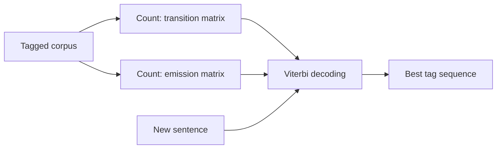
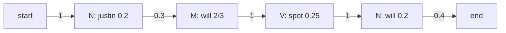

**In one line:** <mark>Both HMM tables are found by counting in a tagged corpus</mark>: <mark>transition $P(t_i \mid t_{i-1}) = C(t_{i-1}, t_i)/C(t_{i-1})$ and emission $P(w_i \mid t_i) = C(t_i, w_i)/C(t_i)$</mark>; the Viterbi algorithm then finds the best tag sequence. <Cite id="class-nlp-pyq3" loc="p. 7" />

<Box kind="key">

**Key points to write (any HMM numerical):**

- <mark>Transition probability: how likely a tag follows the previous tag</mark>; <mark>emission probability: how likely a tag produces a word</mark>.
- Count tags first (**including start `<s>` and end `</s>`**), then divide.
- <mark>Every row of the transition and emission tables must add up to 1</mark>.
- A word that is tagged two ways (Will as noun and modal) appears in **two rows**.
- <mark>Viterbi: $v_t(j) = \max_i v_{t-1}(i) \cdot P(j \mid i) \cdot P(w_t \mid j)$</mark>, then follow the best path back.
- Finish with the **end probability** and the final tag sequence.

</Box>

## Core answer (5 marks, fits every question here)

<Box kind="definition">

An **HMM tagger** has hidden states (the tags) and observations (the words). It uses two kinds of probabilities, both learned by counting in a tagged corpus: **transition** (tag to next tag) and **emission** (tag to word). <Cite id="class-nlp-pyq3" loc="p. 3" /> <Cite id="class-nlp-pyq3" loc="p. 7" />

</Box>

$$
P(t_i \mid t_{i-1}) = \frac{C(t_{i-1}, t_i)}{C(t_{i-1})}, \qquad P(w_i \mid t_i) = \frac{C(t_i, w_i)}{C(t_i)}
$$

**Method:**

1. Add `<s>` and `</s>` to every sentence (the start has count = number of sentences).
2. Count each tag, each tag-to-tag pair and each tag-word pair.
3. Divide pair counts by the count of the first tag (transition) or of the tag (emission).
4. Check that every row adds up to 1.
5. To tag a new sentence, run Viterbi: for each word and tag keep the best path probability, then trace back.

**Conclusion:** counting gives the two tables, and Viterbi tags the sentence.

## Extended answer (10 marks): add these

### 1. Full solution

<Sum>

<Given>

four sentences with tags N (noun), M (modal), V (verb): Martin/N Justin/N can/M watch/V Will/N; Spot/N will/M watch/V Martin/N; Will/N Justin/N spot/V Martin/N; Martin/N will/M pat/V Spot/N. Test sentence: *Justin will spot Will*. Here *Will*/*will* and *Spot*/*spot* are treated as the same word. <Cite id="class-nlp-pyq3" loc="p. 7" />

</Given>

<Find>

the transition matrix, the emission matrix, and the most likely tags for the test sentence.

</Find>

<Steps>

1. **Count tags.** N = 10, M = 3 (can, will, will), V = 4 (watch, watch, spot, pat), start `<s>` = 4. Total 17 words. *Reason: these are the denominators.*
2. **Transitions** $P(t_i \mid t_{i-1}) = C(t_{i-1}, t_i) / C(t_{i-1})$. All 4 sentences start with N. From N: to N 2, to M 3, to V 1, to `</s>` 4 (10 in all). From M: to V 3. From V: to N 4.

| From \ To | N | M | V | `</s>` |
|---|---|---|---|---|
| `<s>` | 4/4 = 1 | 0 | 0 | 0 |
| N | 2/10 = 0.2 | 3/10 = 0.3 | 1/10 = 0.1 | 4/10 = 0.4 |
| M | 0 | 0 | 3/3 = 1 | 0 |
| V | 4/4 = 1 | 0 | 0 | 0 |

3. **Emissions** $P(w \mid t) = C(t, w) / C(t)$:

| Tag | martin | justin | will | spot | can | watch | pat |
|---|---|---|---|---|---|---|---|
| N | 4/10 = 0.4 | 2/10 = 0.2 | 2/10 = 0.2 | 2/10 = 0.2 | 0 | 0 | 0 |
| M | 0 | 0 | 2/3 | 0 | 1/3 | 0 | 0 |
| V | 0 | 0 | 0 | 1/4 | 0 | 2/4 = 0.5 | 1/4 |

4. **Viterbi trellis.** Each cell = (previous cell) × transition × emission. Start: $P(N \mid \langle s\rangle)=1$.

| Tag | justin | will | spot | will |
|---|---|---|---|---|
| N | $1 \times 0.2 = 0.2$ | $0.2 \times 0.2 \times 0.2 = 0.008$ | $0.008 \times 0.2 \times 0.2 = 0.00032$ | $0.01 \times 1 \times 0.2 = 0.002$ (from V) |
| M | 0 | $0.2 \times 0.3 \times \frac23 = 0.04$ | 0 | $0.00032 \times 0.3 \times \frac23 = 0.000064$ |
| V | 0 | 0 | $0.04 \times 1 \times 0.25 = 0.01$ (from M) | 0 |

5. **End.** $0.002 \times P(\langle /s\rangle \mid N) = 0.002 \times 0.4 = 0.0008$. The M cell cannot end (M to `</s>` is 0). Trace back: will from V, spot from M, justin's will from N.

</Steps>

<Answer>

*Justin/N will/M spot/V Will/N*, with probability $0.0008$.

</Answer>

<Box kind="verify">

Row sums of the transition matrix are 1 (N: $0.2+0.3+0.1+0.4$). Multiply the winning path directly: $1 \times 0.2 \times 0.3 \times \frac23 \times 1 \times 0.25 \times 1 \times 0.2 \times 0.4 = 0.0008$. The best rival, N N V N, gives $0.000016$, far smaller.

</Box>

</Sum>

### 2. How the other two corpora differ

| Corpus | Tag counts | Key probabilities | Best tags |
|---|---|---|---|
| a dog chases a cat / the dog barks loudly / a cat runs fast | DT 4, NN 4, V 3, RB 2 | NN to V 3/4, NN to `</s>` 1/4, V to RB 2/3; DT: a 3/4, the 1/4 | The cat chases the dog: DT NN V DT NN, probability 1/3072 |
| the students pass the test / ... wait for the result / teachers test students | DT 4, NN 6, V 3, P 1 | NN to V 1/2, NN to `</s>` 1/2, V to DT, P, NN 1/3 each | The students wait for the test: DT NN V P DT NN, probability 1/648 |

<Cite id="web-nlp-1-slp3-hmm" /> <Cite id="web-nlp-1-wiki-viterbi" />

## Fit it to each question

- **"Corpus table (Martin Justin can watch Will ...) Create Transition Matrix & Emission Probability Matrix. Statement is "Justin will spot Will". Apply Hidden Markov Model and do POS tagging"** (10 marks) <PYQ id="2023-05-ce/q4a" /> <PYQ id="2025-05-ce/q4a" />: write the formulas, count tags, both tables, the Viterbi trellis and the final tags (section 1).
- **"Consider the following corpus `<s>` the/DT students/NN pass/V the/DT test/NN `</s>` ... Compute ..."** (10 marks) <PYQ id="2023-12-ce/q3a" />: same method: tag counts 4, 6, 3, 1, both tables from the section 2 summary, then Viterbi for the test sentence.
- **"Consider the following corpus `<s>` a/DT dog/NN chases/V a/DT cat/NN `</s>` ... Compute the emission and transition ..."** (10 marks) <PYQ id="2024-12-ce/q3a" />: same method on the dog corpus; tables are in section 2; if a sentence is asked, run Viterbi (only one path is possible here).

## Exam tips

- **Show the counting** (tag counts first); examiners award marks for the denominators.
- **Check each row adds up to 1** and say so; it shows the table is right.
- Put the final tags and the **probability of the best path** in a box at the end.
