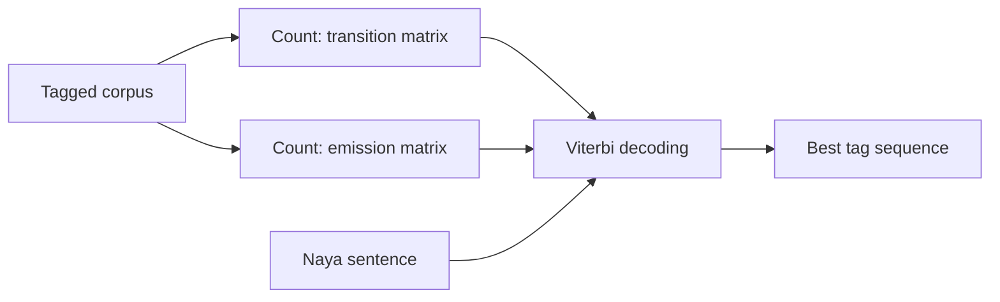
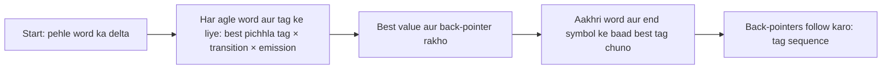

**Ek line mein:** <mark>Hidden Markov Model ek statistical model hai jo aise systems samajhne ke liye hai jinke asli states directly dikhte nahi, par unpe depend karne wale outcomes dikhte hain</mark>; POS tagging mein <mark>tags hidden hain aur words wo hain jo hum dekhte hain</mark>. <Cite id="class-nlp-pyq3" loc="p. 2" />

<Box kind="key">

**Ye points likho:**

- <mark>HMM: states hidden, observations visible</mark>. Tagging mein: **states = tags, observations = words**.
- Paanch components: <mark>states, observations, transition probabilities, emission probabilities, initial state probabilities</mark>.
- Dono tables <mark>tagged corpus mein ginkar</mark> milte hain: $P(t_j \mid t_i) = \text{Count}(t_i \to t_j)/\text{Count}(t_i)$, $P(\text{word} \mid \text{tag}) = \text{Count}(\text{word}, \text{tag})/\text{Count}(\text{tag})$.
- <mark>Viterbi algorithm highest probability wala tag sequence dhoondhta hai</mark>, back-pointers ke saath.
- Limitation: <mark>next tag sirf current tag pe depend karta hai</mark>; extra clues use nahi kar sakta.
- Analogy: aap mausam dekh nahi sakte, par log kya kar rahe hain wo dekhte ho.

</Box>

## Core answer (5 marks, yahan ke har question ke liye)

<Box kind="definition">

**Hidden Markov Model (HMM):** a statistical model used to understand systems where the actual states are not directly visible, but we can see outcomes that depend on those hidden states. POS tagging mein tags hidden hain aur words wo hain jo hum dekhte hain, isliye HMM words ke most likely tags dhoondhta hai. <Cite id="class-nlp-pyq3" loc="p. 2" />

</Box>

**Roz ki analogy:** aap bahar dekhke mausam nahi dekh sakte, par log kya karte hain (walk, shop, clean) wo dekhte ho; wo actions hidden mausam ka clue dete hain.

**Components** <Cite id="class-nlp-pyq3" loc="p. 3" />

1. **States:** hidden conditions (tags).
2. **Observations:** jo signals hum dekh sakte hain (words).
3. **Transition probabilities:** ek state se doosre state mein jaane ki probability (tag se next tag).
4. **Emission probabilities:** state ke observation produce karne ki probability (tag se word). Example: Rainy mein walk 0.1, shop 0.4, clean 0.5.
5. **Initial state probabilities:** system har state se shuru hone ki probability.

**Conclusion:** HMM tagger transition aur emission probabilities (counting se mili) aur best tags chunne ke liye Viterbi use karta hai.

## Extended answer (10 marks): ye add karo

### 1. Tagged corpus se HMM seekhna

Model counting se seekha jaata hai. <Cite id="class-nlp-pyq3" loc="p. 7" />

$$
P(t_j \mid t_i) = \frac{\text{Count}(t_i \to t_j)}{\text{Count}(t_i)}, \qquad P(\text{word} \mid \text{tag}) = \frac{\text{Count}(\text{word}, \text{tag})}{\text{Count}(\text{tag})}
$$

### 2. Viterbi algorithm se tagging

$\delta_t(j)$ wo best probability hai jo kisi bhi tag path ki ho jo word $t$ pe tag $j$ pe pahunche, pichhle tag ke back-pointer ke saath. Aakhir mein back-pointers follow karke tags padhte hain. <Cite id="class-nlp-pyq3" loc="p. 7" /> <Cite id="web-nlp-1-wiki-viterbi" />

$$
\delta_t(j) = \max_i \; \delta_{t-1}(i) \cdot P(j \mid i) \cdot P(w_t \mid j)
$$

### 3. Ek chhota scoring example

Tag sequence ka score uske transitions aur emissions ko multiply karke milta hai. Dog corpus (`<s>` a/DT dog/NN chases/V a/DT cat/NN `</s>`; `<s>` the/DT dog/NN barks/V loudly/RB `</s>`; `<s>` a/DT cat/NN runs/V fast/RB `</s>`) mein sequence *the/DT dog/NN barks/V* ka score $P(DT|\langle s\rangle)\,P(the|DT)\,P(NN|DT)\,P(dog|NN)\,P(V|NN)\,P(barks|V) = 1 \times \tfrac14 \times 1 \times \tfrac12 \times \tfrac34 \times \tfrac13 = \tfrac1{32}$ hai. <Cite id="web-nlp-1-slp3-hmm" />

### 4. Advantages aur limitations

| Advantages | Limitations |
|---|---|
| Simple: counting se seekha jaata hai | Next tag sirf current tag pe depend karta hai (independence assumption) <Cite id="class-nlp-pyq3" loc="p. 5" /> |
| Viterbi se fast decoding | Extra clues (word ending, capital letter) aasani se use nahi kar sakta |
| Kaafi tagged data ho to achha chalta hai | Bada labelled corpus chahiye; unseen words problem hain |

<Cite id="web-nlp-1-wiki-hmm" /> <Cite id="web-nlp-1-wiki-pos" />

## Har question mein kaise fit karein

- **"Explain hidden Markov model for POS based tagging."** (10 marks) <PYQ id="2024-05-ce/q3a" /> <PYQ id="2025-05/q4a" /> <PYQ id="assignment-1/q3b" />: definition, analogy aur diagram, paanch components, phir section 1 aur 2 (formulas aur Viterbi) aur section 4 ki limitation. Time ho to section 3 add karo.

## Exam tips

- Mausam ki picture ya do-table flow **draw karo**; diagram ka mark milta hai.
- **Paanch components** numbered list mein naam se likho.
- Dono **count formulas** likho aur kaho ki Viterbi best path dhoondhta hai.

Exam mein English mein likho.
