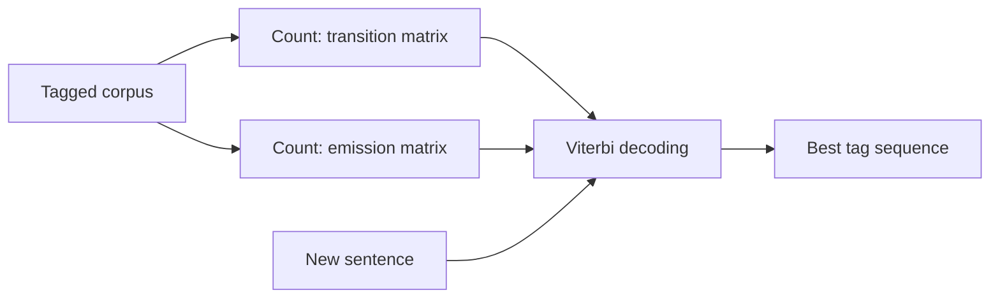
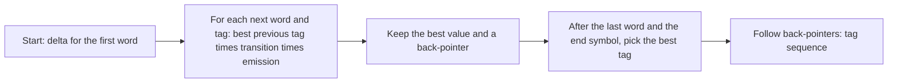

**In one line:** <mark>A Hidden Markov Model is a statistical model used to understand systems where the actual states are not directly visible, but we can see outcomes that depend on those hidden states</mark>; for POS tagging <mark>the tags are hidden and the words are what we see</mark>. <Cite id="class-nlp-pyq3" loc="p. 2" />

<Box kind="key">

**Key points to write:**

- <mark>HMM: states are hidden, observations are visible</mark>. In tagging: **states = tags, observations = words**.
- Five components: <mark>states, observations, transition probabilities, emission probabilities, initial state probabilities</mark>.
- Both tables come from <mark>counting in a tagged corpus</mark>: $P(t_j \mid t_i) = \text{Count}(t_i \to t_j)/\text{Count}(t_i)$, $P(\text{word} \mid \text{tag}) = \text{Count}(\text{word}, \text{tag})/\text{Count}(\text{tag})$.
- <mark>Viterbi algorithm finds the tag sequence with the highest probability</mark>, using back-pointers.
- Limitation: <mark>next tag depends only on the current tag</mark>; cannot use extra clues.
- Analogy: you cannot see the weather, but you watch what people do.

</Box>

## Core answer (5 marks, fits every question here)

<Box kind="definition">

**Hidden Markov Model (HMM):** a statistical model used to understand systems where the actual states are not directly visible, but we can see outcomes that depend on those hidden states. For POS tagging, the tags are hidden and the words are what we see, so the HMM finds the most likely tags for the words. <Cite id="class-nlp-pyq3" loc="p. 2" />

</Box>

**Everyday analogy:** you cannot look outside to see the weather, but you watch what people do (walk, shop, clean); those actions give clues about the hidden weather.

**Components** <Cite id="class-nlp-pyq3" loc="p. 3" />

1. **States:** the hidden conditions (the tags).
2. **Observations:** the signals we can see (the words).
3. **Transition probabilities:** how likely it is to move from one state to another (tag to next tag).
4. **Emission probabilities:** how likely a state is to produce an observation (tag to word). Example: Rainy gives walk 0.1, shop 0.4, clean 0.5.
5. **Initial state probabilities:** how likely the system is to start in each state.

**Conclusion:** an HMM tagger uses transition and emission probabilities, learned by counting, and Viterbi to pick the best tags.

## Extended answer (10 marks): add these

### 1. Learning the HMM from a tagged corpus

The model is learned by counting. <Cite id="class-nlp-pyq3" loc="p. 7" />

$$
P(t_j \mid t_i) = \frac{\text{Count}(t_i \to t_j)}{\text{Count}(t_i)}, \qquad P(\text{word} \mid \text{tag}) = \frac{\text{Count}(\text{word}, \text{tag})}{\text{Count}(\text{tag})}
$$

### 2. Tagging with the Viterbi algorithm

$\delta_t(j)$ is the best probability of any tag path that reaches tag $j$ at word $t$, with a back-pointer to the previous tag. At the end we follow the back-pointers to read the tags. <Cite id="class-nlp-pyq3" loc="p. 7" /> <Cite id="web-nlp-1-wiki-viterbi" />

$$
\delta_t(j) = \max_i \; \delta_{t-1}(i) \cdot P(j \mid i) \cdot P(w_t \mid j)
$$

### 3. A small scoring example

A tag sequence is scored by multiplying its transitions and emissions. With the dog corpus (`<s>` a/DT dog/NN chases/V a/DT cat/NN `</s>`; `<s>` the/DT dog/NN barks/V loudly/RB `</s>`; `<s>` a/DT cat/NN runs/V fast/RB `</s>`), the sequence *the/DT dog/NN barks/V* scores $P(DT|\langle s\rangle)\,P(the|DT)\,P(NN|DT)\,P(dog|NN)\,P(V|NN)\,P(barks|V) = 1 \times \tfrac14 \times 1 \times \tfrac12 \times \tfrac34 \times \tfrac13 = \tfrac1{32}$. <Cite id="web-nlp-1-slp3-hmm" />

### 4. Advantages and limitations

| Advantages | Limitations |
|---|---|
| Simple: learned by counting | Next tag depends only on the current tag (independence assumption) <Cite id="class-nlp-pyq3" loc="p. 5" /> |
| Fast decoding with Viterbi | Cannot use extra clues (word ending, capital letter) easily |
| Works well with enough tagged data | Needs a large labelled corpus; unseen words are a problem |

<Cite id="web-nlp-1-wiki-hmm" /> <Cite id="web-nlp-1-wiki-pos" />

## Fit it to each question

- **"Explain hidden Markov model for POS based tagging."** (10 marks) <PYQ id="2024-05-ce/q3a" /> <PYQ id="2025-05/q4a" /> <PYQ id="assignment-1/q3b" />: definition, analogy and diagram, the five components, then sections 1 and 2 (formulas and Viterbi) and the section 4 limitation. Add section 3 if you have time.

## Exam tips

- **Draw** the weather picture or the two-table flow; it earns the diagram mark.
- Name **all five components**; list them numbered.
- Write both **count formulas** and say Viterbi finds the best path.
