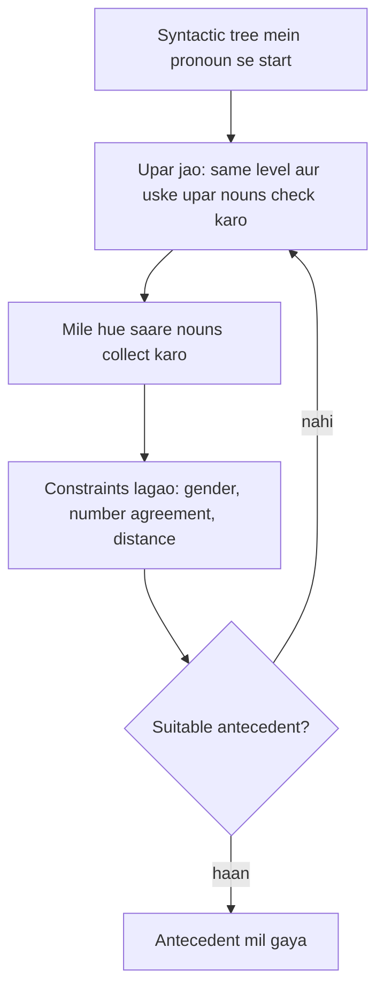
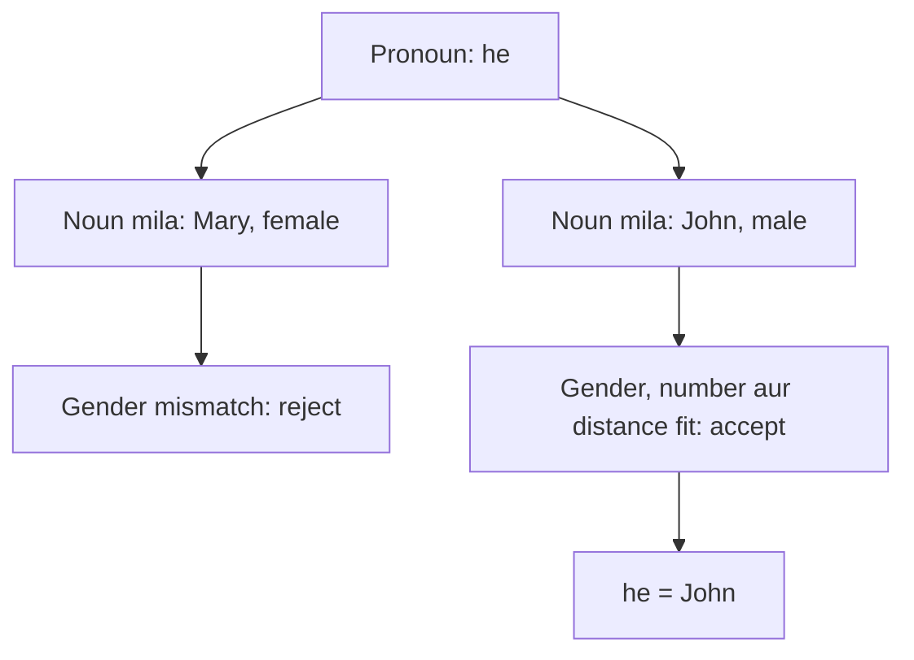

**Ek line mein:** <mark>Hobbs algorithm pronoun resolution ka heuristic method hai jo sentence ke syntactic tree se wo noun dhoondhta hai jisse pronoun judta hai</mark>. <Cite id="class-nlp-asol" loc="p. 3" />

<Box kind="key">

**Ye points likho:**

- <mark>Hobbs algorithm: pronoun resolution ka heuristic method, Jerry Hobbs ne 1976 mein banaya</mark>.
- <mark>Ye sentence ke syntactic tree se dhoondhta hai ki pronoun kis noun ko refer kar raha hai</mark>.
- Steps: **pronoun se start, upar jao, same level aur uske upar wale level pe nouns check karo, collect karo, constraints lagao, kuch na mile to repeat**.
- <mark>Constraints: gender, number agreement aur pronoun se distance</mark>.
- Example: "John saw Mary, he greeted her": nouns Mary aur John; *he* male hai, isliye <mark>he = John</mark>.
- **Heuristic** matlab rule of thumb jo aksar chalta hai par guarantee nahi.

</Box>

## Core answer (5 marks, yahan ke har question ke liye)

<Box kind="definition">

**Hobbs Algorithm** is a heuristic method for pronoun resolution, developed by Jerry Hobbs in 1976. It finds to which noun a pronoun is referring. It uses the syntactic tree of the sentence and finds the solution by operations on that tree. <Cite id="class-nlp-asol" loc="p. 3" />

</Box>

**Basics:** **pronoun** (he, she, it) noun ki jagah use hota hai; jis pehle wale noun ki jagah wo aaya wo uska **antecedent** hai; use dhoondhna **pronoun (anaphora) resolution** hai. **Syntactic tree** dikhata hai ki sentence ke words grammar se kaise group hain. <Cite id="class-nlp-asol" loc="p. 5" /> <Cite id="web-nlp-2-anaphora" />

**Steps:** <Cite id="class-nlp-asol" loc="p. 3" />

1. Syntactic tree mein pronoun se **start** karo aur upar jao. Same level aur uske upar wale level pe noun check karo.
2. Noun mile to use **consider** karo aur tree mein baaki nouns bhi check karo.
3. Saare nouns dekhne ke baad **constraints lagao**: gender, number agreement aur pronoun se distance.
4. Koi suitable antecedent na mile to saare steps **repeat** karo.

**Example:** "John saw Mary, he greeted her." Pronoun *he* ke upar ke nouns Mary aur John hain. *He* male ke liye use hota hai aur John male hai, isliye *he* **John** ko refer karta hai. <Cite id="class-nlp-asol" loc="p. 4" />

**Conclusion:** Hobbs algorithm pronoun se tree mein chalta hai, nouns collect karta hai, aur gender, number aur distance antecedent chunte hain.

## Extended answer (10 marks): ye add karo

### 1. Tree aur example detail mein

Isi tarah *her* female aur singular hai, to wo John nahi ho sakta aur Mary se resolve hota hai.

### 2. Kai sentences mein search kaise chalti hai

Input pronoun aur current tak ke sentences ka syntactic parse hota hai. Search noun phrases ko fixed order mein dekhti hai, simplified form: current sentence mein pronoun se left ki taraf, phir pichhla sentence left to right, phir usse pichhla sentence. Number, gender aur person mein agree karne wala pehla noun phrase chuna jaata hai. <Cite id="web-nlp-2-slp3-coref" loc="Historical Notes" />

| Constraint | Kya poochta hai | Example |
|---|---|---|
| Gender | Noun pronoun ki tarah male, female ya neuter hai? | *he* Mary ko reject karta hai |
| Number | Singular ke saath singular, plural ke saath plural? | *they* John ko reject karta hai |
| Distance | Search order mein sabse paas kaun? | sabse paas ka agreeing noun jeetta hai |

### 3. Doosra example

<Sum>

<Given>

"Aragorn picked up the sword. He looked at Frodo." *He* ka antecedent dhoondho.

</Given>

<Find>

wo noun jise *He* refer karta hai.

</Find>

<Steps>

1. *He* doosre sentence ka pehla word hai, isliye current sentence mein uske left mein koi noun nahi.
2. Pichhle sentence pe jao, left to right: nouns *Aragorn* aur *sword* hain.
3. Pehla check karo: *Aragorn* male aur singular hai, to *He* se agree karta hai.
4. Search pehle agreeing noun pe ruk jaati hai.

</Steps>

<Answer>

*He* = Aragorn.

</Answer>

<Box kind="verify">

*Sword* gender test mein fail hota (cheez hai, male nahi), isliye search wahan tak pahunchti bhi to reject hota.

</Box>

</Sum>

### 4. Advantages aur limits

| Advantages | Limits |
|---|---|
| Simple, fast, sirf parse tree chahiye | Sentence ka sahi parse chahiye |
| Antecedent ke paas wale pronouns pe achha chalta hai | Meaning ya discourse focus use nahi karta, isliye do agreeing nouns mein galat chun sakta hai |
| Step by step samjhana aasan | Ek time pe ek pronoun; poore text ka flow follow nahi karta |

Lappin aur Leass ne ek salience-based algorithm ko same pronouns pe Hobbs ke tree search se test kiya aur use lagbhag 4 percent better paaya. <Cite id="web-nlp-2-lappin-leass" />

## Har question mein kaise fit karein

- **"Explain Hobbs algorithm for pronoun resolution."** (10 marks) <PYQ id="2022-12-ce/q5b" /> <PYQ id="assignment-2/q5c" />: definition, chaar steps, flowchart, *John saw Mary* example, phir sections 2 se 4.
- **"Discuss Hobbs algorithm for Pronoun Resolution."** (10 marks) <PYQ id="2025-05/q2a" />: wahi; constraints table aur dono examples pe zor do.

## Exam tips

- **Draw karo:** flowchart aur tree sketch; nouns *Mary* aur *John* label karo.
- Teeno constraints hamesha likho: **gender, number agreement, distance**.
- "**Heuristic**" bolo: aksar chalta hai par guarantee nahi.

Exam mein English mein likho.
