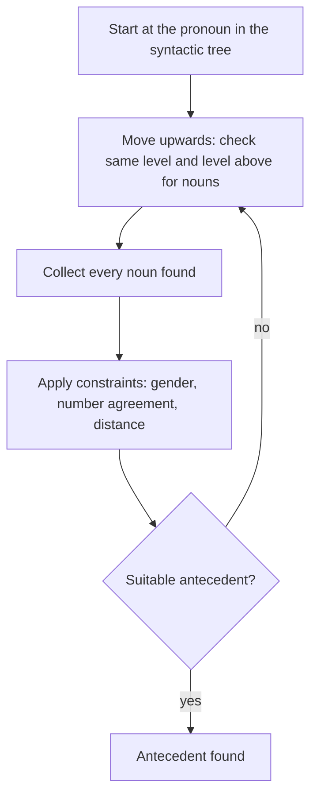
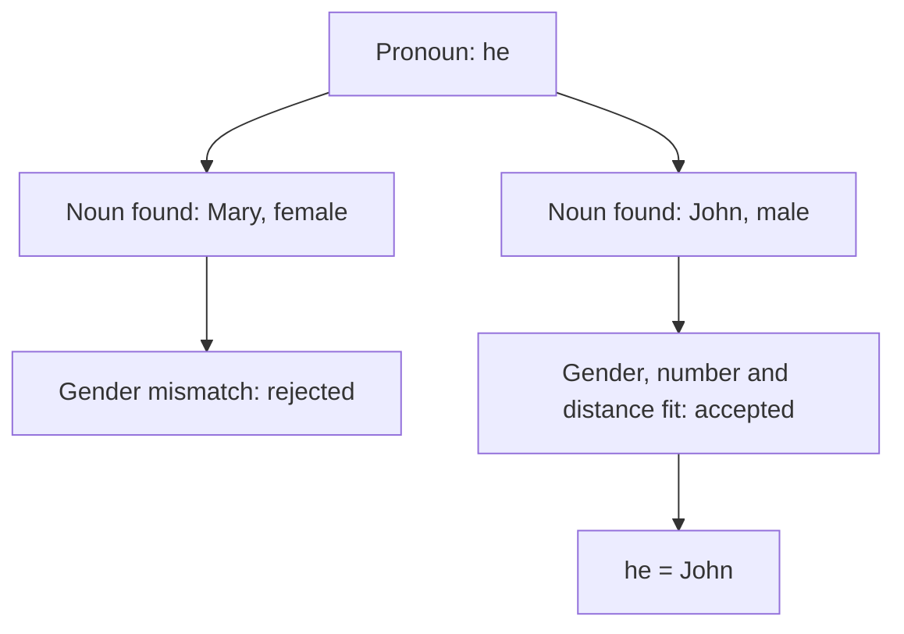

**In one line:** <mark>Hobbs algorithm is a heuristic method for pronoun resolution that uses the syntactic tree of the sentence to find the noun a pronoun refers to</mark>. <Cite id="class-nlp-asol" loc="p. 3" />

<Box kind="key">

**Key points to write:**

- <mark>Hobbs algorithm: a heuristic method for pronoun resolution, developed by Jerry Hobbs in 1976</mark>.
- <mark>It finds to which noun a pronoun is referring, using the syntactic tree of the sentence</mark>.
- Steps: **start at the pronoun, move up, check the same level and the level above for nouns, collect them, apply constraints, repeat if none fits**.
- <mark>Constraints: gender, number agreement and distance from the pronoun</mark>.
- Example: "John saw Mary, he greeted her": nouns Mary and John; *he* is male, so <mark>he = John</mark>.
- A **heuristic** is a rule of thumb that usually works but is not guaranteed.

</Box>

## Core answer (5 marks, fits every question here)

<Box kind="definition">

**Hobbs Algorithm** is a heuristic method for pronoun resolution, developed by Jerry Hobbs in 1976. It finds to which noun a pronoun is referring. It uses the syntactic tree of the sentence and finds the solution by operations on that tree. <Cite id="class-nlp-asol" loc="p. 3" />

</Box>

**Basics:** a **pronoun** (he, she, it) is used instead of a noun; the earlier noun it stands for is its **antecedent**; finding it is **pronoun (anaphora) resolution**. A **syntactic tree** shows how the words of a sentence are grouped by grammar. <Cite id="class-nlp-asol" loc="p. 5" /> <Cite id="web-nlp-2-anaphora" />

**Steps:** <Cite id="class-nlp-asol" loc="p. 3" />

1. **Start** with the pronoun in the syntactic tree and move upwards. Check the same level and the level above for a noun.
2. When a noun occurs, **consider it** and check for other nouns in the tree.
3. After considering all nouns, **apply constraints**: gender, number agreement and distance from the pronoun.
4. If no suitable antecedent is found, **repeat** all the steps.

**Example:** "John saw Mary, he greeted her." The nouns above the pronoun *he* are Mary and John. *He* is used for a male and John is male, so *he* refers to **John**. <Cite id="class-nlp-asol" loc="p. 4" />

**Conclusion:** Hobbs algorithm walks the tree from the pronoun, collects nouns and lets gender, number and distance pick the antecedent.

## Extended answer (10 marks): add these

### 1. The tree and the example in detail

In the same way, *her* is female and singular, so it cannot be John and it is resolved to Mary.

### 2. How the search runs over several sentences

The input is the pronoun and the syntactic parse of the sentences up to the current one. The search goes through the noun phrases in a fixed order, a simplified form being: the current sentence from the pronoun leftwards, then the previous sentence from left to right, then the sentence before that. The first noun phrase that agrees with the pronoun in number, gender and person is chosen. <Cite id="web-nlp-2-slp3-coref" loc="Historical Notes" />

| Constraint | Question asked | Example |
|---|---|---|
| Gender | Is the noun male, female or neuter like the pronoun? | *he* rejects Mary |
| Number | Singular with singular, plural with plural? | *they* rejects John |
| Distance | Which candidate is nearest in the search order? | the nearest agreeing noun wins |

### 3. A second example

<Sum>

<Given>

"Aragorn picked up the sword. He looked at Frodo." Find the antecedent of *He*.

</Given>

<Find>

the noun that *He* refers to.

</Find>

<Steps>

1. *He* is the first word of the second sentence, so no noun lies to its left in the current sentence.
2. Go to the previous sentence, left to right: the nouns are *Aragorn* and *sword*.
3. Check the first one: *Aragorn* is male and singular, so it agrees with *He*.
4. The search stops at the first agreeing noun.

</Steps>

<Answer>

*He* = Aragorn.

</Answer>

<Box kind="verify">

*Sword* would fail the gender test (a thing, not male), so even if the search reached it, it would be rejected.

</Box>

</Sum>

### 4. Advantages and limits

| Advantages | Limits |
|---|---|
| Simple, fast, needs only a parse tree | Needs a correct parse of the sentence |
| Works well for pronouns close to their antecedent | Uses no meaning or focus of the discourse, so it can pick the wrong one of two agreeing nouns |
| Easy to explain step by step | One pronoun at a time; it does not follow the flow of the whole text |

Lappin and Leass tested a salience-based algorithm against Hobbs' tree search on the same pronouns and found it about 4 percent better. <Cite id="web-nlp-2-lappin-leass" />

## Fit it to each question

- **"Explain Hobbs algorithm for pronoun resolution."** (10 marks) <PYQ id="2022-12-ce/q5b" /> <PYQ id="assignment-2/q5c" />: definition, four steps, flowchart, the *John saw Mary* example, then sections 2 to 4.
- **"Discuss Hobbs algorithm for Pronoun Resolution."** (10 marks) <PYQ id="2025-05/q2a" />: the same; stress the constraints table and the two examples.

## Exam tips

- **Draw** the flowchart and the tree sketch; label the nouns *Mary* and *John*.
- Always write the three constraints: **gender, number agreement, distance**.
- Say "**heuristic**": it usually works but is not guaranteed.
