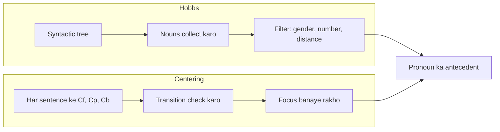
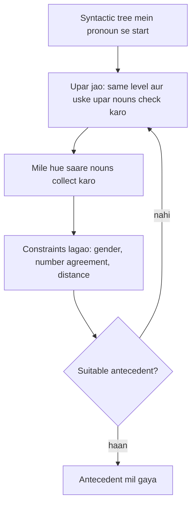

**Ek line mein:** <mark>Anaphora resolution pronoun ko us earlier noun se jodta hai jiski jagah wo aaya hai</mark>. <mark>Hobbs' algorithm syntactic tree mein aisa noun dhoondhta hai jo pronoun se agree kare; Centering algorithm discourse ka focus track karta hai aur wo antecedent chunta hai jo focus banaye rakhe</mark>. <Cite id="class-nlp-asol" loc="p. 1" />

<Box kind="key">

**Ye points likho:**

- <mark>Anaphora resolution: pronoun (he, she, it) ka antecedent (pehle wala noun) dhoondhna</mark>. "Taylor went to the store. She bought groceries." *She* = Taylor.
- <mark>Hobbs (1976/78): heuristic jo syntactic tree use karta hai. Pronoun se shuru karo, upar jao, nouns collect karo, gender, number aur distance constraints lagao</mark>.
- <mark>Centering: discourse ka focus Cf (forward-looking centers), Cp (preferred center) aur Cb (backward-looking center) se track karta hai</mark>.
- Transitions: <mark>Continue (preferred), Retain, Shift</mark>.
- <mark>Hobbs ek pronoun pe parse tree ke saath chalta hai; Centering poore text ke flow pe</mark>.
- Hamesha **comparison table** draw karo aur dono ka ek-ek example do (John saw Mary, he greeted her; Aragorn picked up the sword. He looked at Frodo).

</Box>

## Core answer (5 marks, yahan ke har question ke liye)

<Box kind="definition">

A **pronoun** is a word used instead of a noun (he, she, it, they); the earlier noun it stands for is its **antecedent**. **Anaphora resolution** is the job of finding that antecedent. <Cite id="class-nlp-asol" loc="p. 5" /> <Cite id="class-nlp-asol" loc="p. 1" /> <Cite id="web-nlp-2-anaphora" />

</Box>

**Hobbs algorithm:** pronoun resolution ka heuristic method, Jerry Hobbs ne 1976 mein banaya. Ye sentence ka syntactic tree use karta hai. Pronoun se shuru karke upar jao, nouns collect karo, phir gender, number agreement aur distance ke constraints lagao; koi suitable na mile to repeat karo. *Example:* "John saw Mary, he greeted her": *he* ke upar ke nouns Mary aur John hain; *he* male hai, isliye *he* = John. <Cite id="class-nlp-asol" loc="p. 3" /> <Cite id="class-nlp-asol" loc="p. 4" />

**Centering algorithm:** ye track karta hai ki har sentence kis baare mein hai aur wo antecedent chunta hai jo focus banaye rakhe. Har sentence ke forward-looking centers (**Cf**, ranked, subject pehle), preferred center (**Cp**, aam taur pe subject) aur backward-looking center (**Cb**, pichhle sentence se aaya entity) hote hain. Transitions: **Continue** (preferred), **Retain** aur **Shift**. *Example:* "Aragorn picked up the sword. He looked at Frodo." *He* = Aragorn. <Cite id="class-nlp-asol" loc="p. 2" /> <Cite id="class-nlp-asol" loc="p. 3" />

| Point | Hobbs' algorithm | Centering algorithm |
|---|---|---|
| Main idea | tree mein noun search karna | discourse ka focus track karna |
| Input | sentence ka syntactic tree | har sentence ke ranked entities |
| Scope | ek time pe ek pronoun | poore text ka flow |
| Decide kaise | gender, number, distance | Continue, phir Retain, phir Shift |
| Kind | heuristic, syntax based | discourse based, coherence model karta hai |

**Conclusion:** Hobbs quick hai aur sirf grammar use karta hai; Centering discourse context use karta hai, isliye lambe, coherent text ke liye better hai.

## Extended answer (10 marks): ye add karo

### 1. Hobbs algorithm detail mein

<Box kind="definition">

**Hobbs algorithm** is a heuristic method for pronoun resolution. It finds to which noun a pronoun is referring, using the syntactic tree of the sentence. <Cite id="class-nlp-asol" loc="p. 3" />

</Box>

1. Syntactic tree mein pronoun se **start** karo aur upar jao; same level aur uske upar wale level pe noun check karo.
2. Jo noun mile use **consider** karo.
3. **Constraints lagao:** gender, number agreement aur pronoun se distance.
4. Koi suitable antecedent na mile to **repeat** karo. <Cite id="class-nlp-asol" loc="p. 3" />

Simplified version noun phrases ko is order mein search karta hai: current sentence mein pronoun se right to left, phir pichhla sentence left to right, phir usse pichhla sentence. Number, gender aur person mein agree karne wala pehla noun phrase chuna jaata hai. <Cite id="web-nlp-2-slp3-coref" loc="Historical Notes" />

### 2. Centering algorithm detail mein

<Box kind="definition">

The **Centering Algorithm** is a central part of Centering Theory, providing a structured mechanism for tracking the focus of discourse and determining how pronouns and references are resolved for natural and coherent text understanding. <Cite id="class-nlp-asol" loc="p. 1" />

</Box>

1. Current sentence ke forward-looking centers (**Cf**) prominence ke hisaab se rank karo (subject pehle).
2. Preferred center (**Cp**) chuno, aam taur pe subject.
3. Backward-looking center (**Cb**) dhoondho: pichhle sentence ka wo entity jiske baare mein ye sentence hai.
4. Transition check karo: **Continue** (same focus, preferred), **Retain** (attention shift hota hai par coherent rehta hai), **Shift** (focus alag entity pe jaata hai).
5. Wo antecedent chuno jo centers ki continuity banaye rakhe. <Cite id="class-nlp-asol" loc="p. 2" /> <Cite id="class-nlp-asol" loc="p. 3" />

### 3. Worked example, dono algorithms ek text pe

"Aragorn picked up the sword. He looked at Frodo."

| Step | Hobbs (tree search) | Centering (focus) |
|---|---|---|
| *He* ke candidates | Pichhle sentence ke nouns: Aragorn, sword | Sentence 1 ka Cf = [Aragorn, sword] |
| Filter | *sword* male nahi hai; Aragorn male aur singular hai | Aragorn subject hai, isliye pehle rank pe |
| Result | *He* = Aragorn | *He* = Aragorn; Cb = Aragorn, to transition Continue hai |

Yahan dono ka answer same hai. Farq tab aata hai jab do nouns agreement test pass karein: Hobbs apne search order ka pehla noun leta hai, Centering wo leta hai jo discourse focus banaye rakhe. <Cite id="class-nlp-asol" loc="p. 3" /> <Cite id="web-nlp-2-grosz-centering" />

### 4. Advantages aur limits

| | Hobbs | Centering |
|---|---|---|
| Strength | simple, fast, sirf parse tree chahiye | poore text ki coherence model karta hai |
| Weakness | meaning ya focus ka knowledge nahi; sahi parse chahiye | har sentence mein entities ki ranking chahiye |
| Aur kahan use | pronoun resolution | machine translation, summarization, story generation, conversational AI |

Zyada factors jodne wale ek baad ke salience-based algorithm ne same test pe Hobbs ke search se lagbhag 4 percent better results diye. <Cite id="web-nlp-2-lappin-leass" /> <Cite id="class-nlp-asol" loc="p. 3" />

## Har question mein kaise fit karein

- **"Explain Anaphora Resolution using Hobbs and Centering Algorithm"** (10 marks) <PYQ id="2024-05-ce/q5b" />: definition, dono algorithms (core answer aur sections 1 aur 2), phir comparison table.
- **"Compare and contrast Hobbs' Algorithm and Centering Theory."** (10 marks) <PYQ id="2024-12-ce/q3b" />: har algorithm pe ek line, side-by-side diagram, comparison table aur section 4.
- **"How Anaphora Resolution is performed with Hobbs and Centering Algorithm"** (10 marks) <PYQ id="2025-05-ce/q4b" />: dono algorithms ke steps (sections 1 aur 2) aur section 3 ka worked example.

## Exam tips

- **Draw karo:** Hobbs flowchart, aur Cf, Cp, Cb ke meanings likho.
- Hamesha **dono examples** likho (John saw Mary; Aragorn aur sword).
- "Compare" ke liye **kam se kam paanch rows ki table** paragraphs se zyada marks deti hai.

Exam mein English mein likho.
