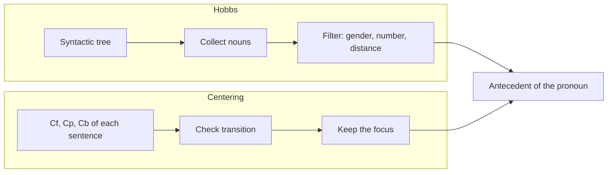
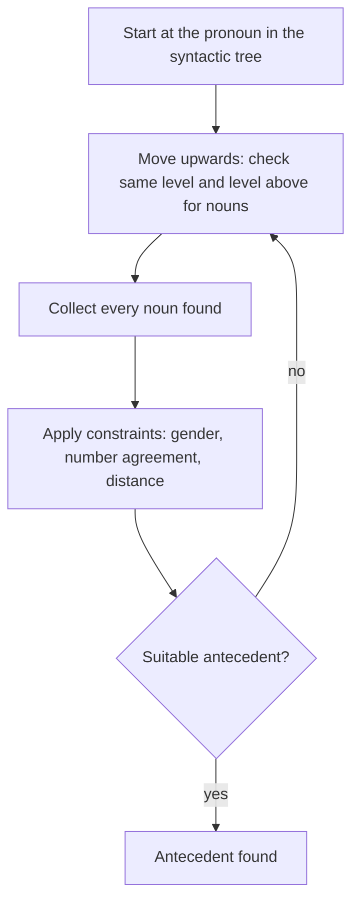

**In one line:** <mark>Anaphora resolution links a pronoun to the earlier noun it stands for</mark>. <mark>Hobbs' algorithm searches the syntactic tree for a noun that agrees with the pronoun; the Centering algorithm tracks the focus of the discourse and prefers the antecedent that keeps it</mark>. <Cite id="class-nlp-asol" loc="p. 1" />

<Box kind="key">

**Key points to write:**

- <mark>Anaphora resolution: finding the antecedent (earlier noun) of a pronoun such as he, she, it</mark>. "Taylor went to the store. She bought groceries." *She* = Taylor.
- <mark>Hobbs (1976/78): a heuristic that uses the syntactic tree. Start at the pronoun, move up, collect nouns, apply gender, number and distance constraints</mark>.
- <mark>Centering: tracks the focus of the discourse with Cf (forward-looking centers), Cp (preferred center) and Cb (backward-looking center)</mark>.
- Transitions: <mark>Continue (preferred), Retain, Shift</mark>.
- <mark>Hobbs works on one pronoun with a parse tree; Centering works on the flow of the whole text</mark>.
- Always draw the **comparison table** and give one example for each (John saw Mary, he greeted her; Aragorn picked up the sword. He looked at Frodo).

</Box>

## Core answer (5 marks, fits every question here)

<Box kind="definition">

A **pronoun** is a word used instead of a noun (he, she, it, they); the earlier noun it stands for is its **antecedent**. **Anaphora resolution** is the job of finding that antecedent. <Cite id="class-nlp-asol" loc="p. 5" /> <Cite id="class-nlp-asol" loc="p. 1" /> <Cite id="web-nlp-2-anaphora" />

</Box>

**Hobbs algorithm:** a heuristic method for pronoun resolution, developed by Jerry Hobbs in 1976. It uses the syntactic tree of the sentence. Start at the pronoun and move up, collect the nouns, then apply the constraints of gender, number agreement and distance; if nothing suitable is found, repeat. *Example:* "John saw Mary, he greeted her": the nouns above *he* are Mary and John; *he* is male, so *he* = John. <Cite id="class-nlp-asol" loc="p. 3" /> <Cite id="class-nlp-asol" loc="p. 4" />

**Centering algorithm:** it tracks what each sentence is about and prefers the antecedent that keeps the focus. Each sentence has forward-looking centers (**Cf**, ranked, subject first), a preferred center (**Cp**, usually the subject) and a backward-looking center (**Cb**, the entity carried over from the previous sentence). Transitions are **Continue** (preferred), **Retain** and **Shift**. *Example:* "Aragorn picked up the sword. He looked at Frodo." *He* = Aragorn. <Cite id="class-nlp-asol" loc="p. 2" /> <Cite id="class-nlp-asol" loc="p. 3" />

| Point | Hobbs' algorithm | Centering algorithm |
|---|---|---|
| Main idea | search the tree for a noun | track the focus of the discourse |
| Input needed | syntactic tree of the sentence | entities ranked in each sentence |
| Scope | one pronoun at a time | flow of the whole text |
| Decides by | gender, number, distance | Continue, then Retain, then Shift |
| Kind | heuristic, syntax based | discourse based, models coherence |

**Conclusion:** Hobbs is quick and uses grammar only; Centering uses discourse context and so suits longer, coherent text.

## Extended answer (10 marks): add these

### 1. Hobbs algorithm in detail

<Box kind="definition">

**Hobbs algorithm** is a heuristic method for pronoun resolution. It finds to which noun a pronoun is referring, using the syntactic tree of the sentence. <Cite id="class-nlp-asol" loc="p. 3" />

</Box>

1. **Start** with the pronoun in the syntactic tree and move upwards; check the same level and the level above for a noun.
2. **Consider** each noun found.
3. **Apply constraints:** gender, number agreement and distance from the pronoun.
4. **Repeat** if no suitable antecedent is found. <Cite id="class-nlp-asol" loc="p. 3" />

A simplified version searches the noun phrases in this order: the current sentence right to left from the pronoun, then the previous sentence left to right, then the sentence before that. The first noun phrase that agrees in number, gender and person is chosen. <Cite id="web-nlp-2-slp3-coref" loc="Historical Notes" />

### 2. Centering algorithm in detail

<Box kind="definition">

The **Centering Algorithm** is a central part of Centering Theory, providing a structured mechanism for tracking the focus of discourse and determining how pronouns and references are resolved for natural and coherent text understanding. <Cite id="class-nlp-asol" loc="p. 1" />

</Box>

1. List the forward-looking centers (**Cf**) of the current sentence, ranked by prominence (subject first).
2. Pick the preferred center (**Cp**), often the subject.
3. Find the backward-looking center (**Cb**): the entity of the previous sentence that this sentence is about.
4. Check the transition: **Continue** (same focus, preferred), **Retain** (attention shifts but stays coherent), **Shift** (focus moves to a different entity).
5. Prefer the antecedent that keeps the continuity of the centers. <Cite id="class-nlp-asol" loc="p. 2" /> <Cite id="class-nlp-asol" loc="p. 3" />

### 3. Worked example, both algorithms on one text

"Aragorn picked up the sword. He looked at Frodo."

| Step | Hobbs (tree search) | Centering (focus) |
|---|---|---|
| Candidates for *He* | Nouns of the previous sentence: Aragorn, sword | Cf of sentence 1 = [Aragorn, sword] |
| Filter | *sword* is not male; Aragorn is male and singular | Aragorn is ranked first (subject) |
| Result | *He* = Aragorn | *He* = Aragorn; Cb = Aragorn, so the transition is Continue |

Both give the same answer here. They differ when two nouns pass the agreement test: Hobbs takes the first one found by its search order, Centering takes the one that keeps the discourse focus. <Cite id="class-nlp-asol" loc="p. 3" /> <Cite id="web-nlp-2-grosz-centering" />

### 4. Advantages and limits

| | Hobbs | Centering |
|---|---|---|
| Strength | simple, fast, needs only a parse tree | models coherence of the whole text |
| Weakness | no knowledge of meaning or focus; needs a correct parse | needs sentence-by-sentence ranking of entities |
| Also used in | pronoun resolution | machine translation, summarization, story generation, conversational AI |

A later salience-based algorithm that adds more factors gave about 4 percent better results than Hobbs' search on the same test. <Cite id="web-nlp-2-lappin-leass" /> <Cite id="class-nlp-asol" loc="p. 3" />

## Fit it to each question

- **"Explain Anaphora Resolution using Hobbs and Centering Algorithm"** (10 marks) <PYQ id="2024-05-ce/q5b" />: definition, both algorithms (core answer and sections 1 and 2), then the comparison table.
- **"Compare and contrast Hobbs' Algorithm and Centering Theory."** (10 marks) <PYQ id="2024-12-ce/q3b" />: one line on each algorithm, the side-by-side diagram, the comparison table and section 4.
- **"How Anaphora Resolution is performed with Hobbs and Centering Algorithm"** (10 marks) <PYQ id="2025-05-ce/q4b" />: the steps of both algorithms (sections 1 and 2) and the worked example in section 3.

## Exam tips

- **Draw** the Hobbs flowchart and write the Cf, Cp, Cb meanings.
- Always write **both examples** (John saw Mary; Aragorn and the sword).
- For "compare", a **table with at least five rows** earns more than paragraphs.
