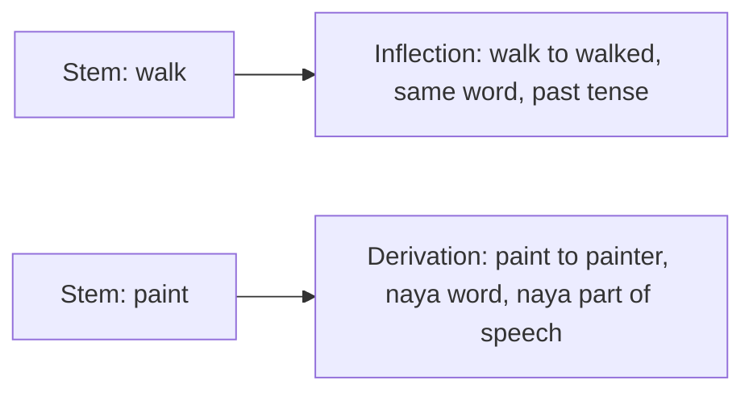
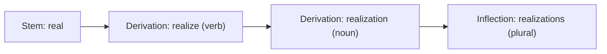

**Ek line mein:** <mark>Inflectional morphology word ka form badalta hai, naya word nahi banata; derivational morphology naye words (new lexemes) banata hai</mark> jo part of speech ya meaning mein alag hote hain. <Cite id="class-nlp-pyq2" loc="p. 3" /> <Cite id="class-nlp-pyq2" loc="p. 4" />

<Box kind="key">

**Ye points likho:**

- <mark>Inflectional: the study of processes, including affixation and vowel change, that distinguish word forms in certain grammatical categories</mark>.
- <mark>Derivational: concerned with forming new lexemes</mark>, words that differ in syntactic category (part of speech) or meaning from their bases.
- Inflection **same word ka alag form** deta hai; derivation **alag word** deta hai.
- Inflection **number, tense, person, case, gender** dikhata hai; derivation **part of speech ya meaning** badalta hai.
- Examples: <mark>school to schools, walk to walked, man to men</mark> (inflection); <mark>paint + er = painter</mark> (derivation).

</Box>

## Core answer (5 marks, yahan ke har question ke liye)

<Box kind="definition">

**Inflectional morphology** is the study of processes, including affixation and vowel change, that distinguish word forms in certain grammatical categories. **Derivational morphology** is concerned with forming new lexemes: words that differ in syntactic category (part of speech) or in meaning from their bases. <Cite id="class-nlp-pyq2" loc="p. 3" /> <Cite id="class-nlp-pyq2" loc="p. 4" />

</Box>

| Point | Inflectional morphology | Derivational morphology |
|---|---|---|
| Deals with | Changes made to existing words | The creation of new words |
| Result | A different form of the same word | A separate word |
| Categories | Number, tense, person, case, gender | Part of speech or meaning |
| Examples | School to schools, walk to walked, man to men, go to going | paint (verb) + er gives painter (noun, someone who paints) |

<Cite id="class-nlp-pyq2" loc="p. 3" /> <Cite id="class-nlp-pyq2" loc="p. 4" />

**Conclusion:** school to schools inflection hai; paint to painter derivation hai.

## Extended answer (10 marks): ye add karo

### 1. English ke inflectional affixes

Class mein ye listed hain: <Cite id="class-nlp-pyq2" loc="p. 3" />

| Affix | Kispe lagta hai | Example |
|---|---|---|
| Plural -s | Noun | dog, dogs |
| Past tense -ed | Verb | call, called |
| Third person singular -s | Verb | walks |
| Present participle -ing | Verb | walking |
| -er, -est (comparative, superlative) | Short adjective | short, shorter, shortest |

### 2. Derivational examples

- **-er** verb ko noun banata hai (kaam karne wala insaan ya cheez): paint, painter. <Cite id="class-nlp-pyq2" loc="p. 4" />
- **-ful**, **-ly** noun se adjective banate hain: success, successful; friend, friendly. **-ment** verb se noun banata hai: install, installment. <Cite id="class-nlp-m2" loc="p. 5" /> <Cite id="class-nlp-m2" loc="p. 7" />
- **un-** jaisa derivational prefix aksar meaning badalta hai, part of speech nahi (happy, unhappy). <Cite id="web-nlp-1-wiki-derivational" />

### 3. Dono ho to order

Pehle derivation, aakhir mein inflection: *nation* se *national* se *nationalize* (derivation), phir *nationalizes* (inflection). Inflection kabhi part of speech nahi badalta. <Cite id="web-nlp-1-wiki-inflection" />

## Har question mein kaise fit karein

- **"Explain inflectional and derivational morphology with an example"** (10 marks) <PYQ id="2024-05-ce/q2a" />: definitions, comparison table aur section 1 aur 2.
- **"Illustrate inflectional and derivational morphology with an example"** (10 marks) <PYQ id="2025-05/q2b" />: upar jaisa; zor do ki examples farq dikhate hain (walk aur paint ka diagram draw karo).
- **"Compare Derivational & Inflectional morphology"** (5 marks) <PYQ id="2025-05-ce/q1a" />: core table aur har ka ek example.
- **"Differentiate between inflectional and derivational morphology"** (5 marks) <PYQ id="2026-05/q1c" />: core table aur one-line conclusion.

## Exam tips

- **Table hamesha likho**, kam se kam chaar rows aur har column mein do examples.
- Yaad rakhne ki cheez: **inflection = same word, alag form; derivation = naya word**.
- 10 marks ke liye English inflectional affixes aur order rule (pehle derivation, aakhir mein inflection) add karo.

Exam mein English mein likho.
