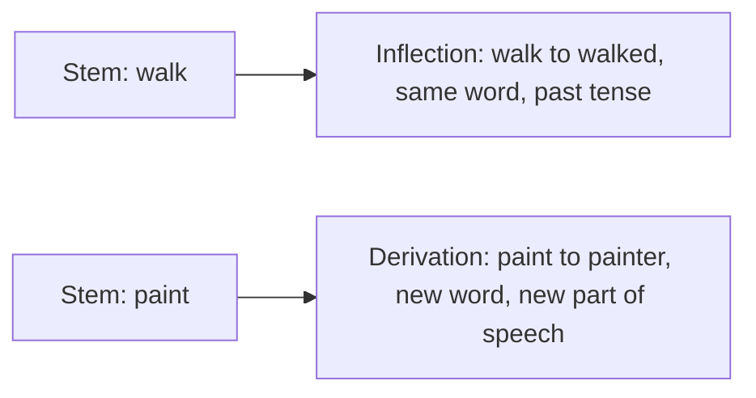
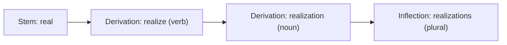

**In one line:** <mark>Inflectional morphology changes the form of a word without making a new word; derivational morphology forms new words (new lexemes)</mark> that differ in part of speech or meaning. <Cite id="class-nlp-pyq2" loc="p. 3" /> <Cite id="class-nlp-pyq2" loc="p. 4" />

<Box kind="key">

**Key points to write:**

- <mark>Inflectional: the study of processes, including affixation and vowel change, that distinguish word forms in certain grammatical categories</mark>.
- <mark>Derivational: concerned with forming new lexemes</mark>, words that differ in syntactic category (part of speech) or meaning from their bases.
- Inflection gives **a different form of the same word**; derivation gives **a separate word**.
- Inflection marks **number, tense, person, case, gender**; derivation changes **part of speech or meaning**.
- Examples: <mark>school to schools, walk to walked, man to men</mark> (inflection); <mark>paint + er = painter</mark> (derivation).

</Box>

## Core answer (5 marks, fits every question here)

<Box kind="definition">

**Inflectional morphology** is the study of processes, including affixation and vowel change, that distinguish word forms in certain grammatical categories. **Derivational morphology** is concerned with forming new lexemes: words that differ in syntactic category (part of speech) or in meaning from their bases. <Cite id="class-nlp-pyq2" loc="p. 3" /> <Cite id="class-nlp-pyq2" loc="p. 4" />

</Box>

| Point | Inflectional morphology | Derivational morphology |
|---|---|---|
| Deals with | Changes made to existing words | The creation of new words |
| Result | A different form of the same word | A separate word |
| Categories | Number, tense, person, case, gender | Part of speech or meaning |
| Examples | School to schools, walk to walked, man to men, go to going | paint (verb) + er gives painter (noun, someone who paints) |

<Cite id="class-nlp-pyq2" loc="p. 3" /> <Cite id="class-nlp-pyq2" loc="p. 4" />

**Conclusion:** school to schools is inflection; paint to painter is derivation.

## Extended answer (10 marks): add these

### 1. English inflectional affixes

The class lists them: <Cite id="class-nlp-pyq2" loc="p. 3" />

| Affix | Attaches to | Example |
|---|---|---|
| Plural -s | Noun | dog, dogs |
| Past tense -ed | Verb | call, called |
| Third person singular -s | Verb | walks |
| Present participle -ing | Verb | walking |
| -er, -est (comparative, superlative) | Short adjective | short, shorter, shortest |

### 2. Derivational examples

- **-er** turns a verb into a noun (the person or thing that does the action): paint, painter. <Cite id="class-nlp-pyq2" loc="p. 4" />
- **-ful**, **-ly** make adjectives from nouns: success, successful; friend, friendly. **-ment** makes a noun from a verb: install, installment. <Cite id="class-nlp-m2" loc="p. 5" /> <Cite id="class-nlp-m2" loc="p. 7" />
- A derivational prefix such as **un-** usually changes meaning and not the part of speech (happy, unhappy). <Cite id="web-nlp-1-wiki-derivational" />

### 3. Order when both occur

Derivation comes first and inflection last: *nation* to *national* to *nationalize* (derivation), then *nationalizes* (inflection). Inflection never changes the part of speech. <Cite id="web-nlp-1-wiki-inflection" />

## Fit it to each question

- **"Explain inflectional and derivational morphology with an example"** (10 marks) <PYQ id="2024-05-ce/q2a" />: definitions, comparison table and sections 1 and 2.
- **"Illustrate inflectional and derivational morphology with an example"** (10 marks) <PYQ id="2025-05/q2b" />: same as above; stress that the examples show the difference (draw the walk and paint diagram).
- **"Compare Derivational & Inflectional morphology"** (5 marks) <PYQ id="2025-05-ce/q1a" />: the core table and one example each.
- **"Differentiate between inflectional and derivational morphology"** (5 marks) <PYQ id="2026-05/q1c" />: the core table and the one-line conclusion.

## Exam tips

- **Always write the table** with at least four rows and two examples per column.
- Memory key: **inflection = same word, another form; derivation = a new word**.
- For 10 marks add the English inflectional affixes and the order rule (derivation first, inflection last).
