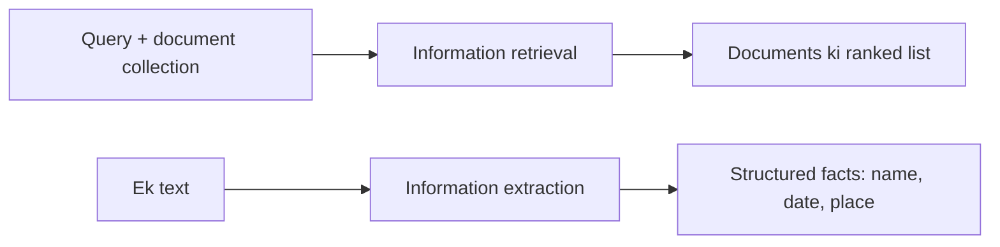
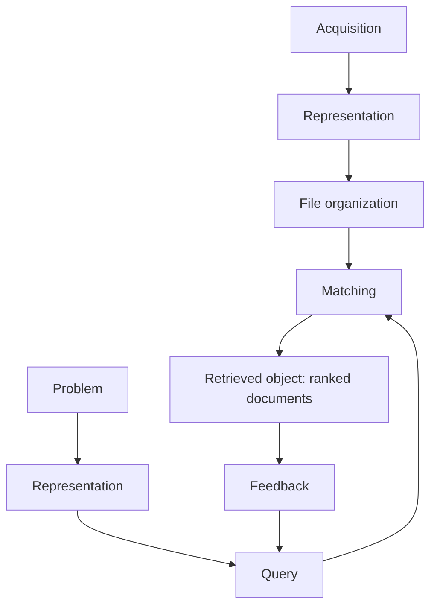
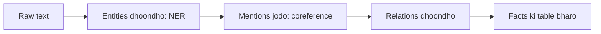

**Ek line mein:** <mark>Information Retrieval (IR) bade collection se user ki query ke liye relevant documents dhoondhta hai aur ranked list deta hai; Information Extraction (IE) text se hi structured facts nikalta hai</mark>. <Cite id="class-nlp-m6" loc="slide 9" />

<Box kind="key">

**Ye points likho:**

- <mark>IR: documents ke bade collections se relevant information dhoondhta hai</mark>; ek software program jo documents se information ke organization, storage, retrieval aur evaluation ka kaam karta hai. **Smart librarian** jaisa jo batata hai kitaab kahan hai.
- <mark>Query ko documents se matching function compare karta hai jo retrieval status value (RSV) deta hai; results RSV se ranked hote hain</mark>.
- IR ke do sides: **user side** (problem, representation, query, feedback) aur **system side** (acquisition, representation, file organization, matching, retrieved object).
- <mark>IE: unstructured text se structured facts (entities, dates, relations) nikalta hai</mark>; named entity recognition IE ka ek step hai.
- <mark>Output: IR ranked list of documents deta hai; IE structured facts</mark>.
- **Comparison table** draw karo (output, input, question, tools, example).

</Box>

## Core answer (5 marks, yahan ke har question ke liye)

<Box kind="definition">

**Information Retrieval (IR)** helps to find relevant information from large collections of documents. It is a software program that deals with the organization, storage, retrieval and evaluation of information from documents. **Information Extraction (IE)** is the task of pulling structured facts out of text. <Cite id="class-nlp-m6" loc="slide 9" /> <Cite id="web-nlp-2-ie" />

</Box>

**IR smart librarian ki tarah kaam karta hai:** ye jawab nahi deta, batata hai ki kaunsi kitaab padhni hai. Ye query ko documents se **matching function** se compare karta hai, jo har document ko **retrieval status value (RSV)** deta hai; results RSV se ranked hote hain. Documents **descriptors** (important keywords) se represent hote hain. <Cite id="class-nlp-m6" loc="slide 9" />

**IE** ek text lekar facts ki table bharta hai: kaun, kya, kab, kahan. Named entity recognition IE ka ek step hai, kyunki ye unstructured text ko structured information mein badalta hai. <Cite id="class-nlp-m6" loc="slide 35" />

| Point | Information retrieval | Information extraction |
|---|---|---|
| Output | documents ki ranked list | structured facts (entities, dates, relations) |
| Kaunsa sawal | "kaunse documents relevant hain?" | "is text mein kaunse facts hain?" |
| Input | query aur documents ka collection | ek text |
| Typical tools | indexing, matching, ranking (RSV) | NER, rules, machine learning |
| Example | search engine | news se names aur dates ki table bharna |

**Conclusion:** IR batata hai kahan padhna hai; IE khud padhkar facts likh deta hai.

## Extended answer (10 marks): ye add karo

### 1. IR model, user side aur system side

**User side (search process):** <Cite id="class-nlp-m6" loc="slide 11" />

- **Problem identification:** student ko machine learning seekhni hai.
- **Representation:** need query ban jaati hai, "machine learning basics".
- **Query:** IR system ko submit hoti hai.
- **Feedback:** results dekhkar user search refine karta hai.

**System side (retrieval process):** <Cite id="class-nlp-m6" loc="slide 12" /> <Cite id="class-nlp-m6" loc="slide 14" />

- **Acquisition:** documents collect aur store hote hain (web crawlers).
- **Representation:** har document keywords se describe hota hai (indexing).
- **File organization:** sequential, ya **inverted** (har term ke neeche records ki list).
- **Matching:** query ko documents se compare karte hain; RSV se rank.
- **Retrieved object:** sabse relevant documents, best pehle.

### 2. Text processing aur inverted index

Indexing se pehle raw text clean hota hai: tokenization, lowercase, stop-word removal, stemming ya lemmatization, phir **inverted index** (har term un documents se jud jaata hai jinme wo hai) TF-IDF jaise weights ke saath. <Cite id="class-nlp-asol" loc="p. 11" /> <Cite id="web-nlp-2-inverted-index" /> <Cite id="web-nlp-2-tfidf" /> <Cite id="web-nlp-2-slp3-ir" loc="§11.1.4" />

<Sum>

<Given>

D1 = "machine learning basics", D2 = "deep learning and machine learning", D3 = "learning to cook". Stop words: and, to. Queries: "machine AND learning" aur "deep OR cook".

</Given>

<Find>

inverted index aur har query ka answer.

</Find>

<Steps>

1. Stop words hatao: D2 ban jaata hai "deep learning machine learning", D3 ban jaata hai "learning cook".
2. Index banao: machine \{D1, D2\}; learning \{D1, D2, D3\}; basics \{D1\}; deep \{D2\}; cook \{D3\}.
3. "machine AND learning": \{D1, D2\} aur \{D1, D2, D3\} ke common documents = \{D1, D2\}.
4. "deep OR cook": \{D2\} aur \{D3\} ke saare documents = \{D2, D3\}.

</Steps>

<Answer>

AND query: D1, D2. OR query: D2, D3.

</Answer>

<Box kind="verify">

D3 mein word *machine* nahi hai, isliye wo AND answer mein nahi aa sakta; D1 mein na *deep* hai na *cook*, isliye wo OR answer mein nahi.

</Box>

</Sum>

### 3. Information extraction detail mein

IE ke steps: entities dhoondho (NER), same entity ke mentions jodo (coreference), unke beech relations dhoondho, aur template bharo. <Cite id="web-nlp-2-ie" />

*Example:* "Barack Obama was born in Honolulu." se Person = Barack Obama, Birthplace = Honolulu milta hai. <Cite id="class-nlp-m6" loc="slide 35" />

### 4. IR aur IE kahan milte hain

Search engine (IR) documents dhoondhta hai; IE un documents ko padhkar facts bana sakta hai. Question answering dono use karta hai. <Cite id="web-nlp-2-ir" />

## Har question mein kaise fit karein

- **"Explain information retrieval versus Information extraction systems"** (10 marks) <PYQ id="2023-05-ce/q6a" />: definitions, comparison table, phir sections 1 se 3.
- **"Explain the Information retrieval system"** (10 marks) <PYQ id="2024-05-ce/q6b" />: IR definition, IR image, user side aur system side, process diagram aur inverted index example (IE wale parts chhod do).
- **"Discuss Information Retrieval vs Information Extraction in detail"** (5 marks) <PYQ id="2024-12/q1b" /> aur **"Compare Information Retrieval and Information extraction in detail"** (5 marks) <PYQ id="2025-05/q1b" />: core answer, table aur diagram.

## Exam tips

- **Comparison table draw karo**, kam se kam paanch rows.
- "IR system" ke liye **do sides** likho aur **matching, RSV, inverted index** words.
- Yaad rakho: **IR documents deta hai, IE facts**.

Exam mein English mein likho.
