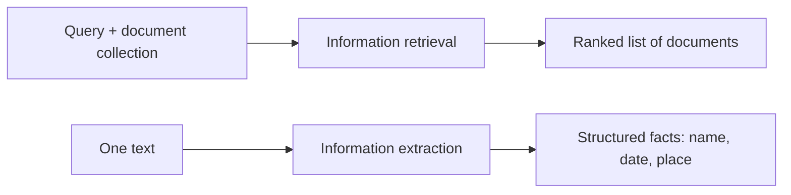
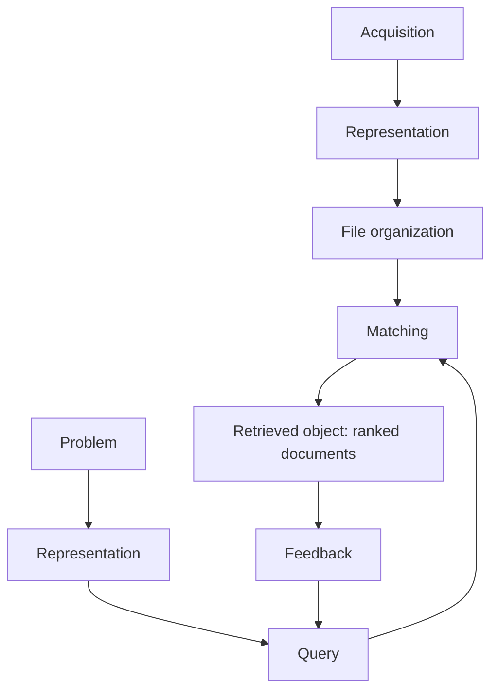
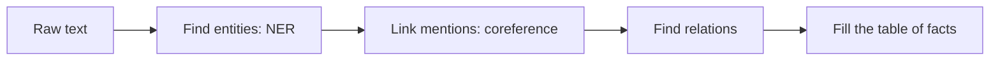

**In one line:** <mark>Information Retrieval (IR) finds relevant documents from a large collection for a user's query and returns a ranked list; Information Extraction (IE) pulls structured facts out of the text itself</mark>. <Cite id="class-nlp-m6" loc="slide 9" />

<Box kind="key">

**Key points to write:**

- <mark>IR: finds relevant information from large collections of documents</mark>; a software program that deals with the organization, storage, retrieval and evaluation of information. Like a **smart librarian** who tells you where the book is.
- <mark>The query is compared with documents by a matching function that gives a retrieval status value (RSV); results are ranked by it</mark>.
- IR has a **user side** (problem, representation, query, feedback) and a **system side** (acquisition, representation, file organization, matching, retrieved object).
- <mark>IE: extracts structured facts (entities, dates, relations) from unstructured text</mark>; named entity recognition is one IE step.
- <mark>Output: IR gives a ranked list of documents; IE gives structured facts</mark>.
- Draw the **comparison table** (output, input, question answered, tools, example).

</Box>

## Core answer (5 marks, fits every question here)

<Box kind="definition">

**Information Retrieval (IR)** helps to find relevant information from large collections of documents. It is a software program that deals with the organization, storage, retrieval and evaluation of information from documents. **Information Extraction (IE)** is the task of pulling structured facts out of text. <Cite id="class-nlp-m6" loc="slide 9" /> <Cite id="web-nlp-2-ie" />

</Box>

**IR works like a smart librarian:** it does not give you the answer, it tells you which book to read. It compares the query with the documents using a **matching function**, which gives each document a **retrieval status value (RSV)**; the results are ranked by it. Documents are represented by **descriptors**, the important keywords. <Cite id="class-nlp-m6" loc="slide 9" />

**IE** takes one text and fills a table of facts: who, what, when, where. Named entity recognition is one IE step, since it turns unstructured text into structured information. <Cite id="class-nlp-m6" loc="slide 35" />

| Point | Information retrieval | Information extraction |
|---|---|---|
| Output | a ranked list of documents | structured facts (entities, dates, relations) |
| Question answered | "which documents are relevant?" | "what facts does this text state?" |
| Input | a query and a collection of documents | a text |
| Typical tools | indexing, matching, ranking (RSV) | NER, rules, machine learning |
| Example | a search engine | filling a table of names and dates from news |

**Conclusion:** IR tells you where to read; IE reads for you and writes down the facts.

## Extended answer (10 marks): add these

### 1. The IR model, user side and system side

**User side (search process):** <Cite id="class-nlp-m6" loc="slide 11" />

- **Problem identification:** a student wants to learn machine learning.
- **Representation:** the need becomes a query, "machine learning basics".
- **Query:** submitted to the IR system.
- **Feedback:** the user refines the search after seeing results.

**System side (retrieval process):** <Cite id="class-nlp-m6" loc="slide 12" /> <Cite id="class-nlp-m6" loc="slide 14" />

- **Acquisition:** documents are collected and stored (web crawlers).
- **Representation:** each document is described by keywords (indexing).
- **File organization:** sequential, or **inverted** (a list of records under each term).
- **Matching:** the query is compared with documents; ranked by RSV.
- **Retrieved object:** the most relevant documents, best first.

### 2. Text processing and the inverted index

Before indexing, raw text is cleaned: tokenization, lowercase, stop-word removal, stemming or lemmatization, then an **inverted index** (each term maps to the documents that contain it) with weights such as TF-IDF. <Cite id="class-nlp-asol" loc="p. 11" /> <Cite id="web-nlp-2-inverted-index" /> <Cite id="web-nlp-2-tfidf" /> <Cite id="web-nlp-2-slp3-ir" loc="§11.1.4" />

<Sum>

<Given>

D1 = "machine learning basics", D2 = "deep learning and machine learning", D3 = "learning to cook". Stop words: and, to. Queries: "machine AND learning" and "deep OR cook".

</Given>

<Find>

the inverted index and the answer to each query.

</Find>

<Steps>

1. Remove stop words: D2 becomes "deep learning machine learning", D3 becomes "learning cook".
2. Build the index: machine \{D1, D2\}; learning \{D1, D2, D3\}; basics \{D1\}; deep \{D2\}; cook \{D3\}.
3. "machine AND learning": common documents of \{D1, D2\} and \{D1, D2, D3\} = \{D1, D2\}.
4. "deep OR cook": all documents of \{D2\} and \{D3\} = \{D2, D3\}.

</Steps>

<Answer>

AND query: D1, D2. OR query: D2, D3.

</Answer>

<Box kind="verify">

D3 has no word *machine*, so it cannot be in the AND answer; D1 has neither *deep* nor *cook*, so it is not in the OR answer.

</Box>

</Sum>

### 3. Information extraction in detail

IE steps: find the entities (NER), link the mentions of the same entity (coreference), find the relations between them, and fill a template. <Cite id="web-nlp-2-ie" />

*Example:* "Barack Obama was born in Honolulu." gives Person = Barack Obama, Birthplace = Honolulu. <Cite id="class-nlp-m6" loc="slide 35" />

### 4. Where IR and IE meet

A search engine (IR) finds the documents; IE can then read those documents to produce facts. Question answering uses both. <Cite id="web-nlp-2-ir" />

## Fit it to each question

- **"Explain information retrieval versus Information extraction systems"** (10 marks) <PYQ id="2023-05-ce/q6a" />: definitions, the comparison table, then sections 1 to 3.
- **"Explain the Information retrieval system"** (10 marks) <PYQ id="2024-05-ce/q6b" />: IR definition, the IR image, user side and system side, the process diagram and the inverted index example (skip the IE parts).
- **"Discuss Information Retrieval vs Information Extraction in detail"** (5 marks) <PYQ id="2024-12/q1b" /> and **"Compare Information Retrieval and Information extraction in detail"** (5 marks) <PYQ id="2025-05/q1b" />: the core answer, table and diagram.

## Exam tips

- **Draw the comparison table** with at least five rows.
- For "IR system", write the **two sides** and the words **matching, RSV, inverted index**.
- Remember: **IR returns documents, IE returns facts**.
