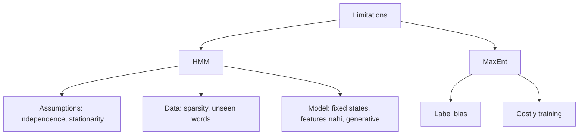
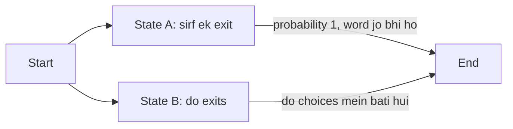

**Ek line mein:** <mark>HMM apni simple assumptions (independence, rich features nahi, unseen words) se limited hai</mark>; <mark>MaxEnt label bias aur costly training se limited hai</mark>. <Cite id="class-nlp-pyq3" loc="p. 5" /> <Cite id="class-nlp-pyq3" loc="p. 10" />

<Box kind="key">

**Ye points likho:**

- HMM: <mark>strong independence assumption</mark>: next state sirf current state pe, aur har word sirf apne tag pe depend karta hai.
- HMM: <mark>limited context</mark> (long-range dependencies nahi), <mark>data sparsity</mark> aur <mark>unseen (OOV) words</mark>.
- HMM: <mark>generative hai, isliye features add karna mushkil</mark> jaise grammar ya meaning.
- MaxEnt: <mark>label bias problem</mark> (har step pe local normalization).
- MaxEnt: <mark>computational cost</mark> (iterative training: L-BFGS, GIS, IIS).
- Fixes: **CRF** (global normalization) aur **neural models** (RNNs, Transformers).

</Box>

## Core answer (5 marks, yahan ke har question ke liye)

**HMM ki limitations** <Cite id="class-nlp-pyq3" loc="p. 5" />

1. **Strong independence assumption:** next state sirf current state pe, aur har word sirf apne tag pe depend karta hai.
2. **Limited context:** door ke words ke beech long-range dependencies nahi pakad sakta.
3. **Data sparsity:** probabilities achhe se nikalne ke liye bada labelled corpus chahiye.
4. **Unseen words:** training data mein na hone wale (out-of-vocabulary) words achhe se handle nahi hote.
5. **Generative model:** grammar ya meaning jaise extra features add karna mushkil hai.
6. **Slow** jab vocabulary ya states bahut ho.

**MaxEnt ki limitations** <Cite id="class-nlp-pyq3" loc="p. 10" />

1. **Label bias problem:** probabilities har step pe locally normalize hoti hain, poore sentence pe nahi, isliye kam outgoing choices wale state ki high-probability move dominate kar sakti hai chahe poora sequence unlikely ho.
2. **Computational cost:** training ko iterative numerical optimization chahiye (L-BFGS, GIS, IIS), jo HMM ki counting se bhari hai.

| Model | Main weakness |
|---|---|
| HMM | Independence assumptions aur rich features nahi |
| MaxEnt (MEMM) | Label bias aur costly training |

**Conclusion:** HMM apni assumptions se limited hai, MaxEnt label bias aur training cost se.

## Extended answer (10 marks): ye add karo

### 1. HMM ki aur limitations (class list)

7. **Fixed number of states:** tag set pehle se define karna padta hai, jo complex NLP tasks ke liye fit nahi ho sakta.
8. **Stationarity assumption:** maanta hai ki probabilities constant rehti hain, jo natural language ke liye sach nahi.
9. **Limited expressive power:** discriminative models (CRFs, RNNs) jaise complex conditional relationships model nahi kar sakta.
10. **Modern models se kamzor:** RNNs aur Transformers context bahut better samajhte hain. <Cite id="class-nlp-pyq3" loc="p. 5" />

### 2. Label bias kyun hota hai

MaxEnt (MEMM) mein ek state se nikalne wali probabilities ka sum **har step pe** 1 hona chahiye. Jis state ka sirf ek exit hai wo apni poori probability aage de deta hai, chahe agla word kuch bhi kahe, isliye word ignore ho jaata hai. Behtar path aise state se guzarne wale path se haar jaata hai. <Cite id="web-nlp-1-wiki-memm" />

### 3. Har limit ka fix

| Limit | Fix |
|---|---|
| HMM mein rich features nahi | MaxEnt overlapping features use karta hai |
| MaxEnt mein label bias | CRF poore sentence pe ek baar normalize karta hai |
| Chhota context, unseen words | Neural models (RNNs, Transformers) |

<Cite id="web-nlp-1-slp3-seqlabel" />

## Har question mein kaise fit karein

- **"What are the limitations of Hidden Markov Model?"** (5 marks) <PYQ id="2022-12-ce/q4a" />: core answer ki HMM list (chhe points, ya section 1 ke saath saare das) plus conclusion.
- **"What are the limitations of Hidden Markov Model (HMM) and MaxEnt Model for POS Tagging."** (5 marks) <PYQ id="2025-05-ce/q1c" />: poora core answer: HMM list, MaxEnt list, do-row table.

## Exam tips

- **Har limitation number karo**; chhote numbered points mark karna aasan hota hai.
- HMM ke liye hamesha **independence assumption, data sparsity, unseen words, rich features nahi** likho.
- MaxEnt ke liye hamesha **label bias** aur **training cost** likho.

Exam mein English mein likho.
