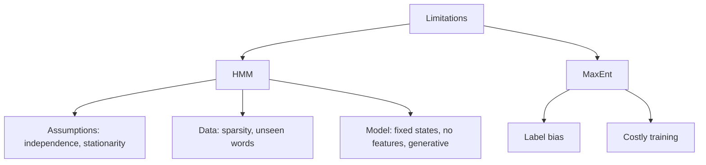
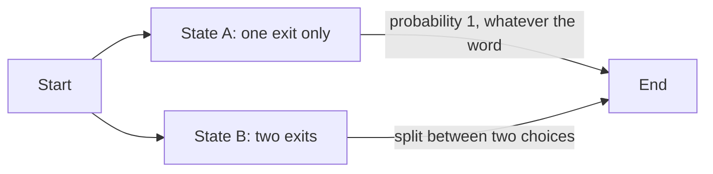

**In one line:** <mark>An HMM is limited by its simple assumptions (independence, no rich features, unseen words)</mark>; <mark>MaxEnt is limited by label bias and costly training</mark>. <Cite id="class-nlp-pyq3" loc="p. 5" /> <Cite id="class-nlp-pyq3" loc="p. 10" />

<Box kind="key">

**Key points to write:**

- HMM: <mark>strong independence assumption</mark>: the next state depends only on the current state, and each word only on its own tag.
- HMM: <mark>limited context</mark> (no long-range dependencies), <mark>data sparsity</mark> and <mark>unseen (OOV) words</mark>.
- HMM: <mark>generative, so hard to add features</mark> such as grammar or meaning.
- MaxEnt: <mark>label bias problem</mark> (local normalization at each step).
- MaxEnt: <mark>computational cost</mark> (iterative training: L-BFGS, GIS, IIS).
- Fixes: **CRF** (global normalization) and **neural models** (RNNs, Transformers).

</Box>

## Core answer (5 marks, fits every question here)

**Limitations of HMM** <Cite id="class-nlp-pyq3" loc="p. 5" />

1. **Strong independence assumption:** the next state depends only on the current state, and each word only on its own tag.
2. **Limited context:** it cannot capture long-range dependencies between distant words.
3. **Data sparsity:** it needs a large labelled corpus to estimate the probabilities well.
4. **Unseen words:** words not in the training data (out-of-vocabulary) are handled badly.
5. **Generative model:** it is hard to add extra features such as grammar or meaning.
6. **Slow** when the vocabulary or the number of states is large.

**Limitations of MaxEnt** <Cite id="class-nlp-pyq3" loc="p. 10" />

1. **Label bias problem:** probabilities are normalized locally at each step, not over the whole sentence, so a high-probability move from a state with few outgoing choices can dominate even when the whole sequence is unlikely.
2. **Computational cost:** training needs iterative numerical optimization (L-BFGS, GIS, IIS), heavier than the counting of an HMM.

| Model | Main weakness |
|---|---|
| HMM | Independence assumptions and no rich features |
| MaxEnt (MEMM) | Label bias and costly training |

**Conclusion:** HMM is limited by its assumptions, MaxEnt by label bias and training cost.

## Extended answer (10 marks): add these

### 1. More HMM limitations (class list)

7. **Fixed number of states:** the tag set must be defined in advance, which may not fit complex NLP tasks.
8. **Stationarity assumption:** it assumes the probabilities stay constant, which is not true for natural language.
9. **Limited expressive power:** it cannot model complex conditional relationships like discriminative models (CRFs, RNNs).
10. **Inferior to modern models:** RNNs and Transformers understand context much better. <Cite id="class-nlp-pyq3" loc="p. 5" />

### 2. Why label bias happens

In MaxEnt (MEMM) the probabilities leaving a state must add up to 1 at **each step**. A state with only one outgoing choice passes all its probability on, whatever the next word says, so the word is ignored. The better path loses to a path through such a state. <Cite id="web-nlp-1-wiki-memm" />

### 3. How each limit is fixed

| Limit | Fix |
|---|---|
| No rich features in HMM | MaxEnt uses overlapping features |
| Label bias in MaxEnt | CRF normalizes once over the whole sentence |
| Short context, unseen words | Neural models (RNNs, Transformers) |

<Cite id="web-nlp-1-slp3-seqlabel" />

## Fit it to each question

- **"What are the limitations of Hidden Markov Model?"** (5 marks) <PYQ id="2022-12-ce/q4a" />: the HMM list of the core answer (six points, or all ten with section 1) plus the conclusion.
- **"What are the limitations of Hidden Markov Model (HMM) and MaxEnt Model for POS Tagging."** (5 marks) <PYQ id="2025-05-ce/q1c" />: the core answer in full: HMM list, MaxEnt list, the two-row table.

## Exam tips

- **Number every limitation**; short numbered points are easy to mark.
- For HMM always include **independence assumption, data sparsity, unseen words, no rich features**.
- For MaxEnt always include **label bias** and **training cost**.
