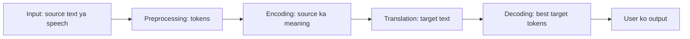
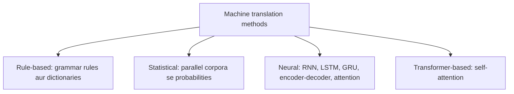
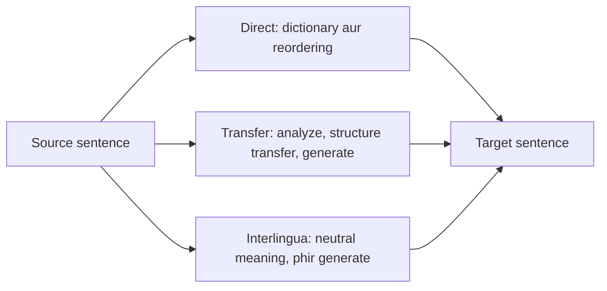

**Ek line mein:** <mark>Machine Translation (MT) NLP se text ya speech ko ek language se doosri mein automatically translate karna hai</mark>; iske approaches hain <mark>rule-based, statistical, neural aur Transformer-based</mark>. <Cite id="class-nlp-m6" loc="slide 1" />

<Box kind="key">

**Ye points likho:**

- <mark>MT: text ya speech ka ek language se doosri mein automatic translation</mark>, har sentence ke liye human translator ke bina, fast aur scalable.
- <mark>Rule-based (RBMT): manually bane grammar rules, bilingual dictionaries aur linguistic information</mark> (morphological analysis, transfer rules).
- <mark>Statistical (SMT): parallel corpora (translated text) se seekhi probabilities; sabse likely translation chunta hai</mark> (IBM models, language model, phrase-based).
- <mark>Neural (NMT): deep neural networks multilingual data se translation seekhte hain</mark> (RNN, LSTM, GRU, encoder-decoder, attention).
- <mark>Transformer-based: self-attention, parallel processing, context-aware translation</mark>, aaj sabse zyada use hota hai.
- Evaluation: **BLEU, ROUGE, METEOR, human evaluation**.

</Box>

## Core answer (5 marks, yahan ke har question ke liye)

<Box kind="definition">

**Machine Translation (MT)** is the use of Natural Language Processing (NLP) to automatically translate text or speech from one language to another. It enables fast and scalable translation across different languages without requiring manual translation for every sentence. <Cite id="class-nlp-m6" loc="slide 1" /> <Cite id="web-nlp-2-mt" />

</Box>

**Working:** <Cite id="class-nlp-m6" loc="slide 2" />

1. **Input:** source language ka text ya speech.
2. **Preprocessing:** input clean karo aur tokens mein todo.
3. **Encoding:** model source sentence ka meaning aur context represent karta hai.
4. **Translation:** model target language mein text generate karta hai.
5. **Decoding:** target tokens ki sabse suitable sequence chuno.
6. **Output:** translation user ko dikhti hai.

**Approaches:**

1. **Rule-based (RBMT)** manually bane grammar rules, bilingual dictionaries aur linguistic information use karta hai. System source sentence ka structure analyze karke predefined rules se target sentence banata hai. <Cite id="class-nlp-m6" loc="slide 3" />
2. **Statistical (SMT)** parallel corpora pe train hue statistical models use karta hai aur sabse likely translation chunta hai. <Cite id="class-nlp-m6" loc="slide 4" />
3. **Neural (NMT)** deep neural networks se multilingual data se translation seekhta hai. <Cite id="class-nlp-m6" loc="slide 5" />
4. **Transformer-based** words ke beech ke relations samajhne ke liye self-attention pe chalta hai. <Cite id="class-nlp-m6" loc="slide 6" />

**Conclusion:** MT hand-written rules se statistics se neural networks tak aaya hai, har step mein manual kaam kam aur translation behtar hui.

## Extended answer (10 marks): ye add karo

### 1. Rule-based MT detail mein

RBMT ke teen classic designs hain: **direct** (dictionary se word-by-word aur thoda reordering), **transfer** (source analyze karo, rules se structure transfer karo, target generate karo) aur **interlingua** (source ko language-neutral meaning mein badlo, phir target generate karo). <Cite id="web-nlp-2-rbmt" /> <Cite id="web-nlp-2-transfer-mt" /> <Cite id="web-nlp-2-interlingua" />

### 2. Statistical MT detail mein

SMT noisy channel ki tarah kaam karta hai: source sentence $f$ ke liye target sentence $e$ aise chuno:

$$
\hat{e} = \arg\max_{e} \; P(f \mid e)\, P(e)
$$

$P(f \mid e)$ **translation model** hai (words match karte hain?) jo parallel corpus se seekha jaata hai, aur $P(e)$ **language model** hai (target fluent hai?). Decoder best $e$ dhoondhta hai. <Cite id="web-nlp-2-smt" /> <Cite id="web-nlp-2-brown-1993" />

<Sum>

<Given>

Source (Hindi) "mujhe chai pasand hai". Do candidates: e1 = "I like tea", e2 = "tea like I". Translation model $P(f \mid e)$ dono ke liye 0.4 (words same). Language model: $P(e_1) = 0.02$, $P(e_2) = 0.0001$. (Made-up numbers.)

</Given>

<Find>

SMT decoder ka chuna hua candidate.

</Find>

<Steps>

1. Score(e1) $= 0.4 \times 0.02 = 0.008$.
2. Score(e2) $= 0.4 \times 0.0001 = 0.00004$.
3. Bada score e1 ka hai (200 guna).

</Steps>

<Answer>

"I like tea"

</Answer>

<Box kind="verify">

Translation model dono ko alag nahi kar saka (words same); sirf language model ne fluent word order chuna, yahi uska kaam hai.

</Box>

</Sum>

### 3. Neural aur Transformer MT

| Architecture | Kya karta hai |
|---|---|
| RNN, LSTM, GRU | sentence ko step by step process karte hain; LSTM long dependencies better handle karta hai |
| Encoder-decoder | ek network source encode karta hai, doosra target generate karta hai |
| Attention | decoder relevant source words pe focus karta hai |
| Transformer | self-attention, tokens parallel process karta hai; sabse zyada use hone wala architecture |

<Cite id="class-nlp-m6" loc="slide 5" /> <Cite id="class-nlp-m6" loc="slide 6" /> <Cite id="web-nlp-2-slp3-mt" loc="§13.2" />

### 4. Evaluation, advantages aur limitations

- **BLEU** (reference translations se similarity), **ROUGE** (overlapping sequences), **METEOR** (stemming aur synonyms ke saath word matches) aur **human evaluation** (fluency, accuracy, meaning). <Cite id="class-nlp-m6" loc="slide 6" /> <Cite id="web-nlp-2-bleu" /> <Cite id="web-nlp-2-slp3-mt" loc="§13.6" />

| Advantages | Limitations |
|---|---|
| Fast aur scalable | Context errors: word ke alag context mein alag meanings |
| Consistent aur routine content ke liye sasta | Idioms, humor aur culture translate nahi hote |
| 24/7 available | Kam data wali languages mein weak; medical aur legal text ko review chahiye |

<Cite id="class-nlp-m6" loc="slide 8" /> **Applications:** website localization, travel, education, multilingual chatbots, subtitles. <Cite id="class-nlp-m6" loc="slide 7" />

## Har question mein kaise fit karein

- **"What is rule base machine translation?"** (5 marks) <PYQ id="2022-12-ce/q1d" /> aur **"Explain rule-based machine translation systems"** (5 marks) <PYQ id="2024-12-ce/q1c" />: MT ki ek-line definition, RBMT paragraph, cycle image aur section 1 ke teen designs.
- **"Explain Machine Translation Approaches used in NLP."** (5 marks) <PYQ id="2023-05-ce/q1d" />: core answer ke chaar approaches aur unka diagram.
- **"Explain statistical approach for machine translation."** (5 marks) <PYQ id="2023-12-ce/q1c" />: definition, SMT paragraph, SMT image aur section 2 ka formula.
- **"Demonstrate the working of machine translation systems"** (10 marks) <PYQ id="2024-05-ce/q6a" />: chhe-step working diagram ke saath, approaches, phir sections 1 se 3.
- **"Machine Translation"** (5 marks) <PYQ id="2024-12/q6c" />: core answer.
- **"Explain Machine Translation system in detail."** (10 marks) <PYQ id="2025-05/q5b" /> <PYQ id="assignment-2/q6a" />: core answer aur poora extended answer.

## Exam tips

- **Draw karo:** chaar-method tree aur chhe-step flow; statistical question ke liye SMT image add karo.
- **Training data** ka naam likho: SMT ke liye "parallel corpus", NMT ke liye "multilingual data".
- Rule-based ke liye **ingredients** hamesha list karo: grammar rules, bilingual dictionary, morphological analysis, transfer rules.

Exam mein English mein likho.
