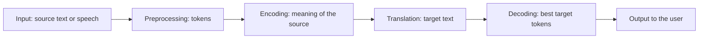
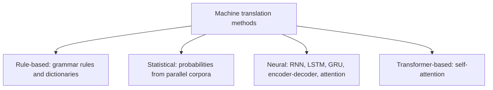
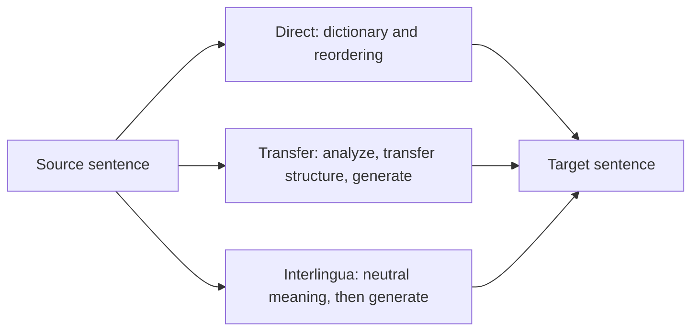

**In one line:** <mark>Machine Translation (MT) is the use of NLP to automatically translate text or speech from one language to another</mark>; its approaches are <mark>rule-based, statistical, neural and Transformer-based</mark>. <Cite id="class-nlp-m6" loc="slide 1" />

<Box kind="key">

**Key points to write:**

- <mark>MT: automatic translation of text or speech from one language to another</mark>, fast and scalable without a human translating every sentence.
- <mark>Rule-based (RBMT): manually created grammar rules, bilingual dictionaries and linguistic information</mark> (morphological analysis, transfer rules).
- <mark>Statistical (SMT): probabilities learned from parallel corpora (translated text); picks the most likely translation</mark> (IBM models, language model, phrase-based).
- <mark>Neural (NMT): deep neural networks learn translation from multilingual data</mark> (RNN, LSTM, GRU, encoder-decoder, attention).
- <mark>Transformer-based: self-attention, parallel processing, context-aware translation</mark>, dominant today.
- Evaluation: **BLEU, ROUGE, METEOR, human evaluation**.

</Box>

## Core answer (5 marks, fits every question here)

<Box kind="definition">

**Machine Translation (MT)** is the use of Natural Language Processing (NLP) to automatically translate text or speech from one language to another. It enables fast and scalable translation across different languages without requiring manual translation for every sentence. <Cite id="class-nlp-m6" loc="slide 1" /> <Cite id="web-nlp-2-mt" />

</Box>

**Working:** <Cite id="class-nlp-m6" loc="slide 2" />

1. **Input:** text or speech in the source language.
2. **Preprocessing:** clean the input and split it into tokens.
3. **Encoding:** a model represents the meaning and context of the source sentence.
4. **Translation:** the model generates text in the target language.
5. **Decoding:** choose the most suitable sequence of target tokens.
6. **Output:** the translation is shown to the user.

**Approaches:**

1. **Rule-based (RBMT)** uses manually created grammar rules, bilingual dictionaries and linguistic information. The system analyzes the structure of the source sentence and applies predefined rules to produce the target sentence. <Cite id="class-nlp-m6" loc="slide 3" />
2. **Statistical (SMT)** uses statistical models trained on parallel corpora and selects the most likely translation. <Cite id="class-nlp-m6" loc="slide 4" />
3. **Neural (NMT)** uses deep neural networks to learn translation from multilingual data. <Cite id="class-nlp-m6" loc="slide 5" />
4. **Transformer-based** relies on self-attention to understand relations between words. <Cite id="class-nlp-m6" loc="slide 6" />

**Conclusion:** MT has moved from hand-written rules to statistics to neural networks, each step needing less manual work and giving better translations.

## Extended answer (10 marks): add these

### 1. Rule-based MT in detail

RBMT has three classic designs: **direct** (word-by-word with a dictionary and a little reordering), **transfer** (analyze the source, transfer the structure with rules, generate the target) and **interlingua** (convert the source to a language-neutral meaning, then generate the target). <Cite id="web-nlp-2-rbmt" /> <Cite id="web-nlp-2-transfer-mt" /> <Cite id="web-nlp-2-interlingua" />

### 2. Statistical MT in detail

SMT works like a noisy channel: choose the target sentence $e$ for a source sentence $f$ with

$$
\hat{e} = \arg\max_{e} \; P(f \mid e)\, P(e)
$$

$P(f \mid e)$ is the **translation model** (do the words match?) learned from the parallel corpus, and $P(e)$ is the **language model** (is the target fluent?). The decoder searches for the best $e$. <Cite id="web-nlp-2-smt" /> <Cite id="web-nlp-2-brown-1993" />

<Sum>

<Given>

Source (Hindi) "mujhe chai pasand hai". Two candidates: e1 = "I like tea", e2 = "tea like I". Translation model $P(f \mid e)$ is 0.4 for both (same words). Language model: $P(e_1) = 0.02$, $P(e_2) = 0.0001$. (Made-up numbers.)

</Given>

<Find>

the candidate chosen by the SMT decoder.

</Find>

<Steps>

1. Score(e1) $= 0.4 \times 0.02 = 0.008$.
2. Score(e2) $= 0.4 \times 0.0001 = 0.00004$.
3. The larger score is e1 (200 times larger).

</Steps>

<Answer>

"I like tea"

</Answer>

<Box kind="verify">

The translation model could not separate the two (same words); the language model alone chose the fluent word order, which is its job.

</Box>

</Sum>

### 3. Neural and Transformer MT

| Architecture | What it does |
|---|---|
| RNN, LSTM, GRU | process the sentence step by step; LSTM handles long dependencies better |
| Encoder-decoder | one network encodes the source, another generates the target |
| Attention | the decoder focuses on the relevant source words |
| Transformer | self-attention, processes tokens in parallel; the dominant architecture |

<Cite id="class-nlp-m6" loc="slide 5" /> <Cite id="class-nlp-m6" loc="slide 6" /> <Cite id="web-nlp-2-slp3-mt" loc="§13.2" />

### 4. Evaluation, advantages and limitations

- **BLEU** (similarity with reference translations), **ROUGE** (overlapping sequences), **METEOR** (word matches with stemming and synonyms) and **human evaluation** (fluency, accuracy, meaning). <Cite id="class-nlp-m6" loc="slide 6" /> <Cite id="web-nlp-2-bleu" /> <Cite id="web-nlp-2-slp3-mt" loc="§13.6" />

| Advantages | Limitations |
|---|---|
| Fast and scalable | Context errors: a word may have different meanings |
| Consistent and cost-effective for routine content | Idioms, humor and culture do not translate |
| Available 24/7 | Poor for languages with little data; medical and legal text needs review |

<Cite id="class-nlp-m6" loc="slide 8" /> **Applications:** website localization, travel, education, multilingual chatbots, subtitles. <Cite id="class-nlp-m6" loc="slide 7" />

## Fit it to each question

- **"What is rule base machine translation?"** (5 marks) <PYQ id="2022-12-ce/q1d" /> and **"Explain rule-based machine translation systems"** (5 marks) <PYQ id="2024-12-ce/q1c" />: definition of MT in one line, the RBMT paragraph, the cycle image and the three designs of section 1.
- **"Explain Machine Translation Approaches used in NLP."** (5 marks) <PYQ id="2023-05-ce/q1d" />: the four approaches and their diagram from the core answer.
- **"Explain statistical approach for machine translation."** (5 marks) <PYQ id="2023-12-ce/q1c" />: definition, the SMT paragraph, the SMT image and the formula of section 2.
- **"Demonstrate the working of machine translation systems"** (10 marks) <PYQ id="2024-05-ce/q6a" />: the six-step working with its diagram, the approaches, then sections 1 to 3.
- **"Machine Translation"** (5 marks) <PYQ id="2024-12/q6c" />: the core answer.
- **"Explain Machine Translation system in detail."** (10 marks) <PYQ id="2025-05/q5b" /> <PYQ id="assignment-2/q6a" />: the core answer and the whole extended answer.

## Exam tips

- **Draw** the four-method tree and the six-step flow; add the SMT image for a statistical question.
- Name the **training data**: "parallel corpus" for SMT, "multilingual data" for NMT.
- For rule-based, always list the **ingredients**: grammar rules, bilingual dictionary, morphological analysis, transfer rules.
