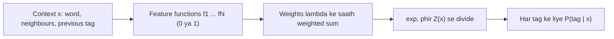
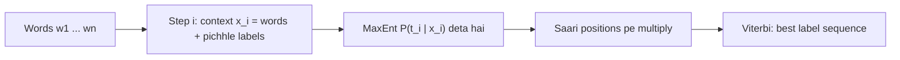

**Ek line mein:** <mark>Maximum Entropy (MaxEnt) model, jise Multinomial Logistic Regression bhi kehte hain, ek discriminative probabilistic framework hai</mark> jo <mark>word aur uske neighbours ke bahut saare clues tolkar tag chunta hai</mark>. <Cite id="class-nlp-pyq3" loc="p. 8" />

<Box kind="key">

**Ye points likho:**

- <mark>MaxEnt = Multinomial Logistic Regression, ek discriminative model</mark>: ye $P(y \mid x)$ model karta hai, context diye hue tag.
- <mark>HMM generative hai ($P(x, y)$); MaxEnt discriminative hai ($P(y \mid x)$)</mark>.
- Principle: <mark>jo pata hai wo model karo; jo nahi pata uske liye uniform uncertainty maano</mark>; constraints fit karne wali maximum entropy distribution chuno.
- <mark>Feature functions $f_i(x, y)$ binary (0 ya 1) hote hain</mark>; ye rich aur overlapping ho sakte hain (word, previous tag, ending, capital letter).
- Formula: <mark>$P(y \mid x) = \frac{1}{Z(x)} \exp(\sum \lambda_i f_i(x, y))$</mark>.
- Sequence tagging: **MEMM** Viterbi ke saath. Limits: <mark>label bias aur costly training</mark>.

</Box>

## Core answer (5 marks, yahan ke har question ke liye)

<Box kind="definition">

The **Maximum Entropy (MaxEnt) model**, also known as a Multinomial Logistic Regression model, is a discriminative probabilistic framework widely used for POS tagging. <Cite id="class-nlp-pyq3" loc="p. 8" />

</Box>

**HMM vs MaxEnt:** HMM generative hai: ye words aur tags ki joint probability $P(x, y)$ model karta hai. MaxEnt seedha conditional probability $P(y \mid x)$ model karta hai, yani context $x$ diye hue tag $y$ ki. <Cite id="class-nlp-pyq3" loc="p. 8" />

**Core idea:** training data ke facts se constraints banao (word *run* aksar verb hota hai). Jo bhi distributions in constraints ko satisfy karein, unme se **maximum entropy** wali chuno, yani sabse uniform aur unbiased, taaki jo observe nahi hua uske baare mein koi arbitrary assumption na ho. <Cite id="class-nlp-pyq3" loc="p. 9" /> <Cite id="web-nlp-1-berger-maxent" />

**Formula:**

$$
P(y \mid x) = \frac{1}{Z(x)} \exp\Big(\sum_{i=1}^{N} \lambda_i f_i(x, y)\Big), \qquad Z(x) = \sum_{y'} \exp\Big(\sum_{i=1}^{N} \lambda_i f_i(x, y')\Big)
$$

$f_i$ binary feature functions hain, $\lambda_i$ unke learned weights (positive tag ki chance badhata hai, negative ghatata hai) aur $Z(x)$ saari tag probabilities ka sum 1 karta hai. <Cite id="class-nlp-pyq3" loc="p. 9" />

**Conclusion:** MaxEnt ek discriminative model hai jo tag predict karne ke liye bahut saare overlapping features combine karta hai.

## Extended answer (10 marks): ye add karo

### 1. Feature functions

Feature tab 1 hota hai jab candidate tag ke liye context pe condition sach ho, warna 0. Isski power ye hai ki ye rich, overlapping, non-independent features use kar sakta hai. <Cite id="class-nlp-pyq3" loc="p. 9" />

| Feature type | Example (sach hone par 1) |
|---|---|
| Current word | word "bank" hai aur tag NN hai |
| Previous tag | previous tag DT hai aur tag NN hai |
| Surrounding words | next word "of" hai aur tag NN hai |
| Morphology | word "-ing" pe khatam hota hai aur tag VBG hai |
| Capitalization | word capitalized hai aur tag NNP hai |

Is tarah bana tagger Penn Treebank pe high accuracy tak pahuncha. <Cite id="web-nlp-1-ratnaparkhi-tagger" />

### 2. MEMM se sequence tagging

Sentence $W = (w_1, \ldots, w_n)$ ko tags $T = (t_1, \ldots, t_n)$ dene ke liye model step by step **Maximum Entropy Markov Model** ki tarah use hota hai:

$$
P(T \mid W) = \prod_{i=1}^{n} P(t_i \mid x_i)
$$

Context $x_i$ mein current aur aas-paas ke words aur pehle predict hue tags $t_{i-1}, t_{i-2}$ hote hain. Best tag sequence Viterbi decoding se milta hai. <Cite id="class-nlp-pyq3" loc="p. 10" /> <Cite id="web-nlp-1-wiki-memm" />

### 3. HMM vs MaxEnt

| Point | HMM | MaxEnt (MEMM) |
|---|---|---|
| Type | Generative, $P(x, y)$ | Discriminative, $P(y \mid x)$ |
| Features | Sirf words aur tags | Rich, overlapping features |
| Training | Counting | Iterative optimization (L-BFGS, GIS, IIS) |
| Normalization | Joint | Local, har step pe |

### 4. Limitations

1. **Label bias:** probabilities har step pe locally normalize hoti hain ($Z(x_i)$), poore sentence pe nahi, isliye kam outgoing choices wale state ki high-probability move dominate kar sakti hai chahe poora sequence unlikely ho. <Cite id="class-nlp-pyq3" loc="p. 10" />
2. **Computational cost:** parameter estimation ko iterative optimization chahiye, jo HMM ki counting se bhari hai. <Cite id="class-nlp-pyq3" loc="p. 10" />

## Har question mein kaise fit karein

- **"Explain Maximum Entropy Model for POS Tagging"** (10 marks) <PYQ id="2023-05-ce/q6b" /> <PYQ id="assignment-1/q3c" />: core answer plus feature table (section 1), MEMM (section 2) aur limitations (section 4).
- **"Explain how Maximum Entropy is used for sequence labeling."** (10 marks) <PYQ id="2024-12-ce/q6b" />: formula ke saath ek chhoti definition, phir section 2 (MEMM, product formula, Viterbi diagram), feature table, label-bias limit aur uses (POS tagging, named entity recognition).

## Exam tips

- **Formula $Z(x)$ ke saath likho** aur har symbol ka matlab batao.
- HMM se compare karte waqt hamesha **discriminative vs generative** likho.
- **Label bias** pe khatam karo; ye standard limitation hai (aur CRF ki wajah).

Exam mein English mein likho.
